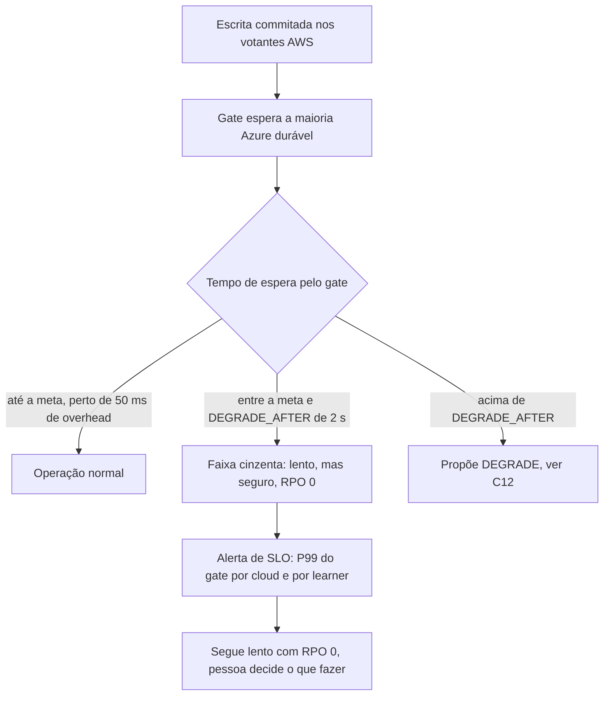

# C25 — Link lento ou saturado (faixa cinzenta): só alertar (antes R01)

**Status:** ✅ Atualizado (decidido pelo Bruno em 13/10/2026) · **ADRs:** [ADR-037](../../03_adr/ADR-037-faixa-cinzenta-do-link-so-alerta.md), [ADR-017](../../03_adr/ADR-017-azure-learners-e-gate.md), [ADR-014](../../03_adr/ADR-014-modo-degradado-opcao-b.md), [ADR-028](../../03_adr/ADR-028-timeouts-em-cascata.md), [ADR-043](../../03_adr/ADR-043-uma-instalacao-por-cliente-identidade-por-configuracao.md) · **Relacionados:** [C12](C12-modo-degradado.md), [C10](C10-celulas-de-app-aws-fora.md), [X02](../complexos/X02-modo-degradado.md), [R07](../a_rever/R07-link-oscilando.md)

## Cenário

O modo degradado só entra quando uma escrita espera a Azure por mais de `DEGRADE_AFTER` (2 s). Um link que continua entregando as confirmações, porém devagar (por exemplo 80 ms a 1,5 s), **nunca dispara a degradação**, mas estoura o orçamento de latência: toda escrita passa a esperar a maioria Azure. Nada está formalmente "fora", então nenhum alarme de "link caído" dispara.

Com o SDK a 30 s por tentativa e `REQUEST_DEADLINE` de 7,5 s, a lentidão abaixo de 2 s **não gera retry em cascata**: o risco é latência acima da meta, não amplificação de carga. Acima de 2 s o caminho é o do [C12](C12-modo-degradado.md).

## Decisão

Na faixa cinzenta o sistema **só alerta e mantém RPO = 0**. Não degrada por latência.

## Diagrama: três faixas de latência do gate

## Etapas

1. **Medição:** `gate_wait_seconds` (histograma) por learner e por cloud, e `azure_ack_rtt_seconds` da replicação.
2. **Detecção:** alerta quando o P99 do gate passa da meta por mais de N minutos, e alerta separado quando a Azure é a causa (um learner lento versus os três).
3. **Ação:** nenhuma automática. O alerta chama uma pessoa.
4. **Proteção do link:** o tráfego de replicação não pode competir com o encaminhamento de escritas entre clouds ([C10](C10-celulas-de-app-aws-fora.md)). QoS, banda reservada ou circuito separado.

## Falhas e tratativas

- **Um único learner lento.** O gate usa o **segundo maior** índice durável entre os 3 learners, então um learner lento sozinho não segura o gate (maioria 2/3). Dois lentos seguram.
- **Lentidão intermitente.** Algumas escritas passam de 2 s e outras não: o shard entra e sai de degradado ([R07](../a_rever/R07-link-oscilando.md)).
- **Fila crescendo.** Com o gate a 1,5 s e 3.000 TPS ficam cerca de 4.500 escritas em voo. É preciso um teto de requisições em voo e rejeição rápida (`503`) quando ele é atingido, para a lentidão não virar memória e conexões sem fim. Valores a definir no spike S1.
- **Lentidão sustentada abaixo de 2 s.** O sistema pode ficar horas "lento mas seguro". O alerta precisa escalar para uma pessoa depois de N minutos; hoje não existe comando para o operador forçar o modo degradado, e criá-lo depende do aceite do RPO > 0 (PEND-02).
- **Cabo compartilhado entre clientes.** Como cada cliente tem a sua instalação mas o cabo dedicado é um só ([ADR-043](../../03_adr/ADR-043-uma-instalacao-por-cliente-identidade-por-configuracao.md)), o tráfego de um cliente pode deixar o link lento para todos. Precisa de limite e métrica de banda por cliente.
- **Fan-out pelo link.** Cada escrita é enviada a 3 learners pelo mesmo link: cerca de 3 × 3.000 TPS × ~2 KB ≈ 18 MB/s só de log, fora o encaminhamento. Avaliar no spike S1 um relay na Azure (a líder envia 1 cópia e um learner repassa), ao custo de um salto a mais.

## Pontos em aberto

- Contratar um segundo circuito privado por outra operadora (reduz a chance de degradar) ou aceitar um único cabo na v1: decisão de custo e risco, fora do software ([R23](../a_rever/R23-hipoteses-gerais.md)).
- Medir o P99 real do gate no spike S1. Voltar à degradação por latência só depois do PEND-02.
