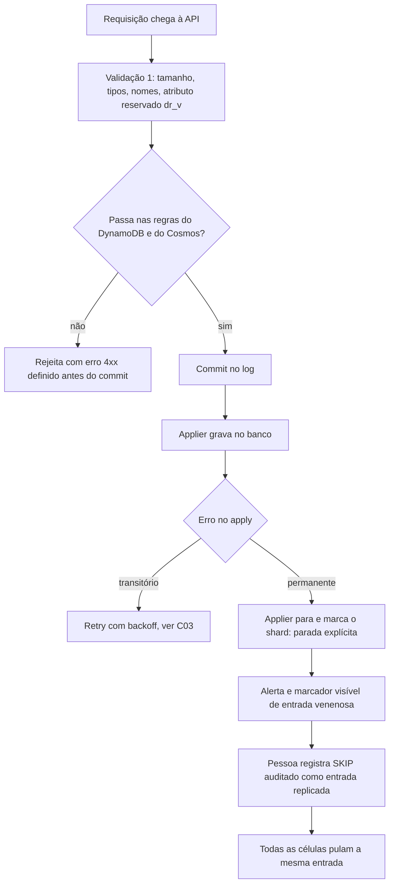

# C26 — Entrada venenosa: um item que o banco recusa para sempre (antes R02)

**Status:** ✅ Atualizado (decidido pelo Bruno em 13/10/2026) · **ADRs:** [ADR-038](../../03_adr/ADR-038-skip-de-entrada-venenosa-sempre-humano.md), [ADR-023](../../03_adr/ADR-023-modos-de-escrita-e-leitura.md), [ADR-024](../../03_adr/ADR-024-delete-real-ttl-local-gsi.md), [ADR-015](../../03_adr/ADR-015-wal-post-image-e-versao.md) · **Relacionados:** [C03](C03-escrita-strong.md), [C23](C23-batchwriteitem-lote-uma-entrada.md), [X01](../complexos/X01-gate-e-troca-de-lider.md), [ADR-005](../../03_adr/ADR-005-ack-exige-gate.md), [R17](../a_rever/R17-atributo-de-versao-e-limite-400kb.md)

## Cenário

Com apply **serial por shard** no modo Strong, o applier não pode pular uma entrada. Se uma entrada **já commitada** é recusada de forma **permanente** pelo banco (item acima do limite, tipo sem tradução no Cloud-Adapter, nome de atributo inválido no Cosmos), o `appliedIndex` para: as escritas seguintes ficam `PENDING` e as leituras fortes esperam um índice que não chega. **Um item trava o shard.**

Variante silenciosa: a recusa acontece só no Cosmos. A AWS segue normal e o atraso da Azure cresce até o failover.

O ACK só sai depois do apply na célula da líder (6.9). Logo, uma recusa permanente na líder aparece **antes do ACK**: o cliente recebe erro. O problema real é que a entrada **já está no log** e todas as células tropeçam nela.

## Decisão

O `SKIP` de uma entrada venenosa é **sempre decidido por uma pessoa**. Não há SKIP automático.

## Diagrama: defesa em camadas

## Etapas

1. **Validar antes do commit.** A líder valida contra as regras dos **dois** bancos (`ValidateCapabilities` do Cloud-Adapter inclui as regras do Cosmos). O que nenhum banco aceita nunca vira entrada do log.
2. **Classificar o erro do apply.** Throttling, 5xx e timeout são transitórios. `ValidationException`, item grande demais e restrição são permanentes.
3. **Parada explícita.** Erro permanente para o applier, expõe `poison_entry_index` e gera alerta. O shard fica visivelmente parado, em vez de lento sem explicação.
4. **`SKIP` auditado, por uma pessoa.** O operador propõe uma entrada replicada `SKIP(index, motivo, autor)`. Como passa pelo Raft, **todas as células pulam a mesma entrada**; a divergência entre bancos é registrada, não escondida. A entrada original nunca é apagada.

## Falhas e tratativas

- **Recusa só no Cosmos.** Se a validação não conhece uma regra do Cosmos, a AWS aplica e a Azure para. O desvio é silencioso até o failover. Mitigação: métrica `applied_lag` por cloud e teste de contrato do Cloud-Adapter com itens reais dos clientes.
- **Raio de impacto.** A parada vale para o shard inteiro e dura até uma pessoa decidir. Com 7,5 s de prazo, todas as escritas do shard viram `503 PENDING` em segundos. Um circuito de proteção (rejeitar rápido enquanto o shard está parado) evita encher as filas.
- **Tempo de resposta humana.** Sem SKIP automático, o tempo parado é o tempo do plantão. Isso entra no desenho do plantão e nos game days ([R10](../a_rever/R10-operador-lento-no-desastre.md)).
- **Divergência por SKIP.** Pular em todas as células mantém os bancos iguais entre si, mas o cliente que recebeu `PENDING` pode ter essa escrita como "desconhecida" para sempre. O SKIP precisa devolver o resultado `REJECTED` na consulta por identificador.
- **Lote com item venenoso.** O lote é uma entrada ([C23](C23-batchwriteitem-lote-uma-entrada.md)); pular a entrada pula o lote inteiro, inclusive os itens bons. A validação pré-commit é a defesa principal.

## Pontos em aberto

- Lista final de regras de validação do Cosmos e do DynamoDB no caminho de commit (junto com [R17](../a_rever/R17-atributo-de-versao-e-limite-400kb.md)).
- H-DR2 (SKIP automático) fica fora da v1 e só volta se o plantão se mostrar um gargalo.
