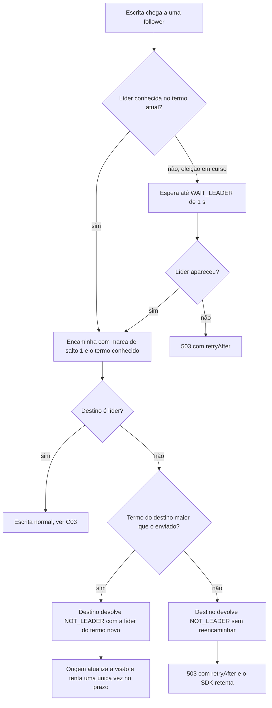

# C27 — Loop de encaminhamento e espera pela líder durante a eleição (antes R05)

**Status:** ✅ Atualizado (decidido pelo Bruno em 13/10/2026) · **ADRs:** [ADR-039](../../03_adr/ADR-039-sem-lider-conhecida-espera-ate-1s-e-503.md), [ADR-010](../../03_adr/ADR-010-follower-encaminha-para-lider.md), [ADR-028](../../03_adr/ADR-028-timeouts-em-cascata.md) · **Relacionados:** [C06](C06-follower-encaminha.md), [C08](C08-queda-de-celula-lider-ou-az-aws.md)

## Cenário

Em uma eleição, células diferentes podem ter visões diferentes de quem é a líder: A2 encaminha a A3, e A3 (que ainda acha que a líder é A2) encaminha de volta. Sem limite de saltos, a requisição circula até estourar o prazo, queimando o orçamento e carregando as células.

## Decisão

Sem líder conhecida, o servidor **espera até 1 s** (`WAIT_LEADER`) pela eleição e só então responde `503` com `retryAfter`. Um encaminhamento nunca é reencaminhado.

## Diagrama: salto único e termo no encaminhamento

## Etapas

1. Uma requisição já encaminhada **nunca** é reencaminhada (limite de 1 salto).
2. O encaminhamento leva o termo conhecido; quem recebe um termo maior atualiza a visão em vez de reencaminhar.
3. Sem líder conhecida: espera até `WAIT_LEADER` = 1 s pela eleição, depois responde `503` com `retryAfter`.
4. O identificador estável de dedupe viaja junto, então qualquer tentativa repetida é idempotente ([ADR-026](../../03_adr/ADR-026-dedupe-de-retry-id-estavel.md)).

## Falhas e tratativas

- **Eleição mais longa que as tentativas do SDK.** O SDK faz no máximo 3 tentativas com backoff curto. Esperar 1 s no servidor reduz esse risco sem passar de 3 s do orçamento de encaminhamento.
- **Requisições paradas esperando.** A 3.000 TPS, 1 s de espera acumula cerca de 3.000 requisições aguardando líder. O número de requisições aguardando precisa de teto; acima dele, `503` imediato.
- **Visões antigas persistentes.** Mensagens atrasadas podem reanunciar uma líder antiga. O termo no encaminhamento descarta isso.
- **Partida.** `WAIT_LEADER` entra na verificação de ordem dos prazos: `WAIT_LEADER` + encaminhamento deve caber em `REQUEST_DEADLINE`.

## Pontos em aberto

- Valor do teto de requisições aguardando líder, a definir no spike S1.
- Duração real da eleição, a medir nos testes de falha (liga com o RTO, [R18](../a_rever/R18-rto-nao-quantificado.md)).
