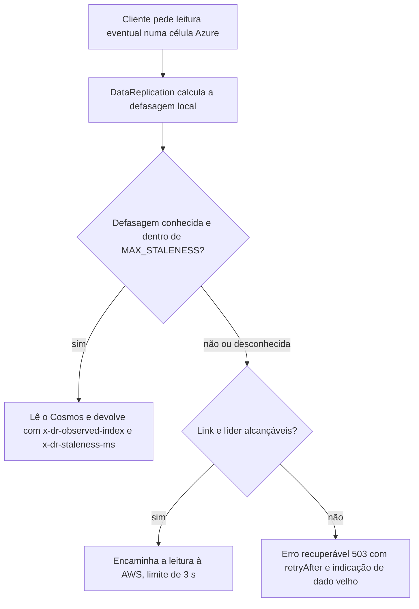

# C28 — Leitura eventual na Azure durante a degradação (antes R04)

**Status:** ✅ Atualizado (decidido pelo Bruno em 13/10/2026) · **ADRs:** [ADR-040](../../03_adr/ADR-040-leitura-eventual-na-azure-acima-do-limite.md), [ADR-009](../../03_adr/ADR-009-eventual-e1.md), [ADR-023](../../03_adr/ADR-023-modos-de-escrita-e-leitura.md), [ADR-027](../../03_adr/ADR-027-sinalizacao-do-modo-degradado.md) · **Relacionados:** [C05](C05-leitura-strong-e-eventual.md), [C12](C12-modo-degradado.md), [X02](../complexos/X02-modo-degradado.md)

## Cenário

No modo degradado a Azure deixa de receber entradas. Uma leitura **eventual** servida por uma célula Azure lê o Cosmos local e pode devolver dado com horas ou dias de atraso, sem que o cliente saiba. Para um banco, isso pode ser um saldo antigo apresentado como atual.

O padrão de leitura é **forte** (`READ_MODE_DEFAULT`); este caso só ocorre quando o cliente pede leitura eventual de forma explícita ([C05](C05-leitura-strong-e-eventual.md)).

## Decisão

Acima do limite de defasagem, a leitura é **redirecionada à AWS se possível; senão é recusada**.

## Diagrama: limite máximo de defasagem

## Etapas

1. A defasagem é `max(idade do último heartbeat da líder, tempo estimado para aplicar o que já chegou)`, medida **com relógio monotônico local**, sem depender do relógio da AWS (H9).
2. Quando o link caiu, a defasagem é **desconhecida**, e desconhecida conta como acima do limite.
3. Toda resposta eventual da Azure devolve `x-dr-observed-index` e `x-dr-staleness-ms`; a aplicação decide se serve.
4. `MAX_STALENESS` é configuração obrigatória por tabela ou global (valor inicial sugerido: 5 s, a medir).

## Falhas e tratativas

- **Redirecionar para a AWS justo quando o link está ruim.** O encaminhamento usa o link que pode ser a causa da degradação. Por isso o fallback é erro recuperável, não retry infinito.
- **Degradação típica = link caído.** Nesse caso não há como redirecionar e a leitura eventual na Azure **falha** em vez de devolver dado velho. É a escolha deliberada de preferir o erro ao saldo antigo; a aplicação que dependia da Azure para ler precisa tratar o `503`.
- **Clientes que ignoram o cabeçalho.** O cabeçalho informa, não impede. Para dado que nunca pode ser velho, o cliente deve usar leitura forte.
- **Depois da promoção da Azure.** A Azure vira a líder ([C14](C14-aws-cai-sem-degradacao.md)) e a defasagem passa a ser medida contra ela mesma; o limite deixa de se aplicar à Azure e passa a valer para as células que forem learners.

## Pontos em aberto

- Valor inicial de `MAX_STALENESS` (sugestão: 5 s), ajustado depois do spike.
