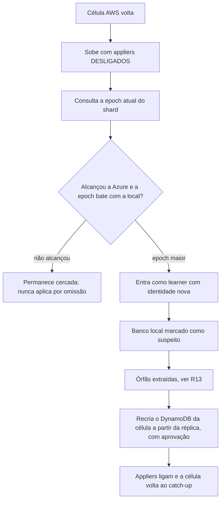

# C30 — Fencing: o DynamoDB e o applier da AWS que voltam depois da promoção (antes R14)

**Status:** ✅ Atualizado (decidido pelo Bruno em 13/10/2026; coerente com o ADR-044 na revisão crítica); o gatilho da promoção é o do lease, e a PEND-01 fecha quando D e M forem aprovados e o TLA+ provar a regra · **ADRs:** [ADR-042](../../03_adr/ADR-042-aws-que-volta-boot-cercado-e-recriacao-da-celula.md), [ADR-044](../../03_adr/ADR-044-lease-do-modo-degradado-e-promocao-da-azure.md), [ADR-047](../../03_adr/ADR-047-delete-real-invariante-e-reconstrucao-em-tabela-sombra.md), [ADR-022](../../03_adr/ADR-022-banco-por-celula-nome-logico.md), [ADR-033](../../03_adr/ADR-033-promocao-da-azure-humana.md), [ADR-034](../../03_adr/ADR-034-fsync-fatal-e-identidade-nova.md) · **Relacionados:** [C32](C32-particao-e-lease-do-modo-degradado.md), [C33](C33-reconstrucao-em-tabela-sombra.md), [C16](C16-aws-volta-apos-promocao.md), [X03](../complexos/X03-desastre-e-promocao-da-azure.md), [R13](../a_rever/R13-escritas-orfas-reconciliacao.md)

## Cenário

Depois da promoção da Azure (epoch E+1), os DynamoDBs da AWS continuam com o estado que tinham, incluindo órfãs aplicadas antes da queda. Um applier antigo da AWS que volta ainda na epoch E pode aplicar o que faltava do log local e piorar a divergência.

**O que a v1 já ajuda:** cada célula tem o **seu** banco e **um applier por tabela** ([ADR-022](../../03_adr/ADR-022-banco-por-celula-nome-logico.md)), então o applier antigo da AWS só escreve no DynamoDB da AWS, não no Cosmos. E a célula AWS que volta entra como **learner com identidade nova** ([ADR-034](../../03_adr/ADR-034-fsync-fatal-e-identidade-nova.md)).

**O que o lease acrescenta:** a promoção só é aceita depois de D + M ([ADR-044](../../03_adr/ADR-044-lease-do-modo-degradado-e-promocao-da-azure.md)), então a AWS antiga já parou de aceitar escrita (`503 LEASE_EXPIRED`) antes de a Azure aceitar a primeira. Isso cobre a escrita nas duas pontas **durante** a partição, mas não o que fica gravado nos bancos da AWS nem o applier antigo que volta depois; para isso continuam o boot cercado, a revogação de credenciais e a recriação do banco.

**O que não estava coberto:** o fencing por condição de versão (`v < índice`) compara o item com a entrada e **não conhece a epoch**. O DynamoDB da AWS nunca recebeu E+1, então a condição passa.

## Decisão

**Boot cercado + revogação de credenciais + recriação completa do DynamoDB da célula**, esta última pelo protocolo da tabela sombra ([C33](C33-reconstrucao-em-tabela-sombra.md)). A reconciliação dirigida das chaves órfãs fica fora da v1.

## Diagrama: boot cercado

## Etapas

1. **Boot cercado (fail-closed):** appliers desligados até confirmar a epoch. Sem resposta da Azure, a célula **não aplica**.
2. **Registro de epoch por shard** no banco: o primeiro passo da reentrada grava E+1; os appliers checam no boot e periodicamente, **não por escrita** (checar por escrita via `TransactWriteItems` custaria o dobro de WCU, [R20](../a_rever/R20-custo-6x.md)).
3. **Revogar as credenciais** de escrita (papel IAM) dos appliers antigos como passo da promoção, assim que o console da AWS estiver acessível.
4. **Extrair as órfãs** antes de apagar qualquer coisa ([R13](../a_rever/R13-escritas-orfas-reconciliacao.md)).
5. **Recriar o DynamoDB da célula** a partir da réplica, em tabela sombra com índice F, replay do log e cutover do nome lógico ([C33](C33-reconstrucao-em-tabela-sombra.md)), e só então religar os appliers.

## Falhas e tratativas

- **Boot fail-closed e disponibilidade.** Uma célula AWS que reinicia por motivo comum (deploy, nó) não pode ficar cercada por não alcançar a Azure. A regra só vale quando a célula detecta que a epoch do grupo mudou ou quando o log local tem entradas além do `commitIndex` conhecido.
- **Recriar apaga as órfãs.** Se o passo 4 for pulado, as escritas ACKadas só na AWS durante a degradação somem. A recriação exige aprovação humana e um backup (PITR) como rede de segurança.
- **Custo e tempo da recriação.** Reler tudo do Cosmos consome RU e leva um tempo ainda não medido ([R09](../a_rever/R09-resincronizacao-lenta-ou-bloqueada.md)).
- **Credenciais dependem do console.** Se a AWS estiver fora do ar, a revogação espera; o boot cercado cobre o intervalo ([R11](../a_rever/R11-api-de-promocao-depende-da-aws.md)).
- **Failback.** O retorno à AWS é uma transferência planejada depois de a célula ser reconstruída e validada ([C16](C16-aws-volta-apos-promocao.md)).

## Pontos em aberto

- O gatilho da promoção tem desenho decidido ([ADR-044](../../03_adr/ADR-044-lease-do-modo-degradado-e-promocao-da-azure.md), [C32](C32-particao-e-lease-do-modo-degradado.md)). A PEND-01 fecha quando D e M forem aprovados (PEND-02) e o modelo TLA+ provar a ausência de escrita nas duas pontas ([R12](../a_rever/R12-promocao-com-aws-viva.md)).
