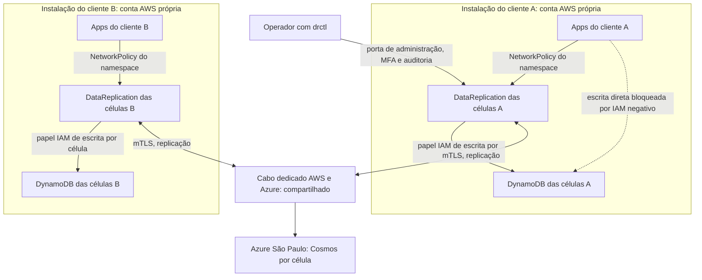

# C31 — Uma instalação por cliente e identificação na API (antes R19)

**Status:** ✅ Atualizado (decidido pelo Bruno em 13/10/2026); consequências do 1 para 1 respondidas em 13/10 · **ADRs:** [ADR-043](../../03_adr/ADR-043-uma-instalacao-por-cliente-identidade-por-configuracao.md), [ADR-016](../../03_adr/ADR-016-app-unico-por-celula-monolito-modular.md), [ADR-022](../../03_adr/ADR-022-banco-por-celula-nome-logico.md), [ADR-031](../../03_adr/ADR-031-hexagonal-e-bibliotecas.md) · **Relacionados:** [C02](C02-dentro-da-celula.md), [C20](C20-bypass-de-escrita-direta.md), [C22](C22-cliente-com-sdk-nao-suportado.md), [R20](../a_rever/R20-custo-6x.md)

## Cenário

As aplicações do cliente chamam o `DataReplication` confiando na **NetworkPolicy do namespace**. A pergunta era como identificar o cliente na API (`Access Key Id` do SigV4 ou mTLS). O Bruno esclareceu que a solução é **1 para 1**: na configuração já se sabe qual é o time que usa o serviço, e **cada time tem a sua conta AWS** com a arquitetura isolada.

## Decisão

- Uma **instalação completa por cliente**; não há multi-tenancy dentro do `DataReplication`.
- O cliente é identificado **pela configuração do deploy**, não pela requisição.
- **Azure isolada por cliente** (assinatura e conta Cosmos próprias), como a AWS.
- **Banda do cabo reservada ou limitada por cliente**, com métrica por cliente.
- **Faixas de IP sem sobreposição** entre clientes, por plano de endereçamento central (a confirmar com a rede).
- A fronteira entre aplicação e `DataReplication` é a NetworkPolicy do namespace do cliente; o IAM das aplicações não tem escrita nas tabelas.

## Diagrama: fronteiras de confiança e o que é compartilhado

## Etapas

1. **App → DataReplication:** NetworkPolicy fecha o namespace; o `Access Key Id` do SigV4 não é usado para identificar o cliente. O proxy não consegue validar a assinatura sem o segredo, então não finge que valida.
2. **DataReplication → bancos:** papel IAM (EKS) ou identidade da carga de trabalho (AKS) por célula, com o mínimo de permissão; as aplicações ficam **sem** permissão de escrita nas tabelas ([C20](C20-bypass-de-escrita-direta.md)).
3. **Célula ↔ célula:** mTLS com rotação sem reinício e alerta de expiração; certificado vencido equivale a Azure inalcançável (modo degradado).
4. **Operador:** porta de administração separada, MFA, aprovação para `ForcePromote` e `drctl rebuild`, auditoria imutável; funciona sem dependência da AWS ([R11](../a_rever/R11-api-de-promocao-depende-da-aws.md)).
5. **Identidade do cliente:** vem da configuração do deploy e serve de rótulo para métricas, auditoria e chave de dedupe (nome da variável a definir).

## Falhas e tratativas

- **Pod do mesmo namespace escreve como se fosse o cliente.** Aceito: o namespace pertence ao cliente e a conta é dele. O risco que sobra é de uma aplicação do próprio cliente, não de outro time.
- **Cabo compartilhado: vizinho barulhento.** A replicação de um cliente (cerca de 18 MB/s de log a 3.000 TPS, mais o encaminhamento) pode saturar o cabo e atrasar o gate dos outros ([C25](C25-link-lento-faixa-cinzenta.md)). Por isso a decisão é reservar ou limitar a banda por cliente (QoS no cabo e limite no `DataReplication`, com métrica por cliente); sem isso, a lentidão de um vira latência de todos.
- **Endereçamento sobreposto.** O tráfego transitivo entre VPCs de contas diferentes exige faixas de IP sem sobreposição entre clientes. Contas criadas separadamente costumam repetir a mesma faixa; o plano central de endereçamento é requisito para entrar um cliente novo, e a premissa ainda precisa ser confirmada com a rede.
- **Custo por cliente.** Cada instalação repete os 6 clusters, os bancos e as 6 gravações por escrita ([R20](../a_rever/R20-custo-6x.md)); o custo fixo de um cliente pequeno é o mesmo de um grande.
- **Operação de frota.** Versões, correções, certificados e a definição de pronto passam a valer por instalação; N clientes são N atualizações coordenadas e N plantões de promoção.
- **Lado Azure.** Isolado por cliente, espelhando a AWS; o custo fixo do Cosmos por cliente entra na estimativa ([R20](../a_rever/R20-custo-6x.md)).

## Pontos em aberto

- Confirmar com a rede o plano de endereçamento sem sobreposição e definir como a banda por cliente é medida e limitada (valores no spike S1).
- Estimativa de custo por cliente ([R20](../a_rever/R20-custo-6x.md)).
