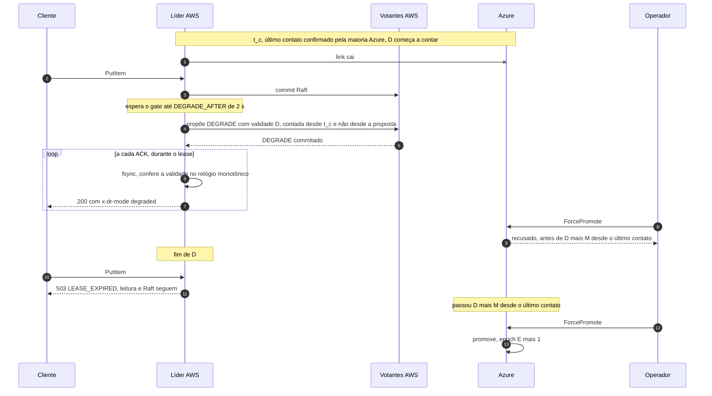
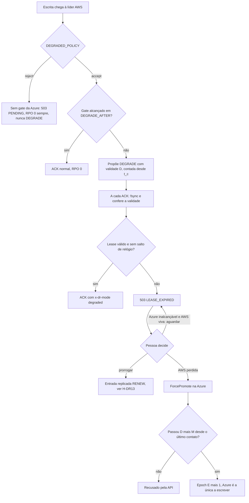

# C32 — Partição entre AWS e Azure: lease do modo degradado e promoção da Azure

**Status:** ✅ Atualizado (decidido pelo Bruno em 13/10/2026, revisão crítica); o valor de D e o de M são a definir (PEND-02), e a regra precisa ser provada no TLA+ (H-DR13 e H-DR14) · **ADRs:** [ADR-044](../../03_adr/ADR-044-lease-do-modo-degradado-e-promocao-da-azure.md), [ADR-045](../../03_adr/ADR-045-politica-de-degradacao-por-instalacao.md), [ADR-033](../../03_adr/ADR-033-promocao-da-azure-humana.md), [ADR-014](../../03_adr/ADR-014-modo-degradado-opcao-b.md), [ADR-027](../../03_adr/ADR-027-sinalizacao-do-modo-degradado.md), [ADR-008](../../03_adr/ADR-008-terceiro-dominio.md), [ADR-030](../../03_adr/ADR-030-verificacao-formal-tla.md) · **Relacionados:** [C12](C12-modo-degradado.md), [C13](C13-ressincronizacao-da-azure.md), [C14](C14-aws-cai-sem-degradacao.md), [C15](C15-aws-cai-em-degradacao.md), [C16](C16-aws-volta-apos-promocao.md), [C17](C17-maquina-de-estados.md), [C30](C30-aws-que-volta-boot-cercado.md), [X02](../complexos/X02-modo-degradado.md), [X03](../complexos/X03-desastre-e-promocao-da-azure.md), [R12](../a_rever/R12-promocao-com-aws-viva.md)

## Cenário

O link entre AWS e Azure cai e as duas pontas ficam vivas, cada uma achando que a outra morreu. Da Azure, "AWS morta" e "link caído" são idênticos. Com a opção B ([ADR-014](../../03_adr/ADR-014-modo-degradado-opcao-b.md)) a AWS continua escrevendo; se uma pessoa promover a Azure nesse intervalo, **as duas pontas aceitam escrita** (split-brain). Revogar credenciais e checar a epoch no boot não impedem isso, porque a ponta antiga não sabe que foi substituída.

Sem terceiro domínio de desempate ([ADR-008](../../03_adr/ADR-008-terceiro-dominio.md), restrição dura de só AWS e Azure), a autoridade única só pode vir do **tempo, não de consenso**:

- A entrada `DEGRADE` carrega uma **validade de duração D** (`DEGRADED_LEASE`), o teto do RPO > 0 que o negócio aprova (PEND-02). D conta **desde o último contato com a maioria dos learners da Azure** (`t_c`), não desde a proposta do `DEGRADE`.
- Ao fim de D a AWS **para de aceitar escrita sozinha**. Só uma pessoa prorroga.
- A Azure só pode ser promovida **depois de D + M**, contados no relógio monotônico da Azure desde o último contato recebido da AWS. A API `ForcePromote` recusa antes disso.
- Com isso nunca há dois lados escrevendo, assumindo apenas deriva de relógio limitada (a premissa de todo lease).

D e M são valores a definir: D vem do aceite de negócio (PEND-02) e `M = deriva máxima de relógio + pausa máxima de processo`, ambas a medir. `DEGRADE_AFTER` **não** entra em M: como a AWS conta D desde `t_c`, o instante de envio do último heartbeat ou `AppendEntries` confirmado por uma maioria Azure, e duas maiorias de 3 learners se cruzam em ao menos um learner, esse learner viu a AWS em `t_c` ou depois. A Azure não consegue estar apta a promover antes de a AWS ter parado.

## Diagrama: linha do tempo da partição

## Diagrama: o que cada ponta decide

## Etapas

1. **Partição:** o link cai. Escritas commitam nos votantes AWS e esperam o gate. A líder guarda `t_c`, o instante de envio do último heartbeat ou `AppendEntries` confirmado por uma maioria Azure, e a Azure passa a contar o tempo desde o último contato que recebeu, cada uma no seu relógio monotônico.
2. **Entrada em degradado (política `accept`):** passados `DEGRADE_AFTER` (2 s), a líder propõe `DEGRADE(epoch, fromIndex, validade D)`. O prazo conta no relógio monotônico da líder **desde `t_c`**, e **não desde a proposta**: assim a janela não depende de quando chega a primeira escrita depois da partição. Se a proposta ocorrer horas depois de `t_c`, o lease já nasce vencido e a escrita responde `503 LEASE_EXPIRED`.
3. **Checagem a cada ACK:** depois do fsync e antes de responder, a líder confere se o lease ainda vale. Não basta um temporizador, por causa de pausas de processo. Um salto de tempo detectado conta como lease expirado.
4. **Fim de D:** a AWS responde `503 LEASE_EXPIRED` a escritas. Leituras e o Raft seguem; as células Azure continuam respondendo como em [C12](C12-modo-degradado.md).
5. **Prorrogação:** só por uma pessoa, com uma entrada replicada `RENEW(epoch, nova validade)` no Raft da AWS. Ver o cenário oculto da prorrogação abaixo.
6. **Promoção:** `ForcePromote` continua sendo ação humana ([ADR-033](../../03_adr/ADR-033-promocao-da-azure-humana.md)), mas a API **recusa** antes de D + M desde o último contato. Vale também para os primeiros 2 s da partição, antes de existir `DEGRADE`: o lease já corre desde `t_c`.
7. **Política `reject`:** não há lease. A líder nunca propõe `DEGRADE`; sem o gate da Azure o cliente recebe `503 PENDING` e o RPO é 0 sempre. A promoção se apoia na maioria Azure já estar na epoch nova (fencing por maioria, a provar no modelo), por isso não há D + M a esperar.

## Falhas e tratativas

- **AWS morre de verdade em modo degradado.** O RTO passa a ser **pelo menos D + M**: é o preço de ter autoridade única sem terceiro domínio. Quem vendeu RTO curto precisa saber disso ([C15](C15-aws-cai-em-degradacao.md)). Como a Azure não distingue AWS morta de link caído, a mesma espera vale quando a AWS cai estando em modo normal e a política é `accept` ([C14](C14-aws-cai-sem-degradacao.md)).
- **Escritas param ao fim de D com a Azure ainda inalcançável.** A disponibilidade em degradado passa a ser finita. A saída é uma pessoa prorrogar, esperar a Azure voltar ([C13](C13-ressincronizacao-da-azure.md)) ou promover depois de D + M. O alerta de lease chegando ao fim precisa disparar com antecedência (limiar a definir).
- **Escrita commitada com resposta `503 LEASE_EXPIRED`.** Se o lease vence entre o commit e a conferência, a entrada está no log da AWS mas o cliente não recebeu ACK: resultado desconhecido, como em [C07](C07-timeout-depois-do-commit.md). Depois de uma promoção ela vira órfã sem nunca ter sido confirmada; a consulta por identificador deve devolver `PENDING` ([ADR-048](../../03_adr/ADR-048-skip-por-item.md)).
- **Retry em cascata.** O SDK trata `503` como retentável e repete até 3 vezes. Enquanto o lease está expirado, a líder deve rejeitar rápido, com `retryAfter`, como no circuito de [C26](C26-entrada-venenosa.md), para não encher filas.

## Cenários ocultos

| Cenário | O que acontece | Tratativa |
|---|---|---|
| **Pausa de processo ou GC** na líder (VM congelada, snapshot) | O temporizador não dispara a tempo e a líder poderia ACKar depois do fim de D | A validade é conferida a cada ACK, depois do fsync; a pausa é parcela de M |
| **Salto de relógio** (NTP, migração de VM, suspensão) | O relógio de parede não serve para medir duração | Só relógio monotônico, de preferência o que conta a suspensão (`CLOCK_BOOTTIME`); salto detectado conta como lease expirado. Deriva máxima entra em M |
| **Partição assimétrica** (a Azure recebe da AWS, mas as confirmações não voltam) | A AWS não vê o gate e degrada; a Azure continua vendo contato recente e nunca libera a promoção. Seguro, mas só uma pessoa destrava, por `RENEW` | Hipótese H-DR14, a modelar no TLA+. No sentido inverso (nada da AWS chega à Azure), a Azure fica sem contato e o desfecho é o do link caído |
| **AWS morta em degradado** | Nada para a AWS parar além do lease que já vale; a Azure espera D + M | RTO >= D + M, declarado ao negócio; opção `reject` para quem não aceita |
| **Prorrogação contra promoção** (H-DR13) | Se `RENEW` sai depois de a Azure já poder ser promovida (D + M desde o último contato), as duas pontas podem escrever | Regra candidata do ADR-044: a prorrogação é feita em dois passos humanos, primeiro marcar a Azure como `promotion_blocked` (pela porta de administração, sem usar o link) e depois propor `RENEW`. Não vale como regra até o modelo TLA+ provar |
| **Primeira escrita chega muito depois da partição** | Se D contasse desde a proposta do `DEGRADE`, a janela da AWS iria além do instante em que a Azure já pode ser promovida | **Regra decidida:** D conta desde `t_c`, o último contato confirmado por uma maioria Azure. Com a proposta tardia, o lease já está vencido e a escrita não é ACKada |
| **Troca de líder ou reinício do nó em degradado** | A líder nova herda o `DEGRADE` por replicação mas não herda `t_c`; contar D desde a eleição estenderia o lease | **Regra decidida:** a líder nova (e o nó reiniciado) trata o lease como expirado até obter contato com a Azure ou um `RENEW`. Custo aceito: fica sem escrita até lá |
| **Reinício de uma célula Azure** | O "último contato" vive em memória, no relógio monotônico de cada célula, e some no reinício | Reinício conta como contato (promove mais tarde, lado seguro); a recusa usa o contato mais recente entre as três células Azure |
| **Política `reject` com entradas commitadas e nunca ACKadas** | O RPO dos ACKs continua 0, mas existem entradas no log da AWS que a Azure não tem; o cliente tem resultado desconhecido | O cliente trata `503 PENDING` como desconhecido ([X05](../complexos/X05-timeouts-e-idempotencia.md)); na promoção, são extraídas como as órfãs de [R13](../a_rever/R13-escritas-orfas-reconciliacao.md) |

## Pontos em aberto

- Valor de D (aceite do negócio, PEND-02) e de M (medir a deriva e a pausa máxima de processo); ambos entram na validação de partida.
- Modelo TLA+ do lease ([ADR-030](../../03_adr/ADR-030-verificacao-formal-tla.md)): H-DR13 (prorrogação contra promoção) e H-DR14 (partição assimétrica) seguem como hipóteses a provar; as regras de `t_c` e de líder nova são decididas, mas também entram no modelo.
- Contorno de emergência (break-glass) da recusa do `ForcePromote` antes de D + M, por exemplo quando uma pessoa comprova que a AWS foi destruída: **decidido pelo Bruno em 13/10 (15b): não há contorno na v1**. A espera de D + M vale sempre e o RTO no pior caso é D + M. Um contorno com fencing comprovado fora do software e duas pessoas pode ser reavaliado depois do modelo TLA+.
- A PEND-01 fecha quando D e M forem aprovados e o modelo provar a ausência de escrita nas duas pontas.
