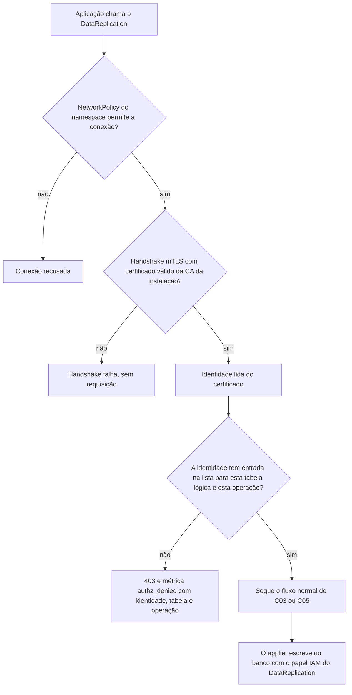
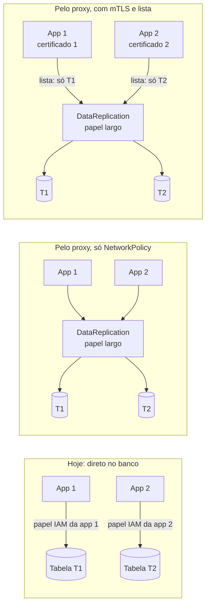

# C34 — Autorização por aplicação: mTLS e lista de permissões por identidade

**Status:** ✅ Atualizado (decidido pelo Bruno em 13/10/2026, revisão crítica); a lista de permissões depende do levantamento dos papéis IAM atuais (PEND-19) · **ADRs:** [ADR-052](../../03_adr/ADR-052-autorizacao-por-aplicacao-com-mtls.md), [ADR-043](../../03_adr/ADR-043-uma-instalacao-por-cliente-identidade-por-configuracao.md), [ADR-051](../../03_adr/ADR-051-compatibilidade-dynamodb-inventario-conformidade-e-idempotencia.md), [ADR-025](../../03_adr/ADR-025-escopo-da-api-v1-e-sdks.md), [ADR-001](../../03_adr/ADR-001-camada-intermediaria-agnostica.md) · **Relacionados:** [C31](C31-implantacao-por-cliente-e-identidade.md), [C20](C20-bypass-de-escrita-direta.md), [C22](C22-cliente-com-sdk-nao-suportado.md), [C02](C02-dentro-da-celula.md)

## Cenário

O [ADR-043](../../03_adr/ADR-043-uma-instalacao-por-cliente-identidade-por-configuracao.md) respondeu "quem é o cliente"; faltava responder "**quem pode escrever o quê**". Hoje cada aplicação do cliente tem o seu papel IAM, normalmente limitado às suas tabelas. Pelo proxy, o papel largo é o do `DataReplication` (o applier escreve em todas as tabelas da célula), e com a NetworkPolicy como única barreira **qualquer pod do namespace escreve em qualquer tabela**. Isso é uma **ampliação de privilégio** em relação ao cenário de hoje, não só impersonação. O `Access Key Id` do SigV4 não resolve, porque a camada não consegue validar a assinatura sem o segredo.

A saída é identidade de carga de trabalho: cada aplicação fala **mTLS** com o `DataReplication`, com certificado emitido pelo cert-manager, e o `DataReplication` mantém uma lista **identidade → tabelas e operações permitidas**. Sem entrada na lista, a resposta é `403`.

## Diagrama: decisão de autorização na entrada

## Diagrama: privilégio hoje, sem lista e com a lista

No bloco do meio, a App 1 consegue escrever em T2, o que o IAM de hoje não permite. No bloco da direita, a lista devolve o privilégio ao nível de hoje.

## Etapas

1. **Levantar as permissões atuais:** por aplicação, quais tabelas e quais operações o papel IAM dela permite hoje (PEND-19). A lista nasce desse levantamento; se todas as aplicações compartilham o mesmo papel hoje, o ganho é menor, mas a lista continua valendo como registro.
2. **Emitir os certificados:** o cert-manager emite um certificado de cliente por aplicação, com uma identidade estável (por exemplo, o nome da aplicação ou da conta de serviço). A CA é da instalação do cliente.
3. **Montar a lista:** em configuração versionada e auditada, identidade → tabelas lógicas → operações da API da v1 ([ADR-025](../../03_adr/ADR-025-escopo-da-api-v1-e-sdks.md)). O nome da tabela é o lógico, com `{cell}`, e a lista é a mesma em todas as células.
4. **Handshake:** o `DataReplication` exige certificado de cliente; o cliente HTTP do SDK precisa apresentá-lo. **"Só trocar o endpoint" deixa de ser verdade.** Cada SDK suportado (Java 2.x, Go v2, .NET v4) tem um ponto de extensão no cliente HTTP para isso, a validar na suíte de compatibilidade (X3). A alternativa de uma malha de serviço no cluster entregar o mTLS sem mudar a aplicação fica a avaliar.
5. **Autorizar:** a identidade vem do certificado, nunca do `Access Key Id` nem do `User-Agent`. A decisão é tomada na célula que recebe a chamada; o encaminhamento à líder confia no mTLS entre células ([C31](C31-implantacao-por-cliente-e-identidade.md)).
6. **Recusar e registrar:** sem entrada, `403`, com a métrica `authz_denied{identidade,tabela,operacao}` e registro de auditoria.
7. **Bancos:** continuam fechados para as aplicações; só o applier escreve, com o papel IAM do `DataReplication` ([C20](C20-bypass-de-escrita-direta.md)).

## Falhas e tratativas

- **Certificado vencido ou rotação mal feita.** O handshake falha e a aplicação perde o acesso, o que para o cliente é indisponibilidade. A rotação precisa de sobreposição (o novo certificado vale antes de o antigo vencer), alerta de expiração e renovação automática pelo cert-manager. Os SDKs costumam montar o material TLS na criação do cliente: a recarga do certificado sem reiniciar a aplicação precisa ser testada por SDK.
- **Revogação.** Retirar a identidade da lista corta o acesso na próxima recarga da configuração, sem esperar o vencimento do certificado. Se o certificado vazar, o uso fora da lista continua dando `403`, mas dentro das permissões da própria identidade o vazamento vale: proteger o segredo no cluster (RBAC de `Secret`) e usar validade curta.
- **Lista incompleta no dia da ativação.** Uma aplicação legítima receberia `403` em produção. Proposta: um período de observação em que a negação só conta e alerta, no mesmo molde do período de alerta do SDK ([C22](C22-cliente-com-sdk-nao-suportado.md)), antes de impor a regra.
- **Listas diferentes entre as células.** Uma célula que recusa o que outra aceita muda o comportamento quando a liderança ou o tráfego muda. A lista deve ser idêntica nas seis células, com alerta de divergência. Depois de uma promoção, as aplicações na Azure usam a mesma lista; o emissor de certificados do AKS precisa confiar na mesma CA, ou a lista deve aceitar a identidade nos dois emissores.
- **Custo do handshake.** A conexão é reaproveitada (keep-alive, `IdleTimeout` de 120 s); só a conexão nova paga o handshake. Medir o efeito sobre o orçamento de latência ([C24](C24-orcamento-de-50ms-e-escrita-no-dynamodb.md)).
- **Sondas e administração.** As sondas do kubelet não têm certificado de aplicação: `readyz` e `livenessProbe` ficam em porta separada, sem acesso a dados. A porta de administração continua separada, com MFA e auditoria ([C31](C31-implantacao-por-cliente-e-identidade.md)).
- **Pod comprometido da própria aplicação.** O mTLS não impede o que a identidade já pode fazer; limita o dano ao conjunto de tabelas e operações dela, que é o que o IAM faz hoje.

## Pontos em aberto

- PEND-19: levantar as permissões IAM atuais de cada aplicação para montar a lista; entra no inventário de cada cliente ([ADR-051](../../03_adr/ADR-051-compatibilidade-dynamodb-inventario-conformidade-e-idempotencia.md)).
- Formato e local da lista (configuração, recarga, auditoria) e o nome da identidade no certificado: a definir.
- Mudança nos SDKs ou malha de serviço: decidir por cliente conforme o custo no inventário.
- Validade dos certificados e prazo de sobreposição na rotação: a definir (risco 18, operação da frota).
