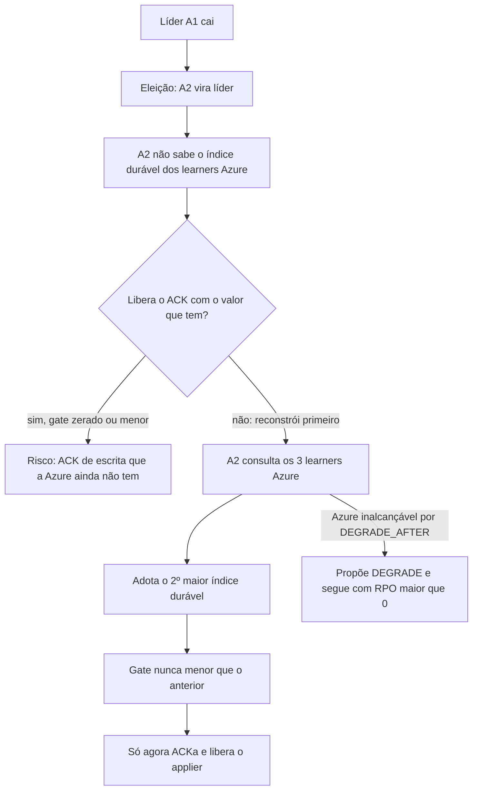

# X01 — Gate: definição, monotonicidade e troca de líder

**Status:** Decidido (D9, D12); falta o modelo TLA+ · **ADRs:** [ADR-017](../../03_adr/ADR-017-azure-learners-e-gate.md), [ADR-029](../../03_adr/ADR-029-gate-monotonico-na-troca-de-lider.md), [ADR-030](../../03_adr/ADR-030-verificacao-formal-tla.md)

## Cenário

O gate é a regra que une o Raft (decisão só da AWS) à exigência de durabilidade na Azure. É lógica nossa, fora de uma prova conhecida, e por isso é o ponto de maior risco do consenso da v1. Este documento detalha a regra, o que muda na troca de líder e as propriedades que o modelo TLA+ deve provar.

## Diagrama: troca de líder

## Etapas

1. **Regra:** `gateIndex = min(raftCommitIndex, azureMajorityIndex)`. O `azureMajorityIndex` é o 2º maior entre os 3 índices duráveis dos learners Azure (maior índice confirmado por ≥ 2 de 3 com fsync feito).
2. **Em modo degradado** (entrada `DEGRADE` commitada), `gateIndex = raftCommitIndex`. O modo faz parte do estado replicado: um líder novo o lê do log, não da memória.
3. **Monotonicidade (D9):** o gate nunca recua. O `azureMajorityIndex` é estado do líder; ao assumir, o líder novo consulta os learners e adota o maior valor confirmado por ≥ 2 de 3 **antes** de ACKar ou liberar o applier.
4. **Learner que perde o disco:** volta com identidade nova e começa do zero. Ele deixa de contar até alcançar o índice; o gate nunca usa um índice que não esteja durável nele agora.
5. **Entradas replicadas aos learners mas nunca commitadas:** podem existir na Azure. Na promoção, o log é escolhido por (termo, índice) e o cliente que recebeu `PENDING` trata o resultado como desconhecido (ver X03).

## Falhas e tratativas

- **Líder nova sem o valor.** Janela curta sem ACK logo após a eleição (parte da meta de 3 a 4 s de C08).
- **Learner reporta índice menor que antes.** O gate guarda o máximo; o learner volta a contar quando alcança.
- **Azure inalcançável durante a reconstrução.** Passados `DEGRADE_AFTER`, a líder propõe `DEGRADE` (C12).

## Propriedades para o modelo TLA+ (D12)

| # | Propriedade | Tipo |
|---|---|---|
| P1 | Toda entrada ACKada está durável em ≥ 2 de 3 votantes AWS | Segurança |
| P2 | Fora de uma janela `DEGRADE`..`RESTORE`, toda entrada ACKada está durável em ≥ 2 de 3 learners Azure | Segurança |
| P3 | O gate nunca recua, inclusive na troca de líder | Segurança |
| P4 | Nenhuma entrada ACKada se perde depois de qualquer sequência de quedas de uma AZ AWS e de uma AZ Azure | Segurança |
| P5 | Duas líderes nunca confirmam no mesmo termo | Segurança |
| P6 | `DEGRADE` e `RESTORE` só mudam o modo uma vez por epoch | Segurança |
| P7 | Com maioria AWS viva e Azure viva, toda escrita é ACKada (sem travar) | Vivacidade |
| P8 | Com a Azure fora por mais de `DEGRADE_AFTER`, o gate libera (modo degradado) | Vivacidade |

Escopo mínimo do modelo: 3 votantes, 3 learners, troca de líder, `DEGRADE` e `RESTORE`, falhas de nó e partição AWS↔Azure.

## Pontos em aberto

- Modelo TLA+ ainda não escrito ([ADR-030](../../03_adr/ADR-030-verificacao-formal-tla.md)): primeiro item do plano.
