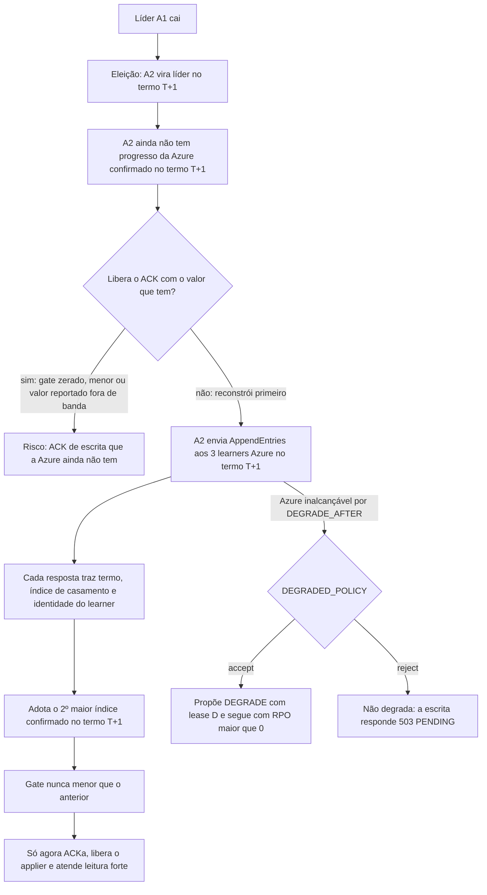

# X01 — Gate: definição, monotonicidade e troca de líder

**Status:** Decidido (D9, D12; revisado em 13/10 pelo [ADR-046](../../03_adr/ADR-046-gate-so-conta-progresso-validado-pelo-raft.md)); falta o modelo TLA+, que agora nasce junto da fase 1 · **ADRs:** [ADR-017](../../03_adr/ADR-017-azure-learners-e-gate.md), [ADR-029](../../03_adr/ADR-029-gate-monotonico-na-troca-de-lider.md), [ADR-046](../../03_adr/ADR-046-gate-so-conta-progresso-validado-pelo-raft.md), [ADR-030](../../03_adr/ADR-030-verificacao-formal-tla.md), [ADR-044](../../03_adr/ADR-044-lease-do-modo-degradado-e-promocao-da-azure.md), [ADR-049](../../03_adr/ADR-049-barreira-da-leitura-forte-e-o-gate.md) · **Relacionados:** [X02](X02-modo-degradado.md), [X03](X03-desastre-e-promocao-da-azure.md), [C32](../atualizados/C32-particao-e-lease-do-modo-degradado.md)

## Cenário

O gate é a regra que une o Raft (decisão só da AWS) à exigência de durabilidade na Azure. É lógica nossa, fora de uma prova conhecida, e por isso é o ponto de maior risco do consenso da v1. Este documento detalha a regra, o que muda na troca de líder e as propriedades que o modelo TLA+ deve provar.

Os learners da Azure são learners do `etcd-io/raft`: a líder só conta o progresso de um learner depois da verificação de índice e termo anteriores do `AppendEntries` (casamento de logs). Por isso "índice N durável" significa "o mesmo prefixo do log até N". Isso só vale se o progresso chegar **pelo próprio `AppendEntries`**: um número que chegue por canal paralelo, sem termo, não prova nada.

## Diagrama: troca de líder

## Etapas

1. **Regra:** `gateIndex = min(raftCommitIndex, azureMajorityIndex)`. O `azureMajorityIndex` é o 2º maior entre os 3 índices duráveis dos learners Azure (maior índice confirmado por ≥ 2 de 3 com fsync feito).
2. **Origem do progresso:** o progresso da Azure chega só pelas respostas do `AppendEntries`. `LearnerDurable()` devolve **(termo, índice, identidade do learner)** e o gate só adota valores do **termo atual** da líder.
3. **Gate alimentado por evento:** cada resposta de learner atualiza o gate no momento em que chega, e não só quando um lote commitado é processado. Sem isso uma escrita pode esperar até o timeout sem que nada a acorde.
4. **Em modo degradado** (entrada `DEGRADE` commitada e lease válido), `gateIndex = raftCommitIndex`. O modo faz parte do estado replicado: um líder novo o lê do log, não da memória. Ao fim do lease D a AWS recusa a escrita (`503 LEASE_EXPIRED`, [X02](X02-modo-degradado.md)); o gate não é afrouxado de outra forma. Com `DEGRADED_POLICY=reject` o `DEGRADE` nunca é proposto.
5. **Monotonicidade (D9):** o gate nunca recua. O `azureMajorityIndex` é estado do líder; ao assumir, o líder novo só adota progresso **confirmado no termo novo** pelo `AppendEntries`, o maior valor confirmado por ≥ 2 de 3, **antes** de ACKar, liberar o applier ou atender leitura forte. Um índice que um learner reporte fora de banda é ignorado até a primeira confirmação, porque pode ser o sufixo de uma líder antiga.
6. **Barreira da leitura forte:** a leitura forte espera `min(ReadIndex, gate)` ([ADR-049](../../03_adr/ADR-049-barreira-da-leitura-forte-e-o-gate.md)). Um cliente só viu escritas já ACKadas, e toda escrita ACKada está abaixo do gate; assim uma Azure lenta não atrasa a leitura. A follower recebe o `ReadIndex` e o gate **na mesma resposta** da líder.
7. **Learner que perde o disco ou é trocado:** volta com identidade nova e começa do zero. Ele deixa de contar até alcançar o índice; o gate nunca usa um índice que não esteja durável nele agora, nem herda o progresso da identidade antiga.
8. **Entradas replicadas aos learners mas nunca commitadas:** podem existir na Azure. Na promoção, o log é escolhido por (termo, índice) e o cliente que recebeu `PENDING` trata o resultado como desconhecido (ver [X03](X03-desastre-e-promocao-da-azure.md)).
9. **Métricas separadas:** `last_committed`, `last_azure_durable`, `last_acked`, `last_applied` e `last_reconciled`. Os nomes distinguem o que está decidido, o que está seguro na Azure, o que o cliente já viu, o que o banco já tem e o que a reconciliação já conferiu.

## Falhas e tratativas

- **Líder nova sem o valor.** Janela curta sem ACK logo após a eleição (parte da meta de 3 a 4 s de C08).
- **Learner reporta índice menor que antes.** O gate guarda o máximo; o learner volta a contar quando alcança.
- **Azure inalcançável durante a reconstrução.** Passados `DEGRADE_AFTER`, com `accept` a líder propõe `DEGRADE` com lease (C12, [C32](../atualizados/C32-particao-e-lease-do-modo-degradado.md)); com `reject` a escrita responde `503 PENDING`.
- **Líder nova herda um lease em curso.** Ela herda o `DEGRADE` mas não o `t_c` (último contato com a maioria Azure): trata o lease como expirado até obter contato com a Azure ou um `RENEW` ([ADR-044](../../03_adr/ADR-044-lease-do-modo-degradado-e-promocao-da-azure.md)).

## Propriedades para o modelo TLA+ (D12, ampliado pelo ADR-046)

As propriedades P1 a P8 são as originais e mantêm a numeração. P9 em diante são as acrescentadas pela revisão de 13/10.

| # | Propriedade | Tipo |
|---|---|---|
| P1 | Toda entrada ACKada está durável em ≥ 2 de 3 votantes AWS | Segurança |
| P2 | Fora de uma janela `DEGRADE`..`RESTORE`, toda entrada ACKada está durável em ≥ 2 de 3 learners Azure | Segurança |
| P3 | O gate nunca recua, inclusive na troca de líder | Segurança |
| P4 | Nenhuma entrada ACKada se perde depois de qualquer sequência de quedas de uma AZ AWS e de uma AZ Azure | Segurança |
| P5 | Duas líderes nunca confirmam no mesmo termo | Segurança |
| P6 | `DEGRADE` e `RESTORE` só mudam o modo uma vez por epoch | Segurança |
| P7 | Com maioria AWS viva e Azure viva, toda escrita é ACKada (sem travar) | Vivacidade |
| P8 | Com a Azure fora por mais de `DEGRADE_AFTER`, o gate libera (modo degradado, só com `DEGRADED_POLICY=accept`) | Vivacidade |
| P9 | O gate só conta progresso confirmado pelo `AppendEntries` no termo atual; "índice N durável" implica o mesmo prefixo até N | Segurança |
| P10 | Lease: com `accept`, a AWS não ACKa escrita depois de D sem `RENEW`, e a conferência é feita a cada ACK, também sob pausa de processo | Segurança |
| P11 | Promoção entre nuvens: nunca dois lados aceitam escrita confirmada ao mesmo tempo. `ForcePromote` é recusada antes de D + M; com `reject` vale o fencing por maioria Azure na epoch nova | Segurança |
| P12 | Prorrogação x promoção: um `RENEW` nunca é efetivo depois de a Azure já poder ser promovida (hipótese H-DR13) | Segurança |
| P13 | Troca de membros: um learner com disco substituído e identidade nova não conta até alcançar o índice, e não herda o progresso da identidade antiga | Segurança |
| P14 | Dedupe: um retry com o mesmo identificador dentro da janela não gera segunda entrada, inclusive depois da troca de líder; o dedupe é por requisição | Segurança |
| P15 | Resultado desconhecido: depois de `503 PENDING`, a escrita ou foi commitada e aparece na consulta por identificador, ou nunca foi; não há perda silenciosa de escrita ACKada | Segurança |
| P16 | I-DEL: com as leituras abertas, o estado materializado da célula é a dobra do log até `applied`, com DELETE, replay e queda em qualquer ponto ([X06](X06-delete-ttl-gsi.md)) | Segurança |
| P17 | Barreira da leitura forte: a leitura forte (espera `min(ReadIndex, gate)`) nunca devolve estado anterior a uma escrita ACKada nem enxerga escrita não ACKada (`applied` nunca passa do gate) | Segurança |
| P18 | Com `reject`, nenhuma escrita é ACKada sem o gate da Azure, e `DEGRADE` nunca é proposto | Segurança |

Escopo mínimo do modelo: 3 votantes, 3 learners, troca de líder, `DEGRADE` com lease e `RENEW`, `RESTORE`, `DEGRADED_POLICY` nos dois valores, `ForcePromote` com epoch E+1, troca de membros (disco substituído, identidade nova), dedupe com retry, operações de resultado desconhecido, DELETE com replay, falhas de nó, pausa de processo, deriva de relógio limitada e partição AWS↔Azure (simétrica e assimétrica, H-DR14).

## Pontos em aberto

- Modelo TLA+ ainda não escrito ([ADR-030](../../03_adr/ADR-030-verificacao-formal-tla.md)): primeiro item do plano. Pela revisão de 13/10 (fases) ele nasce junto da fase 1, e o núcleo mínimo verificável vem antes de qualquer caminho de banco.
- Regra de prorrogação x promoção (H-DR13) e partição assimétrica (H-DR14): ver [R23](../a_rever/R23-hipoteses-gerais.md).
- A regra decidida de que a líder nova não herda `t_c` (lease expirado até contato ou `RENEW`) entra no modelo para prova.
