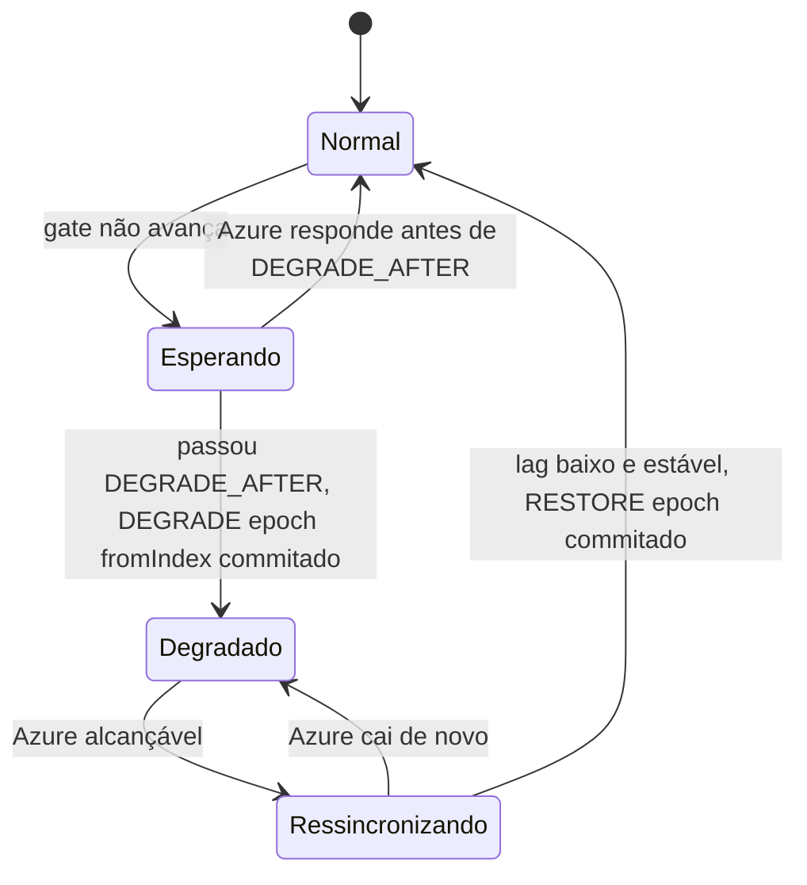

# X02 — Modo degradado: entrada, permanência e saída

**Status:** Decidido (opção B, ADR-014); saída e limiares em revisão · **ADRs:** [ADR-014](../../03_adr/ADR-014-modo-degradado-opcao-b.md), [ADR-027](../../03_adr/ADR-027-sinalizacao-do-modo-degradado.md), [ADR-028](../../03_adr/ADR-028-timeouts-em-cascata.md), [ADR-017](../../03_adr/ADR-017-azure-learners-e-gate.md)

## Cenário

Quando a Azure ou o link fica inalcançável, a AWS segue escrevendo com RPO > 0 (opção B, decisão do Bruno). Este documento reúne a mecânica de entrada e saída, a sinalização ao cliente e o que ainda está em aberto.

## Diagrama: entrada e saída

## Etapas

1. **Gatilho:** os learners não confirmam o índice durável dentro de `DEGRADE_AFTER` (2 s, menor que o prazo da requisição, para não estourar tudo antes da degradação).
2. **Entrada replicada:** o líder propõe `DEGRADE(epoch, fromIndex)`. Como é uma entrada do Raft, os 3 votantes concordam e um líder novo herda o modo.
3. **Efeito:** `gateIndex = raftCommitIndex`; as respostas saem com `x-dr-mode: degraded` e a métrica `degraded_mode` vai a 1.
4. **Marcador:** entre `fromIndex` e `RESTORE` as escritas ficam "sem garantia Azure" (base para a reconciliação, X03).
5. **Saída:** os learners alcançam o índice atual; com lag abaixo de um limite por um tempo estável (histerese), o líder propõe `RESTORE(epoch)` e o gate volta a exigir a maioria Azure.
6. **Células Azure:** respondem erro recuperável ou leitura eventual com defasagem informada.

## Falhas e tratativas

- **Disco do log enche.** Retenção com teto de 70% do volume; passado o teto, a Azure vira "fora da janela" e exige reconstrução (04_wal_e_fsync 6.5). Prefere-se perder a elegibilidade da Azure a derrubar o disco da AWS.
- **Partição assimétrica.** A AWS degrada; a Azure ter dados a mais não causa dano.

## Pontos em aberto

- Link oscilando e histerese: [R07](../a_rever/R07-link-oscilando.md).
- Link lento que nunca expira o timeout: [C25](../atualizados/C25-link-lento-faixa-cinzenta.md).
- Disco do log (teto de 70%, sem descarga para S3 na v1): [C29](../atualizados/C29-disco-do-log-em-degradacao-longa.md).
- RPO > 0 ilimitado e aceite formal (PEND-02, bloqueante): [R23](../a_rever/R23-hipoteses-gerais.md).
- Limiares (lag de catch-up, tempo estável, teto de permanência): PEND-12, a calibrar no POC.
