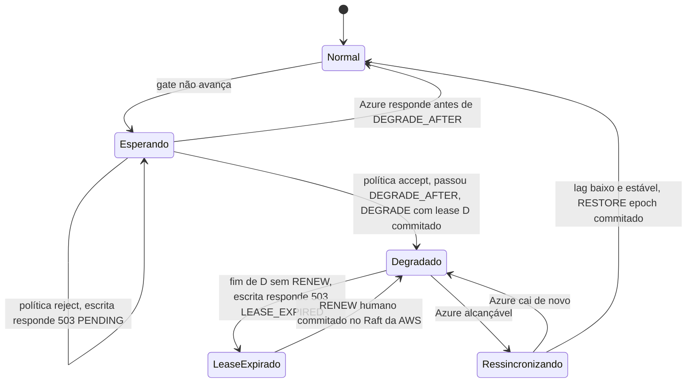

# X02 — Modo degradado: entrada, permanência, lease e saída

**Status:** Decidido (opção B, ADR-014; lease e política em 13/10, [ADR-044](../../03_adr/ADR-044-lease-do-modo-degradado-e-promocao-da-azure.md) e [ADR-045](../../03_adr/ADR-045-politica-de-degradacao-por-instalacao.md)); falta o valor de D (PEND-02) e a prova no TLA+; saída e limiares em revisão · **ADRs:** [ADR-014](../../03_adr/ADR-014-modo-degradado-opcao-b.md), [ADR-044](../../03_adr/ADR-044-lease-do-modo-degradado-e-promocao-da-azure.md), [ADR-045](../../03_adr/ADR-045-politica-de-degradacao-por-instalacao.md), [ADR-027](../../03_adr/ADR-027-sinalizacao-do-modo-degradado.md), [ADR-028](../../03_adr/ADR-028-timeouts-em-cascata.md), [ADR-017](../../03_adr/ADR-017-azure-learners-e-gate.md) · **Relacionados:** [C32](../atualizados/C32-particao-e-lease-do-modo-degradado.md), [X03](X03-desastre-e-promocao-da-azure.md)

## Cenário

Quando a Azure ou o link fica inalcançável, a AWS pode seguir escrevendo com RPO > 0 (opção B, decisão do Bruno), mas **só por um tempo finito e só nas instalações que escolheram `DEGRADED_POLICY=accept`**. A entrada `DEGRADE` carrega uma validade (lease) de duração D; no fim dela a AWS para de aceitar escrita sozinha. É isso que impede que a AWS e a Azure (promovida por uma pessoa) aceitem escrita ao mesmo tempo, sem terceiro domínio de desempate ([ADR-008](../../03_adr/ADR-008-terceiro-dominio.md)). Este documento reúne a mecânica de entrada, permanência, prorrogação e saída, a sinalização ao cliente e o que ainda está em aberto.

Com `DEGRADED_POLICY=reject` não há modo degradado: a líder nunca propõe `DEGRADE`, o RPO é 0 sempre e, sem o gate da Azure, o cliente recebe `503 PENDING`.

## Diagrama: entrada, lease e saída

## Etapas

1. **Gatilho:** os learners não confirmam o índice durável dentro de `DEGRADE_AFTER` (2 s, menor que o prazo da requisição, para não estourar tudo antes da degradação). Só com `DEGRADED_POLICY=accept`; com `reject` a escrita continua esperando o gate e o cliente recebe `503 PENDING` ao fim do prazo.
2. **Entrada replicada com lease:** o líder propõe `DEGRADE(epoch, fromIndex, validade D)`. Como é uma entrada do Raft, os 3 votantes concordam e um líder novo herda o modo. O prazo D (`DEGRADED_LEASE`) conta no **relógio monotônico da líder desde o último contato com a maioria dos learners da Azure** (`t_c`: o instante de envio do último heartbeat ou `AppendEntries` confirmado por uma maioria Azure), e **não desde a proposta** do `DEGRADE`: a janela não depende de quando chega a primeira escrita depois da partição, e uma proposta tardia já nasce com o lease vencido. **Uma líder nova (ou um nó reiniciado) não herda `t_c`:** trata o lease como expirado até obter contato com a Azure ou um `RENEW`.
3. **Conferência a cada ACK:** depois do fsync e antes de responder, a líder confere se o lease ainda vale. Um temporizador não basta: uma pausa de processo (GC, VM congelada) pode passar do prazo sem que o temporizador dispare. Um salto de tempo detectado conta como lease expirado.
4. **Efeito:** `gateIndex = raftCommitIndex` enquanto o lease vale; as respostas saem com `x-dr-mode: degraded` e a métrica `degraded_mode` vai a 1. O header só avisa; quem não aceita RPO > 0 usa `reject`.
5. **Fim de D:** a AWS recusa a escrita com `503 LEASE_EXPIRED`. Leitura e Raft continuam. Uma escrita cujo ACK cairia depois do fim de D não é confirmada, mas já pode ter sido registrada no log antes de o lease acabar: para ela o resultado é desconhecido e o cliente consulta pelo identificador da requisição ([ADR-028](../../03_adr/ADR-028-timeouts-em-cascata.md)). Escritas novas, depois do fim de D, são recusadas.
6. **Prorrogação:** só por uma pessoa, por uma entrada replicada `RENEW(epoch, nova validade)` no Raft da AWS. Prorrogar depois que a Azure já pode ser promovida reabre o risco de duas pontas; a regra que impede isso (por exemplo, marcar a Azure como `promotion_blocked` antes de prorrogar) é a hipótese H-DR13, a fechar no TLA+ ([R23](../a_rever/R23-hipoteses-gerais.md)).
7. **Marcador:** entre `fromIndex` e `RESTORE` as escritas ficam "sem garantia Azure" (base para a reconciliação, X03).
8. **Saída:** os learners alcançam o índice atual; com lag abaixo de um limite por um tempo estável (histerese), o líder propõe `RESTORE(epoch)` e o gate volta a exigir a maioria Azure. O lease vale até o `RESTORE`.
9. **Células Azure:** respondem erro recuperável ou leitura eventual com defasagem informada.
10. **Lado da Azure:** a Azure só pode ser promovida depois de D + M desde o último contato recebido da AWS, com `M = deriva máxima de relógio + pausa máxima de processo` (`DEGRADE_AFTER` não entra: duas maiorias de 3 learners se cruzam, então a Azure não fica apta antes de a AWS parar), e a API `ForcePromote` recusa antes disso ([X03](X03-desastre-e-promocao-da-azure.md)). Os valores de D e de M ficam **a definir**.

## Falhas e tratativas

- **Disco do log enche.** Retenção com teto de 70% do volume; passado o teto, a Azure vira "fora da janela" e exige reconstrução (04_wal_e_fsync 6.5). Prefere-se perder a elegibilidade da Azure a derrubar o disco da AWS.
- **Fim de D com a Azure ainda inalcançável.** As escritas param (`503 LEASE_EXPIRED`) mesmo sem desastre: a disponibilidade em modo degradado é finita. É o preço de ter autoridade única; a decisão humana é prorrogar (`RENEW`) ou esperar a Azure voltar.
- **Pausa longa do processo da líder.** A conferência a cada ACK impede que uma escrita seja confirmada depois do fim do lease, mesmo que o temporizador não tenha disparado.
- **Partição assimétrica.** Quando um sentido do link funciona e o outro não, o "último contato" visto pela Azure e o gate visto pela AWS divergem. Hipótese H-DR14, a modelar no TLA+; deixa de valer a frase antiga de que "a Azure ter dados a mais não causa dano" como única análise.

## Pontos em aberto

- Valor de D (`DEGRADED_LEASE`) e de M: dependem do aceite do negócio (PEND-02, [R23](../a_rever/R23-hipoteses-gerais.md)); sem números nesta versão.
- Prorrogação x promoção (H-DR13) e partição assimétrica (H-DR14): [R23](../a_rever/R23-hipoteses-gerais.md).
- O que acontece com o lease quando a Azure volta depois do fim de D (permissão de `RESTORE` com o lease expirado): a confirmar no modelo.
- Link oscilando e histerese: [R07](../a_rever/R07-link-oscilando.md).
- Link lento que nunca expira o timeout: [C25](../atualizados/C25-link-lento-faixa-cinzenta.md).
- Disco do log (teto de 70%, sem descarga para S3 na v1): [C29](../atualizados/C29-disco-do-log-em-degradacao-longa.md).
- RPO > 0 e aceite formal (PEND-02, bloqueante): [R23](../a_rever/R23-hipoteses-gerais.md). O lease dá um teto finito (D); falta o negócio aprovar o valor.
- Limiares (lag de catch-up, tempo estável, teto de permanência): PEND-12, a calibrar no POC.
