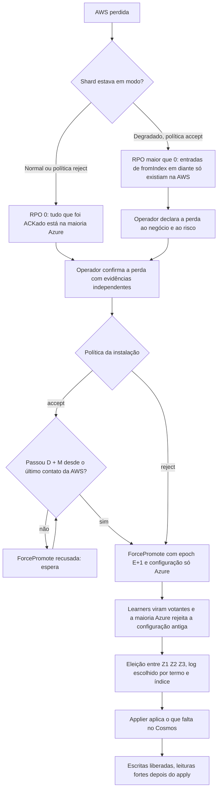

# X03 — Desastre: promoção da Azure, fencing e reconciliação

**Status:** Desenho decidido em 13/10 ([ADR-044](../../03_adr/ADR-044-lease-do-modo-degradado-e-promocao-da-azure.md)); PEND-01 fecha quando D e M forem aprovados e o TLA+ provar a ausência de escrita nas duas pontas; procedimento humano · **ADRs:** [ADR-033](../../03_adr/ADR-033-promocao-da-azure-humana.md), [ADR-044](../../03_adr/ADR-044-lease-do-modo-degradado-e-promocao-da-azure.md), [ADR-045](../../03_adr/ADR-045-politica-de-degradacao-por-instalacao.md), [ADR-042](../../03_adr/ADR-042-aws-que-volta-boot-cercado-e-recriacao-da-celula.md), [ADR-014](../../03_adr/ADR-014-modo-degradado-opcao-b.md) · **Relacionados:** [X02](X02-modo-degradado.md), [C32](../atualizados/C32-particao-e-lease-do-modo-degradado.md), [C30](../atualizados/C30-aws-que-volta-boot-cercado.md)

## Cenário

Quando a AWS é perdida, só uma pessoa promove a Azure (`ForcePromote`). Este documento junta os cenários C14, C15 e C16 com a mecânica de espera (lease), epoch, escolha do log e tratamento de escritas órfãs. A promoção continua humana ([ADR-033](../../03_adr/ADR-033-promocao-da-azure-humana.md)); a decisão de promoção automática está com os outros arquitetos e **não deve ser reaberta** sem a resposta do Bruno.

O que mudou em 13/10: o conflito de duas pontas nasce da opção B. Revogar credenciais e checar a epoch no boot não impedem que a AWS antiga, isolada, continue escrevendo, porque ela não sabe que foi substituída. Sem terceiro domínio, a autoridade única vem do tempo: a AWS para sozinha ao fim de D e a Azure só pode ser promovida depois de D + M.

## Diagrama: promoção

## Etapas

1. **Evidências:** status oficial do provedor, alcance da AWS a partir de várias origens externas, visão do Compass-Router.
2. **Espera do lease (`accept`):** a API `ForcePromote` **recusa** a promoção antes de D + M contados no relógio monotônico da Azure a partir do último contato recebido da AWS. `M = deriva máxima de relógio + pausa máxima de processo`. A AWS conta D desde o último contato confirmado por uma maioria Azure (`t_c`), e duas maiorias de 3 learners se cruzam em ao menos um learner; por isso `DEGRADE_AFTER` não entra em M. A Azure não sabe se a AWS estava em modo normal ou degradado (pode ter ficado isolada antes do `DEGRADE`, nos primeiros 2 s); por isso a espera vale para qualquer promoção em instalação `accept`. Ao fim de D a AWS já recusa escrita sozinha (`503 LEASE_EXPIRED`), então a Azure nunca aceita a primeira escrita enquanto a AWS ainda aceita. Os valores de D e M estão **a definir** (PEND-02).
3. **Fencing por maioria (`reject`):** sem lease, a AWS nunca ACKa sem o gate da Azure. Quando a maioria dos learners Azure já está na epoch E+1, ela rejeita o `AppendEntries` da configuração antiga e a AWS não consegue mais ACKar. A segurança vem daí e não de uma espera; a prova é tarefa do modelo ([X01](X01-gate-e-troca-de-lider.md), P11).
4. **Epoch:** `ForcePromote` grava E+1 e uma configuração só com a Azure; a antiga é revogada para sempre.
5. **Escolha do log:** como numa eleição, por (termo, índice). Entradas replicadas aos learners mas nunca commitadas podem existir; o cliente que recebeu `PENDING` trata o resultado como desconhecido.
6. **Fencing no banco (para o retorno da AWS):** cada célula tem o seu banco e o seu applier (um escritor por tabela), o que reduz o problema, mas **não elimina** a necessidade de impedir que um applier antigo da AWS volte a escrever depois da promoção. Isso continua necessário e é complementar ao lease: boot cercado, revogação de credenciais e recriação da célula ([ADR-042](../../03_adr/ADR-042-aws-que-volta-boot-cercado-e-recriacao-da-celula.md), [C30](../atualizados/C30-aws-que-volta-boot-cercado.md)). O gatilho da promoção é o do ADR-044: quando a Azure aceita a primeira escrita, a AWS antiga já parou por expiração do lease.
7. **Órfãs:** entradas de `fromIndex` em diante que só existiam na AWS. Se a AWS volta, são extraídas do log local **antes** da recriação do banco e viram um relatório por cliente e chave; reaplicar só com aprovação do negócio, nunca automático ([R13](../a_rever/R13-escritas-orfas-reconciliacao.md)).
8. **Failback:** transferência planejada depois de a AWS entrar como learner, fazer catch-up e ser validada.

## RTO do desastre

- Se a AWS morre de verdade **em modo degradado**, o RTO passa a ser **pelo menos D + M** (contado desde o último contato da AWS). É o preço de ter autoridade única sem terceiro domínio; ele precisa constar do aceite do negócio junto com o valor de D.
- Em instalação `reject` não há espera de lease, e o RTO depende da decisão humana, da eleição e da drenagem do backlog no Cosmos.
- O RTO real é uma distribuição medida em exercícios de falha, não uma soma de percentis ([R18](../a_rever/R18-rto-nao-quantificado.md)).

## Pontos em aberto

- Valores de D e de M e o aceite do negócio: PEND-02 ([R23](../a_rever/R23-hipoteses-gerais.md)).
- Prorrogação x promoção: prorrogar o lease depois de a Azure já poder ser promovida reabre o risco (H-DR13, a fechar no TLA+). Partição assimétrica: H-DR14 ([R23](../a_rever/R23-hipoteses-gerais.md)).
- Tempo de decisão humana (RTO): [R10](../a_rever/R10-operador-lento-no-desastre.md).
- API de promoção sem dependência da AWS: [R11](../a_rever/R11-api-de-promocao-depende-da-aws.md).
- Split-brain com a AWS viva: [R12](../a_rever/R12-promocao-com-aws-viva.md).
- Reconciliação de órfãs: [R13](../a_rever/R13-escritas-orfas-reconciliacao.md).
- Fencing do banco que volta: [C30](../atualizados/C30-aws-que-volta-boot-cercado.md).
