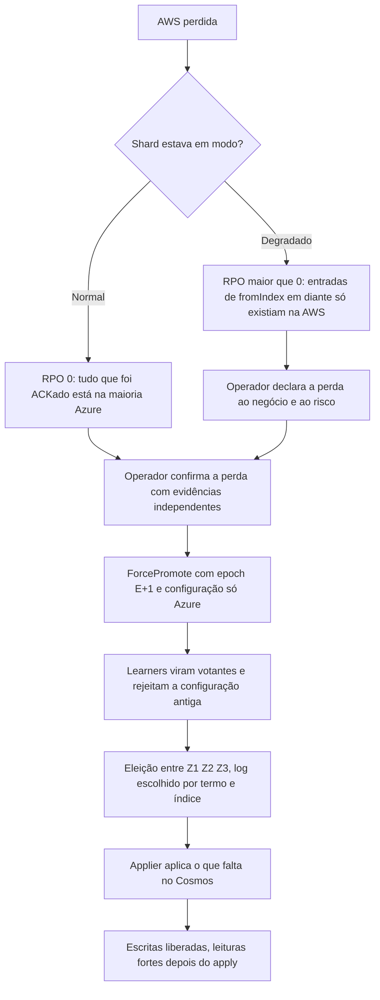

# X03 — Desastre: promoção da Azure, fencing e reconciliação

**Status:** Provisório (PEND-01 aberta); procedimento humano · **ADRs:** [ADR-033](../../03_adr/ADR-033-promocao-da-azure-humana.md), [ADR-014](../../03_adr/ADR-014-modo-degradado-opcao-b.md)

## Cenário

Quando a AWS é perdida, só uma pessoa promove a Azure (`ForcePromote`). Este documento junta os cenários C14, C15 e C16 com a mecânica de epoch, a escolha do log e o tratamento de escritas órfãs. A decisão de promoção automática está com os outros arquitetos e **não deve ser reaberta** sem a resposta do Bruno.

## Diagrama: promoção

## Etapas

1. **Evidências:** status oficial do provedor, alcance da AWS a partir de várias origens externas, visão do Compass-Router.
2. **Epoch:** `ForcePromote` grava E+1 e uma configuração só com a Azure; a antiga é revogada para sempre.
3. **Escolha do log:** como numa eleição, por (termo, índice). Entradas replicadas aos learners mas nunca commitadas podem existir; o cliente que recebeu `PENDING` trata o resultado como desconhecido.
4. **Fencing no banco:** cada célula tem o seu banco e o seu applier (um escritor por tabela), o que reduz o problema, mas **não elimina** a necessidade de impedir que um applier antigo da AWS volte a escrever; decidido como boot cercado, revogação de credenciais e recriação da célula ([C30](../atualizados/C30-aws-que-volta-boot-cercado.md)).
5. **Órfãs:** entradas de `fromIndex` em diante que só existiam na AWS. Se a AWS volta, são extraídas do log local e viram um relatório por cliente e chave; reaplicar só com aprovação do negócio, nunca automático.
6. **Failback:** transferência planejada depois de a AWS entrar como learner, fazer catch-up e ser validada.

## Pontos em aberto

- Tempo de decisão humana (RTO): [R10](../a_rever/R10-operador-lento-no-desastre.md).
- API de promoção sem dependência da AWS: [R11](../a_rever/R11-api-de-promocao-depende-da-aws.md).
- Split-brain com a AWS viva: [R12](../a_rever/R12-promocao-com-aws-viva.md).
- Reconciliação de órfãs: [R13](../a_rever/R13-escritas-orfas-reconciliacao.md).
- Fencing do banco que volta: [C30](../atualizados/C30-aws-que-volta-boot-cercado.md).
