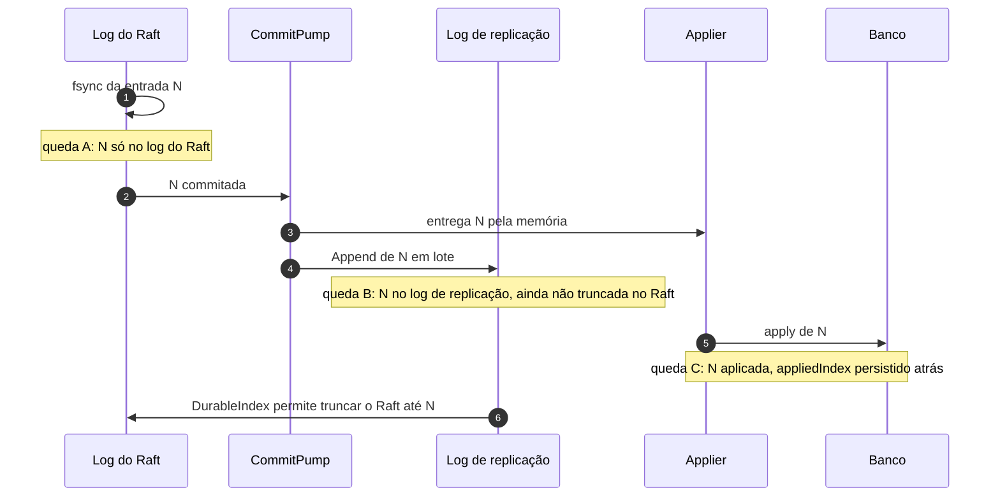

# X04 — Partida, recuperação e coerência entre os dois logs

**Status:** Decidido (ADR-018); casos de queda a cobrir nos testes · **ADRs:** [ADR-018](../../03_adr/ADR-018-dois-logs-raft-e-replicacao.md), [ADR-019](../../03_adr/ADR-019-wal-proprio-volume-dedicado.md), [ADR-034](../../03_adr/ADR-034-fsync-fatal-e-identidade-nova.md)

## Cenário

Há dois logs por réplica: o do Raft (fsync antes do ACK) e o de replicação (depois do commit, em lote). Uma queda pode acontecer entre as duas gravações. Este documento lista cada janela de queda e o que a partida faz.

## Diagrama: janelas de queda

## Etapas

1. **Queda A (N só no log do Raft):** na partida, se o log de replicação está atrás do índice commitado, ele é completado a partir do Raft antes de aceitar tráfego.
2. **Queda B (N no log de replicação):** o Raft não foi truncado; nada se perde. Regra: o Raft só é truncado até o `DurableIndex` do log de replicação.
3. **Queda C (N aplicada, `appliedIndex` atrás):** o applier reaplica em ordem a partir do `appliedIndex`; a escrita é idempotente pela versão. DELETE é refeito na ordem; o item pode reaparecer por instantes durante o replay.
4. **High-water mark:** o ponto mais alto que o applier já tinha aplicado é guardado em arquivo local (melhor esforço). As leituras só abrem depois que o applier o alcança.
5. **Cauda rasgada:** registro parcial no fim do segmento é truncado. **Corrupção no meio:** o nó recusa subir.
6. **Índice único:** o índice do log de replicação é o próprio índice Raft (sem sequência paralela).

## Falhas e tratativas

- **Segundo fsync piora a cauda do primeiro.** Os dois logs disputam o volume. Mitigação: lote maior e menos frequente no log de replicação; se a medição mostrar interferência, volume separado para cada log.

## Pontos em aberto

- Conformidade (`ReplicationLog` e `ConsensusEngine`) inclui todos os casos de queda entre os dois logs.
- Tempo total de partida (RTO do nó): [R18](../a_rever/R18-rto-nao-quantificado.md).
