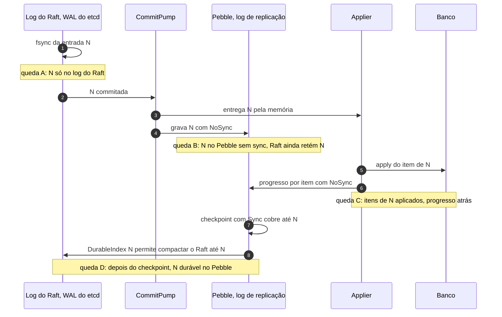

# X04 — Partida, recuperação e coerência entre os dois logs

**Status:** Decidido (ADR-018; progresso por item em 13/10, [ADR-048](../../03_adr/ADR-048-skip-por-item.md); Pebble sem fsync e checkpoint durável em 13/10, [ADR-055](../../03_adr/ADR-055-log-de-replicacao-em-pebble-derivado-do-raft.md)); casos de queda a cobrir nos testes · **ADRs:** [ADR-018](../../03_adr/ADR-018-dois-logs-raft-e-replicacao.md), [ADR-019](../../03_adr/ADR-019-wal-proprio-volume-dedicado.md), [ADR-055](../../03_adr/ADR-055-log-de-replicacao-em-pebble-derivado-do-raft.md), [ADR-034](../../03_adr/ADR-034-fsync-fatal-e-identidade-nova.md), [ADR-047](../../03_adr/ADR-047-delete-real-invariante-e-reconstrucao-em-tabela-sombra.md), [ADR-048](../../03_adr/ADR-048-skip-por-item.md)

## Cenário

Há dois logs por réplica, cada um no seu volume: o do Raft (WAL do etcd, fsync antes do ACK) e o de replicação (Pebble, gravado depois do commit **sem fsync**, com um checkpoint com sync a cada `PEBBLE_SYNC_INTERVAL`). Uma queda pode acontecer entre as gravações. Este documento lista cada janela de queda e o que a partida faz.

Há dois tipos de queda com efeitos diferentes no Pebble:
- **Queda do processo** (pânico, OOM, reinício do contêiner): o que o Pebble já entregou ao kernel continua no cache de páginas e chega ao disco. Nada se perde.
- **Queda do host** (energia, kernel, VM encerrada): o que veio depois do último checkpoint com sync pode sumir. O Pebble recupera um **prefixo** das escritas, na ordem em que foram feitas.

## Diagrama: janelas de queda

## Etapas

1. **Queda A (N só no log do Raft):** na partida, o nó abre o Pebble, lê o maior índice presente e completa o log de replicação a partir do Raft antes de aceitar tráfego.
2. **Queda B (N no Pebble sem sync):** a regra de truncamento garante que o Raft ainda tem N: **o Raft só é compactado até o `DurableIndex` do Pebble, que é o índice coberto por um checkpoint com sync**, nunca o índice apenas copiado ([ADR-055](../../03_adr/ADR-055-log-de-replicacao-em-pebble-derivado-do-raft.md)). Se N sobreviveu à queda, regravar é inofensivo (a chave é o índice); se sumiu, volta pelo passo 1.
3. **Queda C (N aplicada em parte, progresso atrás):** o applier guarda o progresso **por item**, `(índice, ordem)`, no Pebble (não no banco). Na partida ele reaplica em ordem a partir desse ponto; a escrita é idempotente pela versão, então os itens já aplicados de um lote são reaplicados sem efeito e um item marcado por `SKIP` é pulado sozinho ([ADR-048](../../03_adr/ADR-048-skip-por-item.md), [C26](../atualizados/C26-entrada-venenosa.md)). DELETE é refeito na ordem; o item pode reaparecer por instantes durante o replay. Com o Pebble sem sync, o progresso pode voltar até um checkpoint atrás: o replay fica maior, não errado. Como progresso e truncamento estão no mesmo Pebble e ele recupera um prefixo, nunca sobra um truncamento sem o progresso que o permitiu.
4. **High-water mark e I-DEL:** o ponto mais alto que o applier já tinha aplicado fica no Pebble. As leituras só abrem depois que o applier o alcança. Essa regra é a que sustenta a invariante **I-DEL** (com as leituras abertas, o estado materializado é a dobra do log até `applied`): é imposta por código e coberta por teste de propriedade e pelo modelo TLA+ ([ADR-047](../../03_adr/ADR-047-delete-real-invariante-e-reconstrucao-em-tabela-sombra.md), [X06](X06-delete-ttl-gsi.md)). Como o high-water mark pode voltar até um checkpoint atrás numa queda de host, **a proposta é abrir as leituras só quando o applier alcançar o índice de commit recuperado do `HardState` do Raft**, que é sempre maior ou igual ao que já tinha sido aplicado (o apply nunca passa do gate, e o gate nunca passa do commit). Os caminhos que **não passam pelo checkpoint** (reconstrução, restauração PITR, cópia de outra célula) não têm essa proteção e usam o protocolo da tabela sombra ([C33](../atualizados/C33-reconstrucao-em-tabela-sombra.md)).
5. **Leitura forte depois da partida:** além do high-water mark, a líder recém-eleita só atende leitura forte depois de reconstruir o gate ([ADR-049](../../03_adr/ADR-049-barreira-da-leitura-forte-e-o-gate.md), [X01](X01-gate-e-troca-de-lider.md)). Com o applier parado por entrada venenosa, a leitura forte falha rápido com `503`.
6. **Cauda rasgada e corrupção:** o WAL do etcd trata o registro parcial no fim do último segmento; o Pebble descarta a cauda inválida do WAL dele. **Corrupção no meio** de qualquer um dos dois: o nó recusa subir.
7. **Índice único:** o índice do log de replicação é o próprio índice Raft (sem sequência paralela).
8. **Tabela de dedupe:** é projeção do log e é reconstruída na partida. Como o log do Raft agora é curto (segundos), ela é lida do **Pebble**; a retenção mínima do Pebble cobre a janela de dedupe de 5 min mais uma margem ([X05](X05-timeouts-e-idempotencia.md), [R22](../a_rever/R22-memoria-da-janela-de-dedupe.md)).
9. **Learner em catch-up:** o lote recebido pelo canal de catch-up é gravado no Pebble **com sync** antes de o learner informar o índice ao Raft ([C13](../atualizados/C13-ressincronizacao-da-azure.md)).

## Falhas e tratativas

- **Erro de escrita ou de sync no Pebble.** Fatal para o processo, como o fsync do Raft ([ADR-034](../../03_adr/ADR-034-fsync-fatal-e-identidade-nova.md)). Na volta, o trecho perdido vem do Raft (passo 1).
- **Perda só do volume do Pebble.** O Raft do nó está inteiro, mas guarda só segundos; o histórico para a Azure, o progresso do applier e o high-water mark se perdem. Padrão adotado: tratar como disco perdido, e o nó volta com **identidade nova** ([ADR-034](../../03_adr/ADR-034-fsync-fatal-e-identidade-nova.md)). A alternativa (manter a identidade e recarregar o histórico de um par) está nas [perguntas para o Bruno](../../06_pendencias_e_riscos/03_perguntas_para_o_bruno.md).
- **Checkpoint parado (volume do Pebble lento ou cheio).** O `DurableIndex` para, o Raft deixa de ser compactado e cresce no volume pequeno dele e na memória do `MemoryStorage`. Métrica `raft_log_bytes` com alerta; risco 31.
- **High-water mark perdido.** Coberto pela proposta do passo 4 (abrir leituras no commit do `HardState`); falta fixar no desenho e testar.

## Pontos em aberto

- Conformidade (`ReplicationLog` e `ConsensusEngine`) inclui todos os casos de queda entre os dois logs, com **queda de host simulada** (descartar o que o Pebble gravou depois do último sync), e não só queda de processo.
- Valor de `PEBBLE_SYNC_INTERVAL` e de `RAFT_RETAIN_MAX` (PEND-22).
- Tempo total de partida (RTO do nó, medido em exercícios de falha como distribuição): [R18](../a_rever/R18-rto-nao-quantificado.md). A reabertura do Pebble com WAL longo entra na medição.
