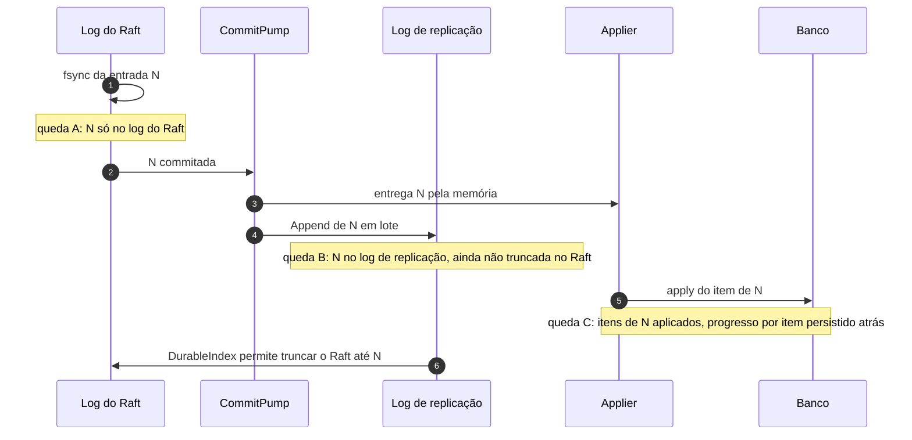

# X04 — Partida, recuperação e coerência entre os dois logs

**Status:** Decidido (ADR-018; progresso por item em 13/10, [ADR-048](../../03_adr/ADR-048-skip-por-item.md)); casos de queda a cobrir nos testes · **ADRs:** [ADR-018](../../03_adr/ADR-018-dois-logs-raft-e-replicacao.md), [ADR-019](../../03_adr/ADR-019-wal-proprio-volume-dedicado.md), [ADR-034](../../03_adr/ADR-034-fsync-fatal-e-identidade-nova.md), [ADR-047](../../03_adr/ADR-047-delete-real-invariante-e-reconstrucao-em-tabela-sombra.md), [ADR-048](../../03_adr/ADR-048-skip-por-item.md)

## Cenário

Há dois logs por réplica: o do Raft (fsync antes do ACK) e o de replicação (depois do commit, em lote). Uma queda pode acontecer entre as duas gravações. Este documento lista cada janela de queda e o que a partida faz.

## Diagrama: janelas de queda

## Etapas

1. **Queda A (N só no log do Raft):** na partida, se o log de replicação está atrás do índice commitado, ele é completado a partir do Raft antes de aceitar tráfego.
2. **Queda B (N no log de replicação):** o Raft não foi truncado; nada se perde. Regra: o Raft só é truncado até o `DurableIndex` do log de replicação.
3. **Queda C (N aplicada em parte, progresso atrás):** o applier guarda o progresso **por item**, `(índice, ordem)`, no volume do log (não no banco). Na partida ele reaplica em ordem a partir desse ponto; a escrita é idempotente pela versão, então os itens já aplicados de um lote são reaplicados sem efeito e um item marcado por `SKIP` é pulado sozinho ([ADR-048](../../03_adr/ADR-048-skip-por-item.md), [C26](../atualizados/C26-entrada-venenosa.md)). DELETE é refeito na ordem; o item pode reaparecer por instantes durante o replay.
4. **High-water mark e I-DEL:** o ponto mais alto que o applier já tinha aplicado é guardado em arquivo local (melhor esforço). As leituras só abrem depois que o applier o alcança. Essa regra é a que sustenta a invariante **I-DEL** (com as leituras abertas, o estado materializado é a dobra do log até `applied`): é imposta por código e coberta por teste de propriedade e pelo modelo TLA+ ([ADR-047](../../03_adr/ADR-047-delete-real-invariante-e-reconstrucao-em-tabela-sombra.md), [X06](X06-delete-ttl-gsi.md)). Os caminhos que **não passam pelo checkpoint** (reconstrução, restauração PITR, cópia de outra célula) não têm essa proteção e usam o protocolo da tabela sombra ([C33](../atualizados/C33-reconstrucao-em-tabela-sombra.md)).
5. **Leitura forte depois da partida:** além do high-water mark, a líder recém-eleita só atende leitura forte depois de reconstruir o gate ([ADR-049](../../03_adr/ADR-049-barreira-da-leitura-forte-e-o-gate.md), [X01](X01-gate-e-troca-de-lider.md)). Com o applier parado por entrada venenosa, a leitura forte falha rápido com `503`.
6. **Cauda rasgada:** registro parcial no fim do segmento é truncado. **Corrupção no meio:** o nó recusa subir.
7. **Índice único:** o índice do log de replicação é o próprio índice Raft (sem sequência paralela).
8. **Tabela de dedupe:** é projeção do log e é reconstruída na partida pelo trecho recente do log do Raft (ou pelo de replicação, se a retenção não cobrir a janela). O dedupe é **por requisição**, não por item ([X05](X05-timeouts-e-idempotencia.md), [R22](../a_rever/R22-memoria-da-janela-de-dedupe.md)).

## Falhas e tratativas

- **Segundo fsync piora a cauda do primeiro.** Os dois logs disputam o volume. Mitigação: lote maior e menos frequente no log de replicação; se a medição mostrar interferência, volume separado para cada log.
- **Arquivo do high-water mark ausente ou corrompido.** É melhor esforço; o critério conservador de abertura de leitura nesse caso precisa ser fixado no desenho e testado.

## Pontos em aberto

- Conformidade (`ReplicationLog` e `ConsensusEngine`) inclui todos os casos de queda entre os dois logs, inclusive queda no meio de um lote (progresso por item).
- Tempo total de partida (RTO do nó, medido em exercícios de falha como distribuição): [R18](../a_rever/R18-rto-nao-quantificado.md).
