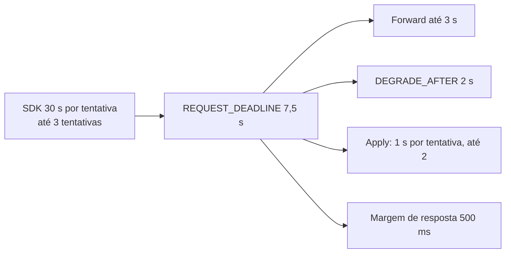

# X05 — Timeouts em cascata e idempotência do retry

**Status:** Decidido (D11, D13); valores a validar · **ADRs:** [ADR-026](../../03_adr/ADR-026-dedupe-de-retry-id-estavel.md), [ADR-028](../../03_adr/ADR-028-timeouts-em-cascata.md)

## Cenário

O SDK desiste em 30 s por tentativa, com no máximo 3 tentativas. O `DataReplication` responde (sucesso ou erro definido) bem antes disso e garante que o retry não duplica a escrita. Este documento reúne a cascata de prazos e o cálculo da janela de dedupe.

## Diagrama

## Etapas

1. **Cascata:** `REQUEST_DEADLINE = CLIENT_TIMEOUT / 4`; `DEGRADE_AFTER` e os prazos internos sempre menores que o externo; validado na partida.
2. **O prazo nasce na borda** (`context.WithTimeout` no adaptador de entrada) e desce por todas as camadas; ninguém cria prazo maior que o recebido; nenhuma chamada usa `context.Background()`.
3. **Prazo estourado depois do commit:** `503 PENDING`. A escrita não se perde.
4. **Identificador estável:** os SDKs da AWS enviam o header `amz-sdk-invocation-id`, igual em todas as tentativas de uma mesma chamada, e `amz-sdk-request` com `attempt` e `max`. É o candidato natural a identificador de dedupe, mas **precisa ser verificado em cada SDK (Java 2.x, Go v2, .NET v4) na suíte de compatibilidade**. Um retry da própria aplicação gera chamada nova (id novo) e não é coberto.
5. **Janela de dedupe:** `máx. de tentativas × (REQUEST_DEADLINE + backoff máximo) + folga`, com 3 tentativas fica em ~25 a 130 s; adotada a janela de **5 min**.
6. **Memória:** 5 min × 3.000 TPS ≈ 900 mil entradas × ~64 B ≈ 58 MiB (R22).
7. **BatchWriteItem:** o lote vira uma entrada ([ADR-035](../../03_adr/ADR-035-lote-batchwriteitem-uma-entrada-e-apply-condicional.md), [C23](../atualizados/C23-batchwriteitem-lote-uma-entrada.md)); o dedupe é por chamada (id do SDK), o que evita o falso positivo do hash por conteúdo.

## Falhas e tratativas

- **Hash do conteúdo como fallback.** Pode confundir duas escritas legítimas iguais (um contador regravado com o mesmo valor) com retry.
- **Aplicação com retry próprio.** Fora da janela e fora da cobertura; informar os times de aplicação.

## Pontos em aberto

- Verificação do header por SDK: spike S5.
- Memória da janela: [R22](../a_rever/R22-memoria-da-janela-de-dedupe.md).
- Lote do `BatchWriteItem`: [C23](../atualizados/C23-batchwriteitem-lote-uma-entrada.md).
