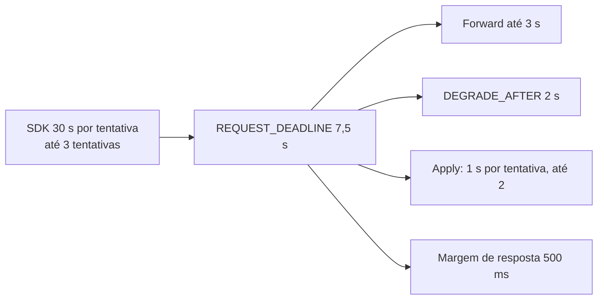

# X05 — Timeouts em cascata e idempotência do retry

**Status:** Decidido (D11, D13; limite da idempotência documentado em 13/10, [ADR-051](../../03_adr/ADR-051-compatibilidade-dynamodb-inventario-conformidade-e-idempotencia.md)); valores a validar · **ADRs:** [ADR-026](../../03_adr/ADR-026-dedupe-de-retry-id-estavel.md), [ADR-028](../../03_adr/ADR-028-timeouts-em-cascata.md), [ADR-035](../../03_adr/ADR-035-lote-batchwriteitem-uma-entrada-e-apply-condicional.md), [ADR-048](../../03_adr/ADR-048-skip-por-item.md), [ADR-051](../../03_adr/ADR-051-compatibilidade-dynamodb-inventario-conformidade-e-idempotencia.md)

## Cenário

O SDK desiste em 30 s por tentativa, com no máximo 3 tentativas. O `DataReplication` responde (sucesso ou erro definido) bem antes disso e garante que o retry **dentro da janela** não duplica a escrita. Este documento reúne a cascata de prazos, o cálculo da janela de dedupe e o limite honesto dessa garantia.

## Diagrama

## Etapas

1. **Cascata:** `REQUEST_DEADLINE = CLIENT_TIMEOUT / 4`; `DEGRADE_AFTER` e os prazos internos sempre menores que o externo; validado na partida.
2. **O prazo nasce na borda** (`context.WithTimeout` no adaptador de entrada) e desce por todas as camadas; ninguém cria prazo maior que o recebido; nenhuma chamada usa `context.Background()`. O `WriteTimeout` do servidor HTTP deve ser maior que o `REQUEST_DEADLINE`, para a resposta de erro definida chegar ao cliente.
3. **Prazo estourado depois do commit:** `503 PENDING`. A escrita não se perde; o resultado é desconhecido para o cliente. Sem a Azure e com `DEGRADED_POLICY=reject`, também `503 PENDING`. O `503 LEASE_EXPIRED` (fim do lease do modo degradado, [X02](X02-modo-degradado.md)) é outro caso: a escrita não foi confirmada.
4. **Identificador estável:** os SDKs da AWS enviam o header `amz-sdk-invocation-id`, igual em todas as tentativas de uma mesma chamada, e `amz-sdk-request` com `attempt` e `max`. É o candidato natural a identificador de dedupe, mas **precisa ser verificado em cada SDK (Java 2.x, Go v2, .NET v4) na suíte de compatibilidade** ([ADR-051](../../03_adr/ADR-051-compatibilidade-dynamodb-inventario-conformidade-e-idempotencia.md)). Um retry da própria aplicação gera chamada nova (id novo) e não é coberto.
5. **Janela de dedupe:** `máx. de tentativas × (REQUEST_DEADLINE + backoff máximo) + folga`, com 3 tentativas fica em ~25 a 130 s; adotada a janela de **5 min**.
6. **Memória:** 5 min × 3.000 TPS ≈ 900 mil entradas × ~64 B ≈ 58 MiB (R22).
7. **Dedupe por requisição:** a chave do dedupe é o identificador da **requisição** (a chamada do SDK), não o item. No `BatchWriteItem`, o lote vira uma entrada ([ADR-035](../../03_adr/ADR-035-lote-batchwriteitem-uma-entrada-e-apply-condicional.md), [C23](../atualizados/C23-batchwriteitem-lote-uma-entrada.md)) e o retry do lote inteiro é reconhecido como retry pelo id da chamada, o que evita o falso positivo do hash por conteúdo. Não existe dedupe por item.
8. **Resultado por item na consulta:** quem recebeu `PENDING` consulta pelo identificador da requisição e recebe o resultado **por item**: `APPLIED`, `REJECTED` ou `PENDING` ([ADR-048](../../03_adr/ADR-048-skip-por-item.md)). Um item pulado por `SKIP` (índice, ordem) aparece como `REJECTED` e os demais seguem aplicados, como no sucesso parcial do `BatchWriteItem` do DynamoDB ([C26](../atualizados/C26-entrada-venenosa.md)).
9. **Limite da idempotência (documentado):** o dedupe vale por requisição e dentro da janela de 5 min. Fora dela vale a semântica do DynamoDB: um `PutItem` cego repetido depois da janela sobrescreve uma versão mais nova, **também no DynamoDB**; a camada não piora isso. O defeito de fundo é outro: a **escrita condicional está fora da v1** ([ADR-025](../../03_adr/ADR-025-escopo-da-api-v1-e-sdks.md)), então uma aplicação com concorrência otimista (versão, saldo) não tem como se proteger pela camada. Por isso há o levantamento do uso real de `ConditionExpression` em cada cliente antes de ele entrar; se depender, a decisão de antecipar a v1.1 volta ao Bruno. Um identificador durável de operação de negócio seria extensão fora do contrato DynamoDB e não foi adotado.

## Falhas e tratativas

- **Hash do conteúdo como fallback.** Pode confundir duas escritas legítimas iguais (um contador regravado com o mesmo valor) com retry.
- **Aplicação com retry próprio.** Fora da janela e fora da cobertura; informar os times de aplicação e registrar no inventário do cliente.
- **Retry depois da troca de líder.** A tabela de dedupe é projeção do log e existe em todos os votantes, então a líder nova reconhece o retry (propriedade P14 do modelo, [X01](X01-gate-e-troca-de-lider.md)).

## Pontos em aberto

- Verificação do header por SDK: spike S5 e suíte de conformidade (PEND-16).
- Inventário real de chamadas e uso de condicional por cliente (PEND-15).
- Memória da janela: [R22](../a_rever/R22-memoria-da-janela-de-dedupe.md).
- Lote do `BatchWriteItem`: [C23](../atualizados/C23-batchwriteitem-lote-uma-entrada.md).
