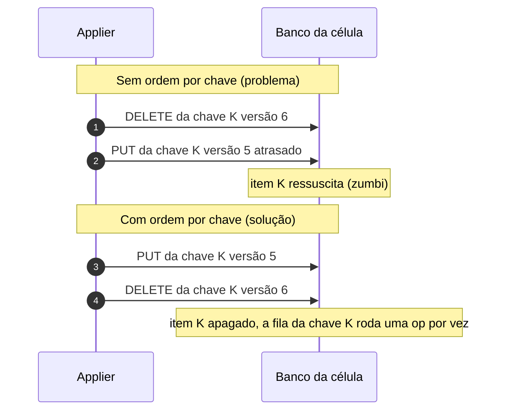

# X06 — DELETE, TTL, Scan e GSI

**Status:** Decidido (ADR-024; invariante I-DEL, tabela sombra e GSI em 13/10: ADR-047 e ADR-050); falta a prova no TLA+ e o teste de propriedade · **ADRs:** [ADR-024](../../03_adr/ADR-024-delete-real-ttl-local-gsi.md), [ADR-047](../../03_adr/ADR-047-delete-real-invariante-e-reconstrucao-em-tabela-sombra.md), [ADR-050](../../03_adr/ADR-050-query-em-gsi-recusada.md), [ADR-015](../../03_adr/ADR-015-wal-post-image-e-versao.md) · **Relacionados:** [C33](../atualizados/C33-reconstrucao-em-tabela-sombra.md), [X04](X04-partida-recuperacao-e-dois-logs.md)

## Cenário

Alguns clientes usam TTL na tabela, poucos usam Scan e algumas Query usam GSI. A escolha foi por DELETE real com ordem por chave no applier, sem tombstone na v1. A segurança disso não é intuitiva, então ela é escrita como invariante (I-DEL) e coberta por prova e teste. O detalhe completo (opções A a D e o raciocínio) está em [05_dados_versao_delete_ttl_gsi_e_banco_por_celula](../../01_arquitetura/05_dados_versao_delete_ttl_gsi_e_banco_por_celula.md).

## Diagrama: zumbi e a ordem por chave

## Etapas

1. **DELETE real:** `DeleteItem` comum; nada vaza para os clientes (Streams, TTL e Scan ficam como estão). **Sem tombstone na v1.**
2. **Ordem por chave:** operações da mesma chave rodam uma de cada vez, na ordem do log; chaves diferentes seguem em paralelo (o apply acontece sempre depois do gate, nunca em paralelo com a espera da Azure, [ADR-057](../../03_adr/ADR-057-um-unico-modo-strong-consistency.md)). Reforço: delete condicional por versão.
3. **Invariante I-DEL:** com as leituras abertas, o estado materializado da célula é a dobra do log até `applied`. A regra "as leituras só abrem depois do high-water mark" é imposta **por código** e provada por teste de propriedade (sequências aleatórias de Put e Delete, com queda em qualquer ponto, convergem para o mesmo estado) e pelo modelo TLA+ ([X01](X01-gate-e-troca-de-lider.md), P16).
4. **Replay após queda:** reaplica em ordem a partir do checkpoint: `Put(10)` recria a chave e `Delete(11)` a remove de novo. O item pode reaparecer por instantes durante o replay, e a regra do item 3 o esconde ([X04](X04-partida-recuperacao-e-dois-logs.md)).
5. **Caminhos sem checkpoint:** reconstrução, restauração PITR e cópia de outra célula **não passam** pelo checkpoint e não têm a proteção acima. Usam o protocolo de **reconstrução em tabela sombra** ([ADR-047](../../03_adr/ADR-047-delete-real-invariante-e-reconstrucao-em-tabela-sombra.md), [C33](../atualizados/C33-reconstrucao-em-tabela-sombra.md)): registrar o índice F e reter o log desde F; copiar por varredura para a tabela sombra com a condição de versão; reaplicar o log desde F até a cabeça; pausar a escrita da célula e fazer o cutover do nome lógico (com geração); verificar por checksum por faixa de chaves antes de religar as leituras. O Cosmos precisa do mesmo protocolo pelo Cloud-Adapter.
6. **TTL do cliente:** a expiração é local a cada célula e **não é replicada**; o Cloud-Adapter traduz o TTL para o Cosmos. Uma leitura pode ainda devolver o item em uma célula e não em outra até a remoção tardia. Um replay pode recriar um item já expirado até o TTL local apagá-lo de novo: o comportamento é igual ao do DynamoDB, onde o item expirado pode ser lido até a remoção, e é documentado para os clientes.
7. **Scan:** funciona normalmente; sem snapshot entre as páginas.
8. **Query em GSI:** toda `Query` ou `Scan` com `IndexName` de GSI é **recusada** com `ValidationException` (HTTP 400), com ou sem `ConsistentRead` ([ADR-050](../../03_adr/ADR-050-query-em-gsi-recusada.md)): o índice global nunca é forte e o `DataReplication` tem um único modo, strong ([ADR-057](../../03_adr/ADR-057-um-unico-modo-strong-consistency.md)). As aplicações que usam GSI mudam o padrão de acesso antes de entrar na camada. Some também a assimetria de índice entre DynamoDB e Cosmos depois do failover.

## Falhas e tratativas

- **Zumbi observado nos testes.** A alternativa registrada é uma **tabela separada de tombstones consultada só em replay e rebuild**, com uma escrita extra por DELETE; na escrita nova o índice é maior que tudo e a condição `v < índice` basta. Tombstone dentro do item foi descartado: obriga a filtrar `Query`, `Scan` e GSI e muda o conteúdo das páginas com `Limit`.
- **Rebuild mais lento que a retenção do log.** Se a varredura demorar mais que a retenção do teto de 70% ([ADR-041](../../03_adr/ADR-041-disco-do-log-teto-de-70-por-cento-sem-s3-na-v1.md)), o rebuild falha e recomeça.
- **Custo da varredura.** WCU no DynamoDB e RU no Cosmos durante a cópia; a anti-entropia por checksum detecta divergência, não a previne.

## Pontos em aberto

- Prova de I-DEL no TLA+ e teste de propriedade: entram no plano da fase 1 ([ADR-030](../../03_adr/ADR-030-verificacao-formal-tla.md)).
- Reconstrução de réplica a partir de uma cópia antiga é coberta pelo protocolo da tabela sombra; a tabela de tombstones só entra se os testes mostrarem zumbi (H-DR1).
