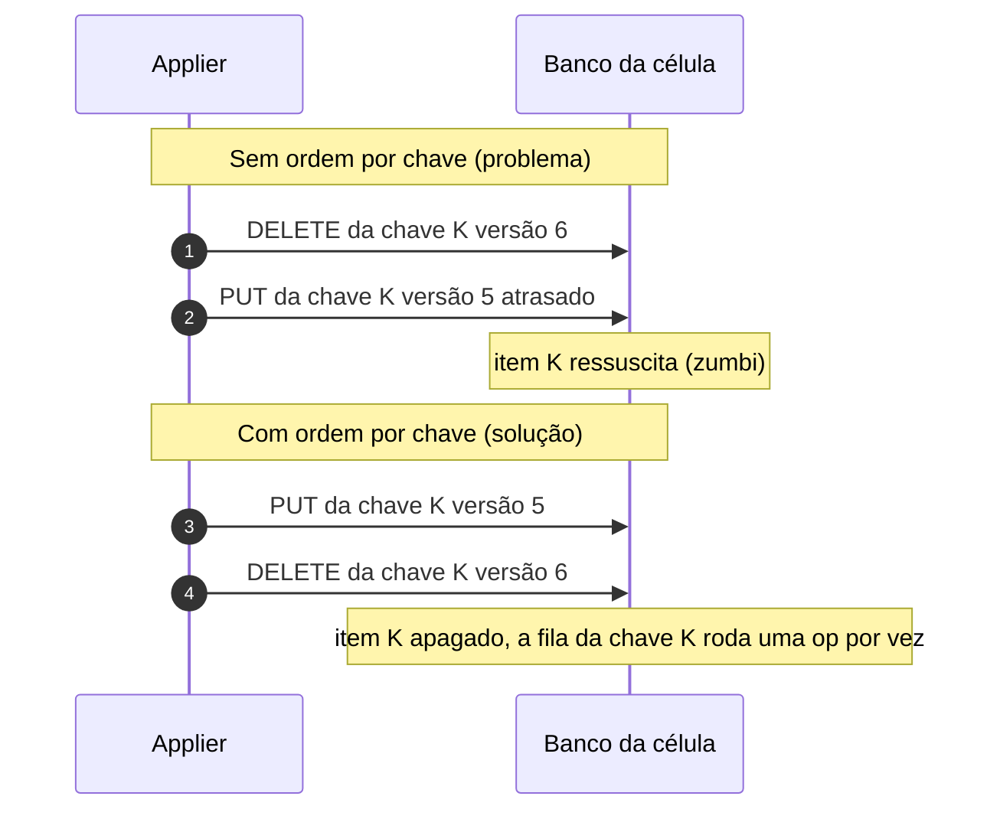

# X06 — DELETE, TTL, Scan e GSI

**Status:** Decidido (ADR-024) · **ADRs:** [ADR-024](../../03_adr/ADR-024-delete-real-ttl-local-gsi.md), [ADR-015](../../03_adr/ADR-015-wal-post-image-e-versao.md)

## Cenário

Alguns clientes usam TTL na tabela, poucos usam Scan e algumas Query usam GSI. A escolha foi por DELETE real com ordem por chave no applier, sem tombstone. O detalhe completo (opções A a D e o raciocínio) está em [05_dados_versao_delete_ttl_gsi_e_banco_por_celula](../../01_arquitetura/05_dados_versao_delete_ttl_gsi_e_banco_por_celula.md).

## Diagrama: zumbi e a ordem por chave

## Etapas

1. **DELETE real:** `DeleteItem` comum; nada vaza para os clientes (Streams, TTL, Scan e GSI ficam como estão).
2. **Ordem por chave:** operações da mesma chave rodam uma de cada vez, na ordem do log; chaves diferentes seguem em paralelo. Reforço: delete condicional por versão.
3. **Replay após queda:** reaplica em ordem; o item pode reaparecer por instantes, por isso as leituras só abrem depois do high-water mark.
4. **TTL do cliente:** a expiração é local a cada célula e **não é replicada**; o Cloud-Adapter traduz o TTL para o Cosmos. Uma leitura pode ainda devolver o item em uma célula e não em outra até a remoção tardia.
5. **Scan:** funciona normalmente; sem snapshot entre as páginas.
6. **Query em GSI:** `ConsistentRead` não é aceito em GSI; a barreira de `appliedIndex` vale na tabela base e a leitura é forte "até a propagação do índice".

## Pontos em aberto

- Reconstrução de réplica a partir de uma cópia antiga pode reabrir a opção do tombstone (H-DR1).
