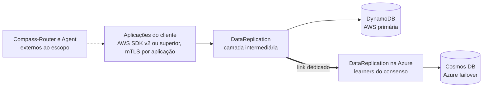
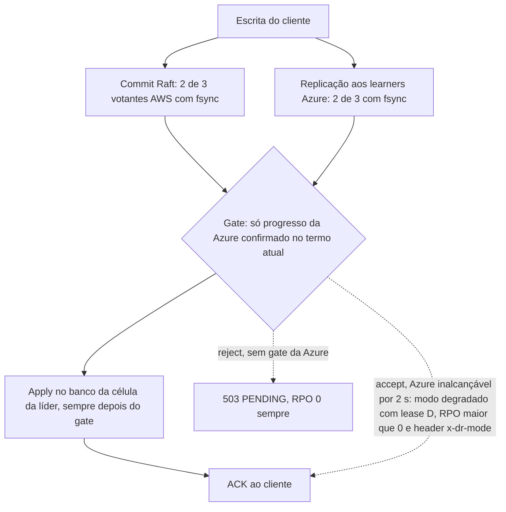

# D01 — Visão do sistema numa página

[Início](../00_COMECE_AQUI.md) · [Documento principal](../DataReplication_Versao_1.md) · [Índice de diagramas](INDEX.md)

O problema e a solução em um desenho: a aplicação escreve como se falasse com o DynamoDB (agora com um certificado cliente, mTLS por aplicação); a camada só confirma depois que o dado está durável na AWS **e** na Azure. Cada instalação escolhe `DEGRADED_POLICY`: `accept` (modo degradado limitado por lease) ou `reject` (sem gate, `503 PENDING`, RPO 0 sempre).

## Contexto

## Regra do ACK

## Onde é detalhado

- Problema, solução e restrições: [documento principal](../DataReplication_Versao_1.md).
- Estrutura detalhada: [C01](../02_cenarios/atualizados/C01-visao-geral.md) e [C02](../02_cenarios/atualizados/C02-dentro-da-celula.md).
- Gate: [D05](D05-gate-e-quorum.md) e [X01](../02_cenarios/complexos/X01-gate-e-troca-de-lider.md). Lease e política: [D06](D06-estados-do-shard-e-do-no.md), [C32](../02_cenarios/atualizados/C32-particao-e-lease-do-modo-degradado.md), [ADR-044](../03_adr/ADR-044-lease-do-modo-degradado-e-promocao-da-azure.md) e [ADR-045](../03_adr/ADR-045-politica-de-degradacao-por-instalacao.md).
