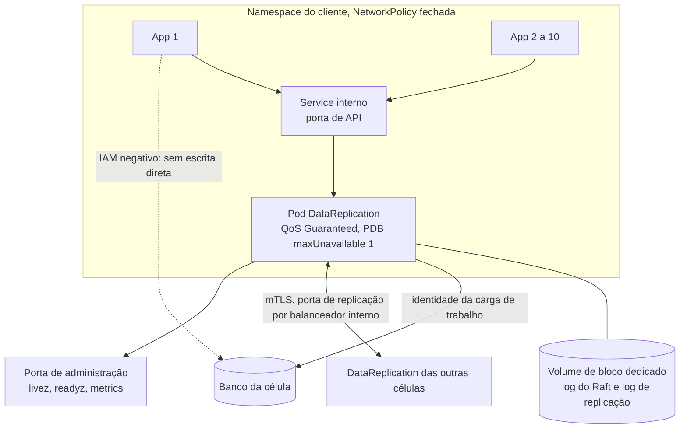

# D02 — Implantação de uma célula no Kubernetes

[Início](../00_COMECE_AQUI.md) · [Documento principal](../DataReplication_Versao_1.md) · [Índice de diagramas](INDEX.md)

Cada célula é um cluster (EKS ou AKS) em uma AZ. No namespace do cliente rodam as aplicações e **um** pod `DataReplication`, sem sidecar e sem HPA. O volume do log é dedicado, e a imposição "só o `DataReplication` escreve no banco" é feita por IAM.

## Dentro de uma célula

## Onde é detalhado

- Modelo e riscos: [01_forma_do_app_e_escopo](../01_arquitetura/01_forma_do_app_e_escopo.md) (seção 3).
- Probes, PDB e desligamento limpo: [08_resiliencia_autocura_e_timeouts](../01_arquitetura/08_resiliencia_autocura_e_timeouts.md) (9.2).
- Rede, identidade e imagem: [09_12factors_cloud_native_e_sdks](../01_arquitetura/09_12factors_cloud_native_e_sdks.md) (seção 11) e [C31](../02_cenarios/atualizados/C31-implantacao-por-cliente-e-identidade.md).
