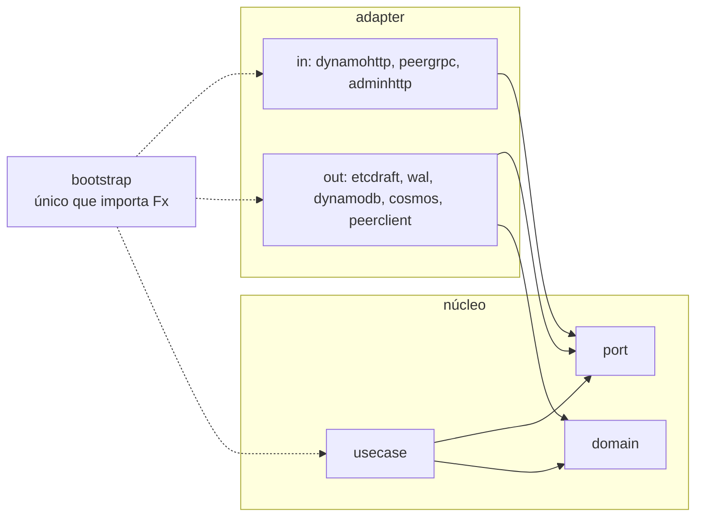

# D03 — Camadas: ports and adapters

[Início](../00_COMECE_AQUI.md) · [Documento principal](../DataReplication_Versao_1.md) · [Índice de diagramas](INDEX.md)

A dependência aponta sempre para dentro. O núcleo (`domain` + `usecase`) só conhece interfaces (`port`); Raft, log, bancos e HTTP são adaptadores. Só `bootstrap` e `cmd` importam o Fx.

## Regra de dependência

## Onde é detalhado

- Estrutura de pastas e regras de lint: [05_implementacao/01](../05_implementacao/01_principios_bibliotecas_e_pastas.md).
- Desenho completo e diagramas de processo: [05_implementacao/02](../05_implementacao/02_desenho_e_diagramas.md).
- Decisão: [ADR-031](../03_adr/ADR-031-hexagonal-e-bibliotecas.md).
