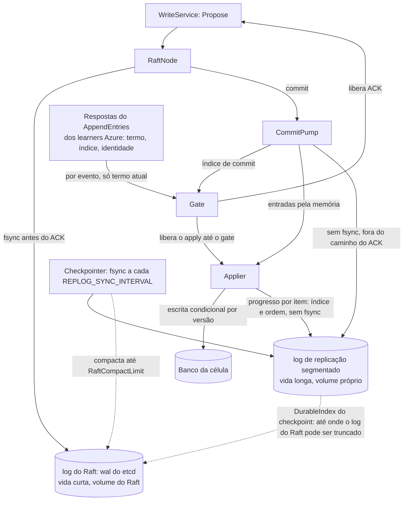

# D04 — Os dois logs e o CommitPump

[Início](../00_COMECE_AQUI.md) · [Documento principal](../DataReplication_Versao_1.md) · [Índice de diagramas](INDEX.md)

O **log do Raft** (`wal` do etcd, volume próprio) é curto e tem fsync antes do ACK. O **log de replicação** (log segmentado próprio, outro volume, [ADR-055](../03_adr/ADR-055-log-de-replicacao-segmentado-derivado-do-raft.md)) é nosso, longo, gravado depois do commit **sem fsync**, com checkpoint com sync periódico, e serve a Azure atrasada, o `drctl` e a reconstrução. O `CommitPump` liga o commit ao gate, ao applier (pela memória) e ao log de replicação. O **gate é alimentado por evento**: cada resposta de `AppendEntries` dos learners Azure (termo, índice, identidade) o atualiza na hora, sem esperar um novo commit. O applier só avança até o gate e persiste o progresso **por item** no volume do log.

## Caminho do dado em um nó

## Onde é detalhado

- Desenho: [03_consenso_raft_quorum_e_gate](../01_arquitetura/03_consenso_raft_quorum_e_gate.md) (5.5 e 5.5.1) e [ADR-018](../03_adr/ADR-018-dois-logs-raft-e-replicacao.md).
- Gate por termo e por evento: [03_consenso_raft_quorum_e_gate](../01_arquitetura/03_consenso_raft_quorum_e_gate.md) (5.3.1) e [ADR-046](../03_adr/ADR-046-gate-so-conta-progresso-validado-pelo-raft.md).
- Retenção, progresso por item e fsync: [04_wal_e_fsync](../01_arquitetura/04_wal_e_fsync.md) (6.3.1) e [ADR-048](../03_adr/ADR-048-skip-por-item.md).
- Log segmentado, checkpoint e regras de retenção: [04_wal_e_fsync](../01_arquitetura/04_wal_e_fsync.md) (6.9) e [ADR-055](../03_adr/ADR-055-log-de-replicacao-segmentado-derivado-do-raft.md).
- Coerência na partida: [X04](../02_cenarios/complexos/X04-partida-recuperacao-e-dois-logs.md).
