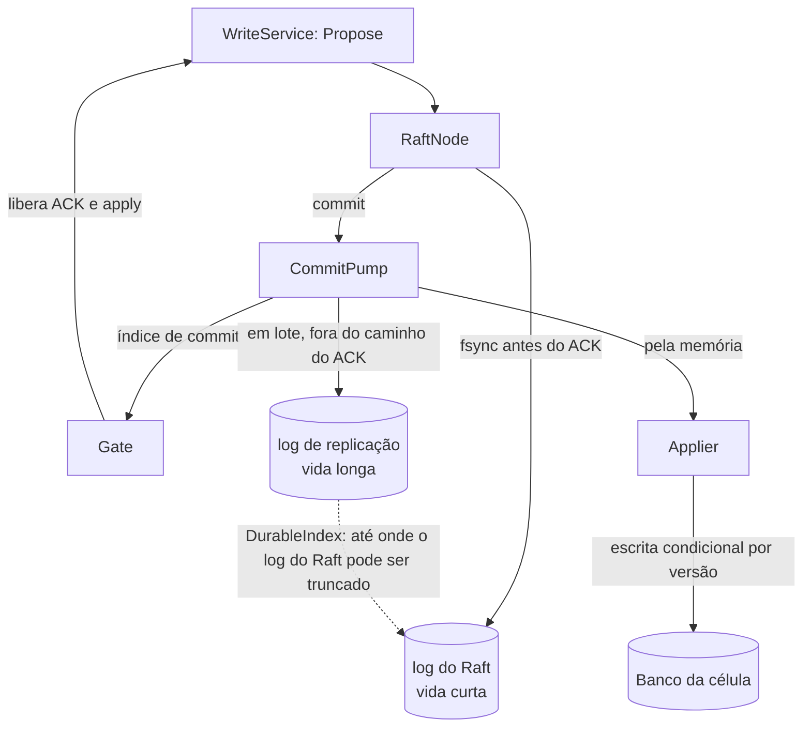

# D04 — Os dois logs e o CommitPump

[Início](../00_COMECE_AQUI.md) · [Documento principal](../DataReplication_Versao_1.md) · [Índice de diagramas](INDEX.md)

O **log do Raft** é curto e tem fsync antes do ACK. O **log de replicação** é nosso, longo, gravado em lote depois do commit, e serve a Azure atrasada, o `drctl` e a reconstrução. O `CommitPump` liga o commit ao gate, ao applier (pela memória) e ao log de replicação.

## Caminho do dado em um nó

## Onde é detalhado

- Desenho: [03_consenso_raft_quorum_e_gate](../01_arquitetura/03_consenso_raft_quorum_e_gate.md) (5.5 e 5.5.1) e [ADR-018](../03_adr/ADR-018-dois-logs-raft-e-replicacao.md).
- Retenção e fsync: [04_wal_e_fsync](../01_arquitetura/04_wal_e_fsync.md).
- Coerência na partida: [X04](../02_cenarios/complexos/X04-partida-recuperacao-e-dois-logs.md).
