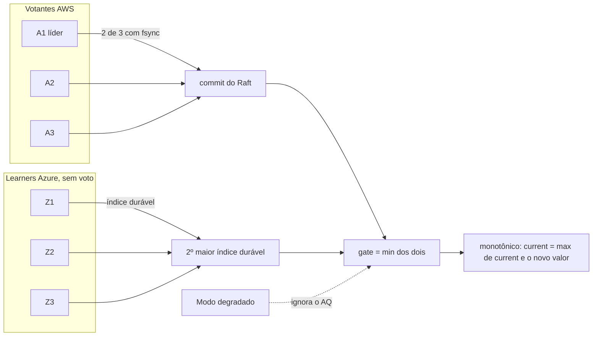

# D05 — Quórum e gate

[Início](../00_COMECE_AQUI.md) · [Documento principal](../DataReplication_Versao_1.md) · [Índice de diagramas](INDEX.md)

Só os 3 votantes AWS elegem e decidem o commit. Os 3 learners da Azure recebem as mesmas entradas e informam o índice **durável**. O gate é `min(commit do Raft, 2º maior índice durável dos learners)` e **nunca recua**. No modo degradado, a Azure sai da conta.

## Composição do gate

## Onde é detalhado

- Definição, regras e troca de líder: [X01](../02_cenarios/complexos/X01-gate-e-troca-de-lider.md) (inclui as propriedades TLA+).
- Decisões: [ADR-017](../03_adr/ADR-017-azure-learners-e-gate.md) e [ADR-029](../03_adr/ADR-029-gate-monotonico-na-troca-de-lider.md).
- Implementação do gate: [05_implementacao/03](../05_implementacao/03_exemplos_de_codigo.md) (7.2).
