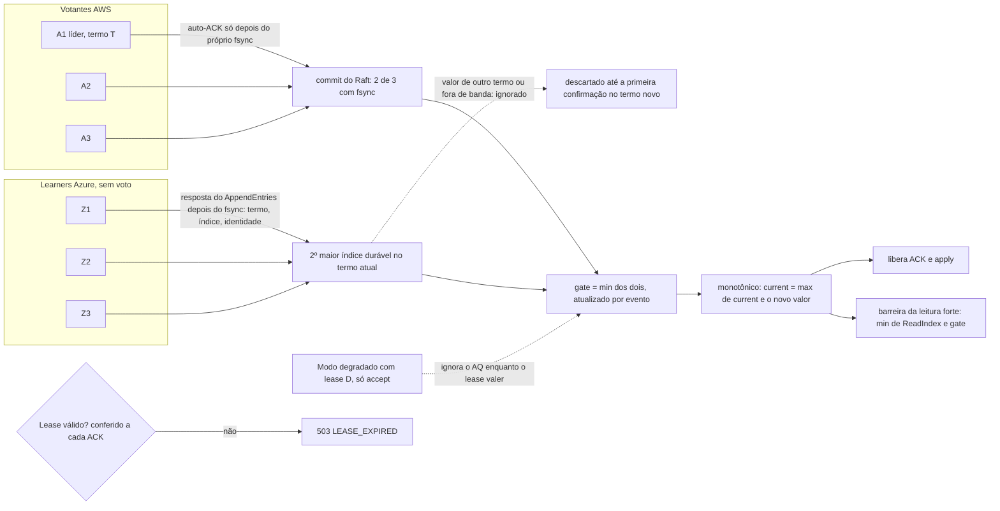

# D05 — Quórum e gate

[Início](../00_COMECE_AQUI.md) · [Documento principal](../DataReplication_Versao_1.md) · [Índice de diagramas](INDEX.md)

Só os 3 votantes AWS elegem e decidem o commit. Os 3 learners da Azure recebem as mesmas entradas e informam o índice **durável** pelas respostas do `AppendEntries`, com **termo, índice e identidade**; o gate só adota o que foi confirmado **no termo atual** e é atualizado **por evento**. O gate é `min(commit do Raft, 2º maior índice durável dos learners)` e **nunca recua**. No modo degradado (`DEGRADED_POLICY=accept`), a Azure sai da conta enquanto o lease D valer; fora do lease a AWS recusa escrita. A leitura forte espera `min(ReadIndex, gate)`. **Nada conta antes do fsync** ([ADR-056](../03_adr/ADR-056-group-commit-por-shard-e-nada-sai-antes-do-fsync.md)): a líder se conta no quórum só depois do próprio fsync, e seguidores e learners só respondem o `AppendEntries` depois do deles; o commit pode vir de dois seguidores enquanto o disco da líder ainda grava.

## Composição do gate

## Onde é detalhado

- Definição, regras e troca de líder: [X01](../02_cenarios/complexos/X01-gate-e-troca-de-lider.md) (inclui as propriedades TLA+).
- Gate por termo e por evento, nomes das métricas, lease e barreira da leitura: [03_consenso_raft_quorum_e_gate](../01_arquitetura/03_consenso_raft_quorum_e_gate.md) (5.3.1 a 5.3.4).
- Decisões: [ADR-017](../03_adr/ADR-017-azure-learners-e-gate.md), [ADR-029](../03_adr/ADR-029-gate-monotonico-na-troca-de-lider.md), [ADR-046](../03_adr/ADR-046-gate-so-conta-progresso-validado-pelo-raft.md), [ADR-044](../03_adr/ADR-044-lease-do-modo-degradado-e-promocao-da-azure.md) e [ADR-049](../03_adr/ADR-049-barreira-da-leitura-forte-e-o-gate.md).
- O que pode sair antes do fsync: [03_consenso_raft_quorum_e_gate](../01_arquitetura/03_consenso_raft_quorum_e_gate.md) (5.5.2) e [ADR-056](../03_adr/ADR-056-group-commit-por-shard-e-nada-sai-antes-do-fsync.md).
- Implementação do gate: [05_implementacao/03](../05_implementacao/03_exemplos_de_codigo.md) (7.2).
