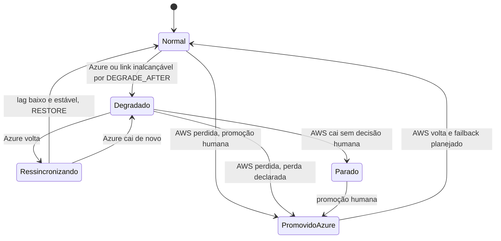
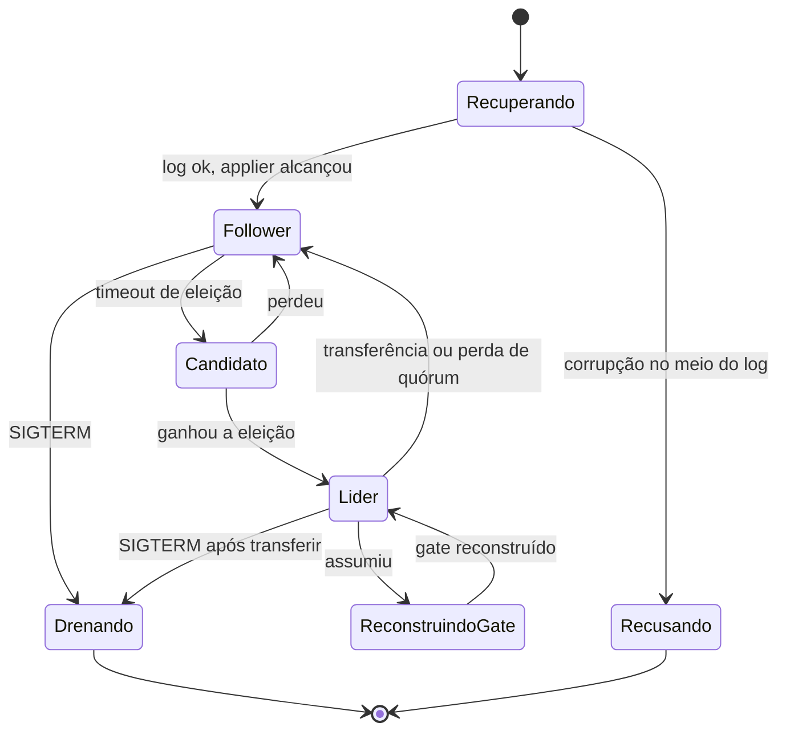

# D06 — Estados do shard e do nó

[Início](../00_COMECE_AQUI.md) · [Documento principal](../DataReplication_Versao_1.md) · [Índice de diagramas](INDEX.md)

Dois níveis: os **modos de operação do shard** (decididos pelo consenso) e os **estados do processo** em cada nó.

## Modos de operação do shard

## Estados do nó

## Onde é detalhado

- Cenários: [C17](../02_cenarios/atualizados/C17-maquina-de-estados.md) e [C18](../02_cenarios/atualizados/C18-partida-e-recuperacao-do-no.md).
- Modo degradado em detalhe: [X02](../02_cenarios/complexos/X02-modo-degradado.md).
