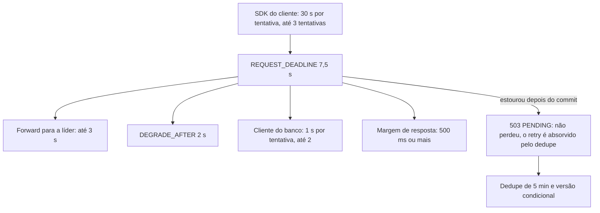

# D07 — Prazos em cascata dentro dos 30 s do SDK

[Início](../00_COMECE_AQUI.md) · [Documento principal](../DataReplication_Versao_1.md) · [Índice de diagramas](INDEX.md)

O prazo nasce **uma vez**, na borda, e desce como `context`. Cada camada tem prazo menor que a de fora; a partida recusa subir com prazos fora de ordem.

## Cascata de prazos

## Onde é detalhado

- Tabela completa e consequências: [08_resiliencia_autocura_e_timeouts](../01_arquitetura/08_resiliencia_autocura_e_timeouts.md) (9.4) e [X05](../02_cenarios/complexos/X05-timeouts-e-idempotencia.md).
- Decisão: [ADR-028](../03_adr/ADR-028-timeouts-em-cascata.md).
