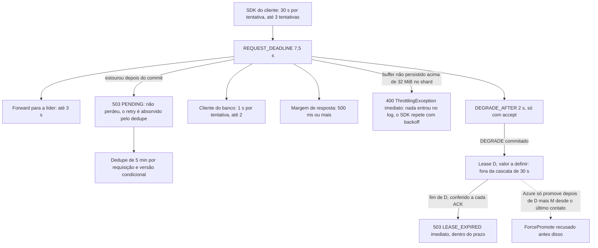

# D07 — Prazos em cascata dentro dos 30 s do SDK

[Início](../00_COMECE_AQUI.md) · [Documento principal](../DataReplication_Versao_1.md) · [Índice de diagramas](INDEX.md)

O prazo nasce **uma vez**, na borda, e desce como `context`. Cada camada tem prazo menor que a de fora; a partida recusa subir com prazos fora de ordem. O **lease D** do modo degradado está **fora** desta cascata: é da ordem de minutos ou mais (valor a definir), não de segundos. O que entra na cascata é o efeito, a resposta imediata `503 LEASE_EXPIRED` depois de D. O buffer de entradas não persistidas cheio também responde na hora, com `ThrottlingException`, sem consumir o prazo ([ADR-056](../03_adr/ADR-056-group-commit-por-shard-e-nada-sai-antes-do-fsync.md)).

## Cascata de prazos

## Onde é detalhado

- Tabela completa e consequências: [08_resiliencia_autocura_e_timeouts](../01_arquitetura/08_resiliencia_autocura_e_timeouts.md) (9.4) e [X05](../02_cenarios/complexos/X05-timeouts-e-idempotencia.md).
- Lease, D e M: [03_consenso_raft_quorum_e_gate](../01_arquitetura/03_consenso_raft_quorum_e_gate.md) (5.3.2) e [C32](../02_cenarios/atualizados/C32-particao-e-lease-do-modo-degradado.md).
- Decisões: [ADR-028](../03_adr/ADR-028-timeouts-em-cascata.md), [ADR-056](../03_adr/ADR-056-group-commit-por-shard-e-nada-sai-antes-do-fsync.md) e [ADR-044](../03_adr/ADR-044-lease-do-modo-degradado-e-promocao-da-azure.md).
