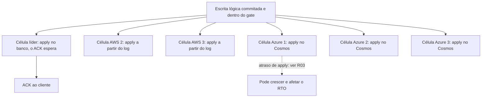

# D08 — Uma escrita lógica, seis bancos

[Início](../00_COMECE_AQUI.md) · [Documento principal](../DataReplication_Versao_1.md) · [Índice de diagramas](INDEX.md)

Cada célula tem o seu banco e o seu applier. O ACK depende do gate e do apply **só na célula da líder**; os outros cinco bancos são alcançados de forma assíncrona pelo log, na ordem.

## Fan-out da escrita

## Onde é detalhado

- Banco por célula e nome lógico: [05_dados_versao_delete_ttl_gsi_e_banco_por_celula](../01_arquitetura/05_dados_versao_delete_ttl_gsi_e_banco_por_celula.md) (6.9) e [ADR-022](../03_adr/ADR-022-banco-por-celula-nome-logico.md).
- Custo da multiplicação por seis: [R20](../02_cenarios/a_rever/R20-custo-6x.md). Atraso de apply: [R03](../02_cenarios/a_rever/R03-backlog-de-apply-no-cosmos.md).
