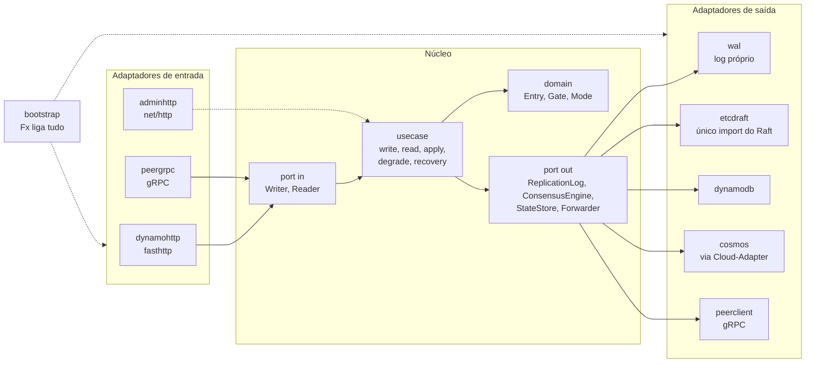
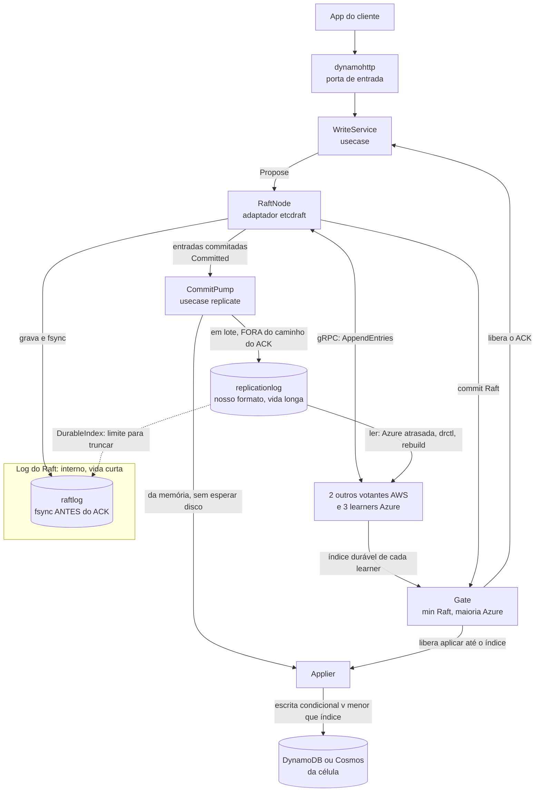
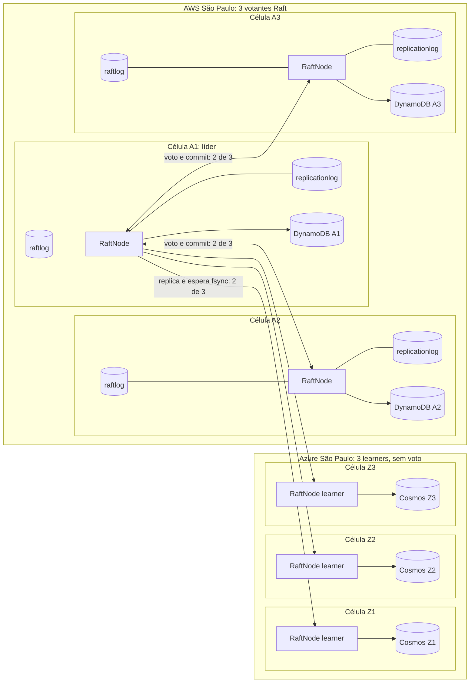
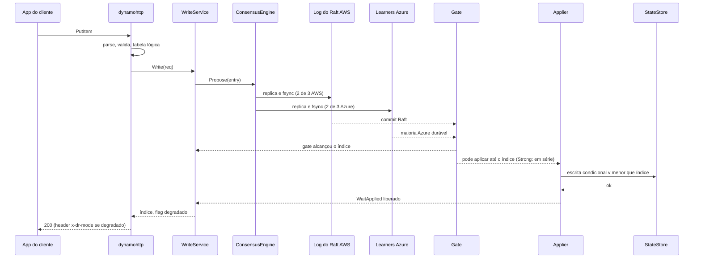
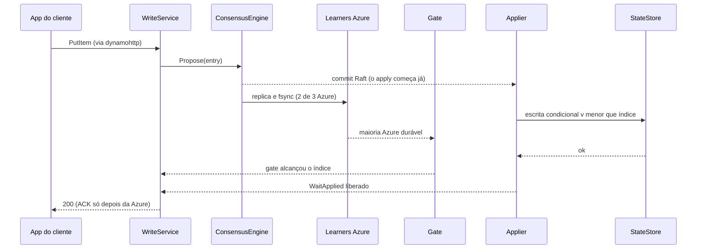
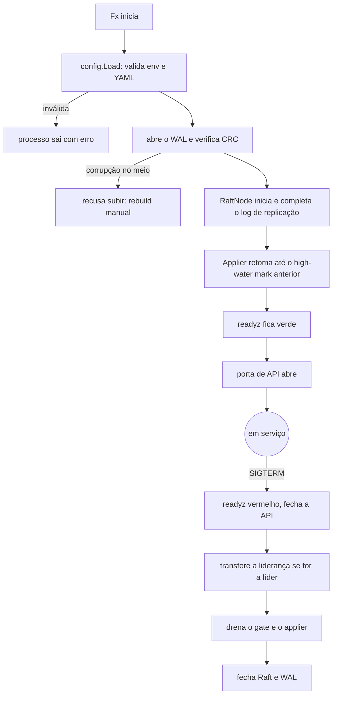
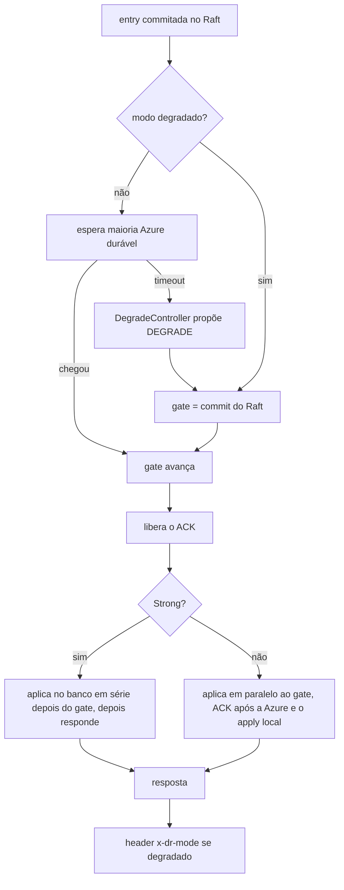
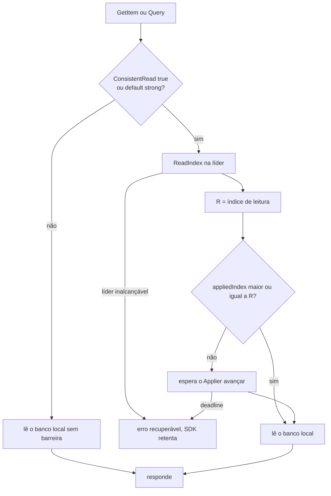
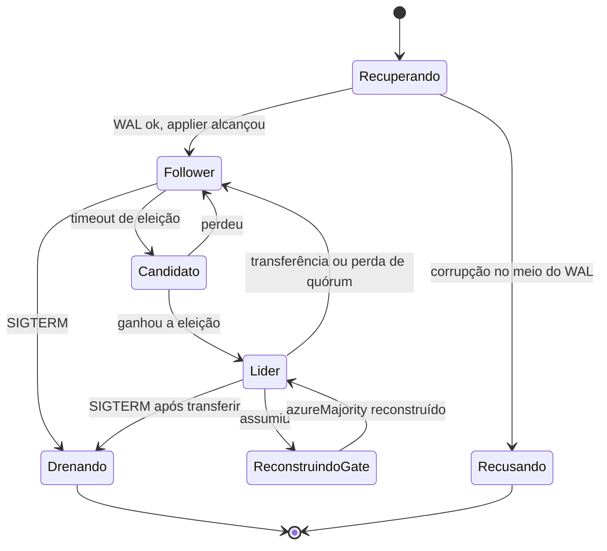

# Desenho da arquitetura e diagramas de processo e de fluxo

[Início](../00_COMECE_AQUI.md) · [Documento principal](../DataReplication_Versao_1.md) · [Índice da implementação](README.md)

## 4. Desenho da arquitetura

**Como ler:** as setas da esquerda (quem chama) entram pelas portas de entrada; o núcleo chama as portas de saída; os adaptadores da direita implementam essas portas. A única coisa que "conhece" tudo é o `bootstrap`.

### 4.1 Camadas e responsabilidade

| Camada | Pode importar | Não pode importar | Teste |
|---|---|---|---|
| `domain` | biblioteca padrão | tudo o mais | unitário puro, sem mock |
| `usecase` | `domain`, `port` | adaptadores, `fx`, libs de infraestrutura | unitário com fakes das portas |
| `adapter` | `port`, `domain`, sua lib de infraestrutura | outro adaptador | conformidade + integração |
| `bootstrap` | tudo | — | `fx.ValidateApp` |

### 4.2 Como o Raft e a replicação atuam (os dois logs)

O diagrama da seção 4 mostra **quem pode falar com quem**. Este mostra **o caminho do dado** dentro de um nó, e por que existem dois logs.

**Passo a passo de uma escrita:**
1. `WriteService` chama `Propose` no `RaftNode` (única porta que fala com o Raft).
2. O Raft grava a entrada no **log do Raft** com fsync e a replica por gRPC: 2 de 3 votantes AWS decidem o commit, e os 3 learners da Azure recebem a mesma entrada.
3. Cada learner informa o índice que já tornou durável. O `Gate` guarda `min(commit do Raft, maioria Azure)`. **Só aqui o ACK é liberado.**
4. Os lotes commitados chegam ao `CommitPump`, que os entrega ao `Applier` **pela memória** e ao **log de replicação** em lote, fora do caminho do ACK.
5. O `Applier` escreve no banco da célula com escrita condicional por versão.
6. O log do Raft só é truncado até o `DurableIndex` do log de replicação (regra de segurança da 5.5.1).

**Quem grava o quê, por escrita lógica:**

| Onde | O que grava | Quando | No caminho do ACK? |
|---|---|---|---|
| `raftlog` (cada réplica) | Entrada do consenso | Antes de responder ao líder, com fsync | **Sim** |
| `replicationlog` (réplicas AWS) | Registro commitado, nosso formato | Depois do commit, em lote | Não |
| Banco da célula (DynamoDB ou Cosmos) | Item com versão | Depois do gate | Não, em Strong o ACK espera o apply serial; em Eventual não |

**Visão do cluster:** quem replica para quem, e o que cada célula guarda.

Os learners da Azure guardam o log do Raft para poder confirmar durabilidade, mas só os votantes AWS decidem eleição e commit. Na Azure o log de replicação existe da mesma forma (omitido no desenho para não poluir) e alimenta o Cosmos pelo Cloud-Adapter.

## 5. Diagramas de processo

### 5.1 Escrita em modo Strong (caminho feliz)

**O ACK sai só depois do gate e do apply na célula da líder** (6.9, item 4 do documento de arquitetura). A decisão de *quando* o apply começa é do `Applier`: no Strong, depois do gate; no Eventual, já no commit do Raft.

### 5.1b Escrita em modo Eventual (caminho feliz)

### 5.2 Ciclo de vida do processo (partida e parada)

Ordem de `OnStart` no Fx: config, log, WAL, Raft, gate, applier, e **por último** a porta de API. O Fx executa `OnStop` na ordem inversa, então a API fecha primeiro e o WAL por último, sem código extra.

## 6. Diagramas de fluxo

### 6.1 Decisão de ACK (gate e modo degradado)

### 6.2 Leitura (Strong x Eventual)

### 6.3 Estados do nó

