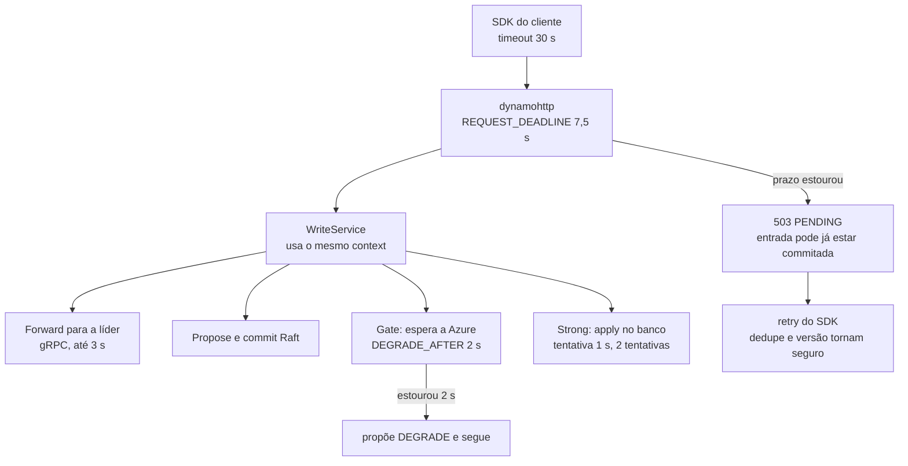

# Exemplos de código

[Início](../00_COMECE_AQUI.md) · [Documento principal](../DataReplication_Versao_1.md) · [Índice da implementação](README.md)

## 7. Exemplos de código

> Os trechos 7.1 a 7.7 estão na pasta [`codigo_exemplo/`](codigo_exemplo/) e foram compilados (`go vet`, Go 1.26.0, com `fx`, `fasthttp` e `zerolog` reais); o `Gate` e o `WriteService` têm testes que passam. Os de 7.8 e 7.9 e o `main` são ilustrativos. Tudo é **esboço para fixar o desenho**, não o código final: faltam o log, o Raft, o parser e os provedores que o `bootstrap` espera (`ConsensusEngine`, `Forwarder`, `AppliedWaiter` e o parser entram por módulos de adaptador). O Go 1.27 não existia neste ambiente; reconfirmar a compatibilidade no primeiro build.

### 7.1 Domínio: a entrada replicada

```go
package domain

// Index é a posição no log; também é a versão do item no banco (6.4).
type Index uint64

type Term uint64

type ShardID uint32

type EntryKind uint8

const (
	KindWrite   EntryKind = iota + 1 // escrita do cliente
	KindDegrade                      // DEGRADE(epoch, fromIndex)
	KindRestore                      // RESTORE(epoch)
)

type OpKind uint8

const (
	OpPut OpKind = iota + 1
	OpDelete
)

// Op é uma mutação já normalizada: tabela lógica, chave e imagem final.
type Op struct {
	Table LogicalTable
	Kind  OpKind
	Key   []byte // chave serializada (partição + ordenação)
	Item  []byte // post-image no formato DynamoDB JSON; vazio no delete
}

// Entry é a unidade replicada. Uma chamada BatchWriteItem vira UMA Entry (achado 2).
type Entry struct {
	Index    Index
	Term     Term
	Kind     EntryKind
	Shard    ShardID
	Ops      []Op
	Epoch    uint64 // só para Degrade e Restore
	ClientID string // id estável do SDK, quando houver (D11)
}

// LogicalTable é o nome com o marcador {cell}, ex.: "cliente_cell_{cell}".
type LogicalTable string
```

### 7.2 Domínio: o gate (monotônico, D9)

```go
package domain

import (
	"context"
	"sort"
	"sync"
)

// Gate calcula até onde o ACK e o applier podem avançar:
// min(commit do Raft, índice durável em ≥ 2 de 3 learners da Azure).
// O valor nunca recua (D9).
type Gate struct {
	mu          sync.Mutex
	raftCommit  Index
	azureQuorum Index
	current     Index
	waiters     []waiter
	degraded    bool // em modo degradado a Azure sai da conta
}

type waiter struct {
	idx Index
	ch  chan struct{}
}

func (g *Gate) Index() Index {
	g.mu.Lock()
	defer g.mu.Unlock()
	return g.current
}

func (g *Gate) SetRaftCommit(i Index) { g.update(func() { g.raftCommit = max(g.raftCommit, i) }) }

// SetAzureDurable recebe o índice durável de cada learner (3 valores) e guarda o 2º maior.
func (g *Gate) SetAzureDurable(durable [3]Index) {
	d := durable[:]
	sort.Slice(d, func(a, b int) bool { return d[a] > d[b] })
	g.update(func() { g.azureQuorum = max(g.azureQuorum, d[1]) })
}

func (g *Gate) SetDegraded(on bool) { g.update(func() { g.degraded = on }) }

func (g *Gate) update(mutate func()) {
	g.mu.Lock()
	defer g.mu.Unlock()
	mutate()
	next := g.raftCommit
	if !g.degraded {
		next = min(next, g.azureQuorum)
	}
	g.current = max(g.current, next) // monotônico
	kept := g.waiters[:0]
	for _, w := range g.waiters {
		if w.idx <= g.current {
			close(w.ch)
		} else {
			kept = append(kept, w)
		}
	}
	g.waiters = kept
}

// WaitFor bloqueia até o gate alcançar idx ou o contexto expirar.
func (g *Gate) WaitFor(ctx context.Context, idx Index) error {
	g.mu.Lock()
	if g.current >= idx {
		g.mu.Unlock()
		return nil
	}
	w := waiter{idx: idx, ch: make(chan struct{})}
	g.waiters = append(g.waiters, w)
	g.mu.Unlock()
	select {
	case <-w.ch:
		return nil
	case <-ctx.Done():
		return ctx.Err()
	}
}
```

Teste que fixa o comportamento (não recua, espera, libera no degradado):

```go
package domain

import (
	"context"
	"testing"
	"time"
)

func TestGate(t *testing.T) {
	g := &Gate{}
	g.SetRaftCommit(10)
	g.SetAzureDurable([3]Index{10, 7, 3})
	if g.Index() != 7 {
		t.Fatalf("esperado 7, veio %d", g.Index())
	}
	g.SetAzureDurable([3]Index{5, 5, 5}) // não recua
	if g.Index() != 7 {
		t.Fatal("gate recuou")
	}
	ctx, c := context.WithTimeout(context.Background(), 20*time.Millisecond)
	defer c()
	if g.WaitFor(ctx, 9) == nil {
		t.Fatal("não devia liberar")
	}
	g.SetDegraded(true)
	if g.WaitFor(context.Background(), 10) != nil {
		t.Fatal("degradado devia liberar até o commit Raft")
	}
}
```

### 7.3 Portas

```go
package port

import (
	"context"

	"example.com/datareplication/internal/domain"
)

// ---- Portas de saída (driven): o núcleo pede, o adaptador implementa ----

// ReplicationLog é o log de replicação próprio (5.5.1). Append só retorna após fsync.
type ReplicationLog interface {
	Append(ctx context.Context, batch []domain.Entry) error
	Read(ctx context.Context, from, to domain.Index) ([]domain.Entry, error)
	TruncateSuffix(ctx context.Context, from domain.Index) error
	CompactPrefix(ctx context.Context, upTo domain.Index) error
	DurableIndex() domain.Index
}

// ConsensusEngine esconde a biblioteca Raft (5.5).
type ConsensusEngine interface {
	Propose(ctx context.Context, e domain.Entry) (domain.Index, error)
	ReadIndex(ctx context.Context) (domain.Index, error)
	Leader() (LeaderInfo, bool)
	TransferLeadership(ctx context.Context, to string) error
	Committed() <-chan CommitBatch // entradas já commitadas, entregues da memória
	LearnerDurable() [3]domain.Index
}

// CommitBatch é um lote de entradas commitadas pelo Raft, em ordem.
type CommitBatch struct {
	Entries []domain.Entry
}

type LeaderInfo struct {
	NodeID string
	Local  bool
}

// StateStore é o banco da célula (DynamoDB ou Cosmos via Cloud-Adapter).
type StateStore interface {
	ApplyBatch(ctx context.Context, ops []VersionedOp) error
	Get(ctx context.Context, table domain.LogicalTable, key []byte, consistent bool) ([]byte, error)
	AppliedIndex() domain.Index
}

type VersionedOp struct {
	domain.Op
	Version domain.Index
}

// Forwarder leva a escrita inteira à líder quando a célula é follower (ADR-010).
// A líder executa o mesmo caminho (propor, gate, apply local) e devolve o resultado.
type Forwarder interface {
	Forward(ctx context.Context, leader string, r WriteRequest) (WriteResult, error)
}

// AppliedWaiter bloqueia até o Applier da célula ter aplicado o índice no banco.
// O ACK de uma escrita só sai depois disso na célula da líder (6.9, item 4).
type AppliedWaiter interface {
	WaitApplied(ctx context.Context, idx domain.Index) error
}

// ---- Portas de entrada (driving): o adaptador chama, o núcleo implementa ----

type WriteRequest struct {
	Ops      []domain.Op
	ClientID string // id estável do SDK, se houver
	Deadline int64  // unix nano
}

type WriteResult struct {
	Index    domain.Index
	Degraded bool // vira o header x-dr-mode: degraded (D10)
}

type Writer interface {
	Write(ctx context.Context, r WriteRequest) (WriteResult, error)
}

type Reader interface {
	Get(ctx context.Context, table domain.LogicalTable, key []byte, strong bool) ([]byte, error)
}
```

### 7.4 Caso de uso: escrever

```go
package usecase

import (
	"context"
	"errors"

	"example.com/datareplication/internal/domain"
	"example.com/datareplication/internal/port"
)

var ErrPending = errors.New("resultado desconhecido: o cliente deve repetir")

// WriteService é o caso de uso "escrever": propõe, espera o gate, espera o apply
// local e responde. A ordem do apply (serial depois do gate no Strong, paralelo no
// Eventual) é decisão do Applier; aqui o ACK é sempre depois do gate E do apply.
type WriteService struct {
	Consensus port.ConsensusEngine
	Forward   port.Forwarder
	Gate      *domain.Gate
	Applied   port.AppliedWaiter
	Degraded  func() bool
}

func (s *WriteService) Write(ctx context.Context, r port.WriteRequest) (port.WriteResult, error) {
	if leader, ok := s.Consensus.Leader(); ok && !leader.Local {
		return s.Forward.Forward(ctx, leader.NodeID, r) // um salto; a líder responde (ADR-010)
	}

	e := domain.Entry{Kind: domain.KindWrite, Ops: r.Ops, ClientID: r.ClientID}
	idx, err := s.Consensus.Propose(ctx, e) // commit Raft: 2/3 AWS com fsync
	if err != nil {
		return port.WriteResult{}, err
	}
	if err := s.Gate.WaitFor(ctx, idx); err != nil { // + 2/3 Azure com fsync
		return port.WriteResult{}, ErrPending
	}
	if err := s.Applied.WaitApplied(ctx, idx); err != nil { // apply no banco da célula da líder
		return port.WriteResult{}, ErrPending
	}
	return port.WriteResult{Index: idx, Degraded: s.Degraded()}, nil
}
```

Teste que fixa a regra "o ACK espera o gate **e** o apply local" (com fakes das portas):

```go
// O ACK não sai com o gate liberado se o apply local ainda não terminou.
func TestAckWaitsForGateAndApply(t *testing.T) {
	applied := fakeApplied{done: make(chan struct{})}
	svc, g := newSvc(applied)
	g.SetRaftCommit(5)
	g.SetAzureDurable([3]domain.Index{5, 5, 5})

	ctx, cancel := context.WithTimeout(context.Background(), 30*time.Millisecond)
	defer cancel()
	if _, err := svc.Write(ctx, port.WriteRequest{}); !errors.Is(err, ErrPending) {
		t.Fatalf("esperado ErrPending sem apply, veio %v", err)
	}

	close(applied.done)
	res, err := svc.Write(context.Background(), port.WriteRequest{})
	if err != nil || res.Index != 5 {
		t.Fatalf("esperado ACK no índice 5, veio %v %v", res, err)
	}
}
```

### 7.4b Caso de uso: ligar o Raft ao log de replicação, ao gate e ao applier

```go
package usecase

import (
	"context"

	"example.com/datareplication/internal/domain"
	"example.com/datareplication/internal/port"
)

// CommitPump liga o Raft ao resto: cada lote commitado vai (1) para o gate,
// (2) para o Applier, da memória, e (3) para o log de replicação, em lote.
type CommitPump struct {
	Consensus port.ConsensusEngine
	Log       port.ReplicationLog
	Gate      *domain.Gate
	ToApplier chan<- []domain.Entry
}

func (p *CommitPump) Run(ctx context.Context) error {
	for {
		select {
		case <-ctx.Done():
			return ctx.Err()
		case b := <-p.Consensus.Committed():
			last := b.Entries[len(b.Entries)-1].Index
			p.Gate.SetRaftCommit(last)
			p.Gate.SetAzureDurable(p.Consensus.LearnerDurable())
			p.ToApplier <- b.Entries // memória: não espera o disco
			// Esboço: na versão final o Append roda numa goroutine própria, com fila
			// limitada, para não atrasar a entrega ao Applier.
			if err := p.Log.Append(ctx, b.Entries); err != nil {
				return err // falha de disco do log de replicação é fatal
			}
		}
	}
}
```

### 7.5 Adaptador de entrada: HTTP compatível com DynamoDB

```go
// Package dynamohttp é o adaptador de entrada: HTTP compatível com DynamoDB.
// Só traduz protocolo; nenhuma regra de negócio mora aqui.
package dynamohttp

import (
	"context"
	"errors"
	"time"

	"github.com/valyala/fasthttp"

	"example.com/datareplication/internal/port"
	"example.com/datareplication/internal/usecase"
)

// Deadline é o prazo de toda requisição; vem da configuração e é menor que o timeout do SDK.
type Deadline time.Duration

type Server struct {
	deadline time.Duration
	srv      *fasthttp.Server
	writer   port.Writer
	parse    func(target string, body []byte) (port.WriteRequest, error)
}

func New(w port.Writer, parse func(string, []byte) (port.WriteRequest, error), d Deadline) *Server {
	s := &Server{writer: w, parse: parse, deadline: time.Duration(d)}
	s.srv = &fasthttp.Server{
		Handler:               s.handle,
		ReadTimeout:           5 * time.Second,
		WriteTimeout:          5 * time.Second,
		IdleTimeout:           120 * time.Second, // maior que o idle dos SDKs (Java 60s, Go 90s), senão o SDK reusa conexão já fechada
		MaxRequestBodySize:    4 << 20,           // 4 MiB (decisão de entrada máxima)
		NoDefaultServerHeader: true,
		ReduceMemoryUsage:     false, // preferir velocidade; medir no spike
	}
	return s
}

func (s *Server) handle(c *fasthttp.RequestCtx) {
	target := string(c.Request.Header.Peek("X-Amz-Target")) // ex.: DynamoDB_20120810.PutItem
	// ATENÇÃO: o body pertence ao fasthttp e é reutilizado depois do handler.
	// O parser deve copiar tudo o que for ao log antes de retornar.
	req, err := s.parse(target, c.PostBody())
	if err != nil {
		writeErr(c, 400, "ValidationException", err.Error())
		return
	}
	ctx, cancel := context.WithTimeout(context.Background(), s.deadline)
	defer cancel()
	res, err := s.writer.Write(ctx, req)
	switch {
	case errors.Is(err, usecase.ErrPending):
		writeErr(c, 503, "ServiceUnavailable", "retry") // o SDK retenta
		return
	case err != nil:
		writeErr(c, 500, "InternalServerError", "")
		return
	}
	if res.Degraded {
		c.Response.Header.Set("x-dr-mode", "degraded") // D10
	}
	c.SetContentType("application/x-amz-json-1.0")
	c.SetBodyString("{}")
}

func writeErr(c *fasthttp.RequestCtx, status int, typ, msg string) {
	c.SetStatusCode(status)
	c.SetContentType("application/x-amz-json-1.0")
	c.SetBodyString(`{"__type":"com.amazonaws.dynamodb.v20120810#` + typ + `","message":"` + msg + `"}`)
}

func (s *Server) ListenAndServe(addr string) error { return s.srv.ListenAndServe(addr) }
func (s *Server) Shutdown(ctx context.Context) error {
	return s.srv.ShutdownWithContext(ctx)
}
```

### 7.6 Configuração (12 Factors)

> O esboço lê as variáveis de ambiente direto, para não puxar dependência. A versão final lê o YAML com `viper` (`UnmarshalExact`, para recusar chaves desconhecidas) e valida do mesmo jeito: variável obrigatória ausente ou prazos fora de ordem impedem a partida ([ADR-031](../03_adr/ADR-031-hexagonal-e-bibliotecas.md)).

```go
package config

import (
	"errors"
	"os"
	"time"
)

// Config é lido uma vez na partida e é imutável (12 Factors, III). Sem hot reload.
type Config struct {
	CellID          string // env CELL_ID (obrigatória)
	WriteMode       string // env WRITE_MODE: strong | eventual (obrigatória)
	ReadModeDefault string // env READ_MODE_DEFAULT: strong | eventual (obrigatória)
	APIAddr         string
	AdminAddr       string
	WALDir          string

	// Orçamento de tempo (ver [9.4 em 08_resiliencia_autocura_e_timeouts](../01_arquitetura/08_resiliencia_autocura_e_timeouts.md)).
	ClientTimeout   time.Duration // menor timeout do SDK dos clientes; padrão 30s
	RequestDeadline time.Duration // prazo de TODA requisição; padrão ClientTimeout/4
	DegradeAfter    time.Duration // espera pela Azure antes de propor DEGRADE; padrão 2s
}

func Load() (Config, error) {
	c := Config{
		CellID:          os.Getenv("CELL_ID"),
		WriteMode:       os.Getenv("WRITE_MODE"),
		ReadModeDefault: os.Getenv("READ_MODE_DEFAULT"),
		APIAddr:         ":8000",
		AdminAddr:       ":9090",
		WALDir:          "/var/lib/dr/wal",
		ClientTimeout:   30 * time.Second,
		DegradeAfter:    2 * time.Second,
	}
	c.RequestDeadline = c.ClientTimeout / 4
	var errs []error
	for k, v := range map[string]string{"CELL_ID": c.CellID, "WRITE_MODE": c.WriteMode, "READ_MODE_DEFAULT": c.ReadModeDefault} {
		if v == "" {
			errs = append(errs, errors.New("variável obrigatória ausente: "+k))
		}
	}
	// Regras de consistência entre prazos: quem está mais dentro responde antes de quem está mais fora.
	if c.RequestDeadline >= c.ClientTimeout {
		errs = append(errs, errors.New("REQUEST_DEADLINE deve ser menor que CLIENT_TIMEOUT"))
	}
	if c.DegradeAfter >= c.RequestDeadline {
		errs = append(errs, errors.New("DEGRADE_AFTER deve ser menor que REQUEST_DEADLINE"))
	}
	return c, errors.Join(errs...) // o processo não sobe se faltar algo
}
```

### 7.6b Prazos em cascata (timeouts)

O prazo nasce **uma vez**, na borda, e desce como `context` por todas as camadas; ninguém cria um prazo maior do que o recebido.



Regras de código: (1) `context.WithTimeout` só na borda (`dynamohttp`); (2) nenhuma chamada de porta usa `context.Background()`; (3) o cliente do DynamoDB/Cosmos recebe `MaxAttempts` e `AttemptTimeout` da configuração; (4) o `Config.Load` recusa subir se `DEGRADE_AFTER >= REQUEST_DEADLINE` ou `REQUEST_DEADLINE >= CLIENT_TIMEOUT` (7.6).

### 7.7 Montagem com Fx

```go
// Package bootstrap liga adaptadores às portas. É o ÚNICO lugar que importa fx.
package bootstrap

import (
	"context"
	"time"

	"github.com/rs/zerolog"
	"go.uber.org/fx"

	"example.com/datareplication/internal/adapter/in/dynamohttp"
	"example.com/datareplication/internal/domain"
	"example.com/datareplication/internal/platform/config"
	"example.com/datareplication/internal/platform/logx"
	"example.com/datareplication/internal/port"
	"example.com/datareplication/internal/usecase"
)

func New(extra ...fx.Option) *fx.App {
	return fx.New(
		fx.StartTimeout(60*time.Second), // recuperação do WAL pode demorar
		fx.StopTimeout(25*time.Second),  // < terminationGracePeriodSeconds do pod
		fx.Provide(
			config.Load,
			logx.New,
			func() *domain.Gate { return &domain.Gate{} },
			fx.Annotate(newWriteService, fx.As(new(port.Writer))),
			func(c config.Config) dynamohttp.Deadline { return dynamohttp.Deadline(c.RequestDeadline) },
			dynamohttp.New,
		),
		fx.Invoke(runHTTP),
		fx.Options(extra...), // adaptadores de Raft, WAL e banco entram por módulos
	)
}

func newWriteService(c port.ConsensusEngine, f port.Forwarder, a port.AppliedWaiter, g *domain.Gate) *usecase.WriteService {
	return &usecase.WriteService{Consensus: c, Forward: f, Gate: g, Applied: a, Degraded: func() bool { return false }}
}

// runHTTP abre a porta de API só depois que as dependências estão prontas (ordem de OnStart).
func runHTTP(lc fx.Lifecycle, s *dynamohttp.Server, cfg config.Config, log zerolog.Logger) {
	lc.Append(fx.Hook{
		OnStart: func(context.Context) error {
			go func() {
				if err := s.ListenAndServe(cfg.APIAddr); err != nil {
					log.Fatal().Err(err).Msg("api caiu")
				}
			}()
			return nil
		},
		OnStop: func(ctx context.Context) error { return s.Shutdown(ctx) },
	})
}
```

```go
// cmd/datareplication/main.go
package main

import "example.com/datareplication/internal/bootstrap"

func main() { bootstrap.New(adapters.Module).Run() } // adapters.Module: um fx.Option por adaptador
```

### 7.8 Teste de que o grafo do Fx fecha

```go
func TestGraph(t *testing.T) {
	if err := fx.ValidateApp(bootstrap.AllOptions()...); err != nil {
		t.Fatal(err) // dependência faltando aparece no CI, não no deploy
	}
}
```

### 7.9 Esboço do WAL (group commit natural, sem linger)

```go
// adapter/out/wal: uma goroutine escritora por nó.
func (w *WAL) loop() {
	for {
		batch := w.queue.DrainBlocking() // pega tudo o que já chegou, sem esperar mais
		w.encode(batch)                  // CRC32C por registro, em buffer reutilizado
		w.file.Write(w.buf)              // arquivo pré-alocado de 64 MiB
		if err := w.file.Datasync(); err != nil {
			w.fatal(err) // falha de fsync é fatal: o processo morre e o nó reentra (6.x)
		}
		w.durable.Store(batch.LastIndex()) // só agora Append() retorna
		batch.Done()
	}
}
```
