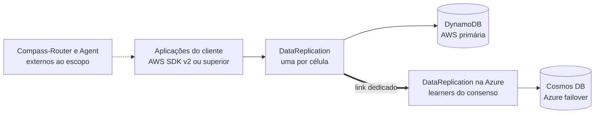
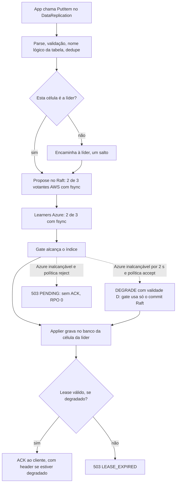
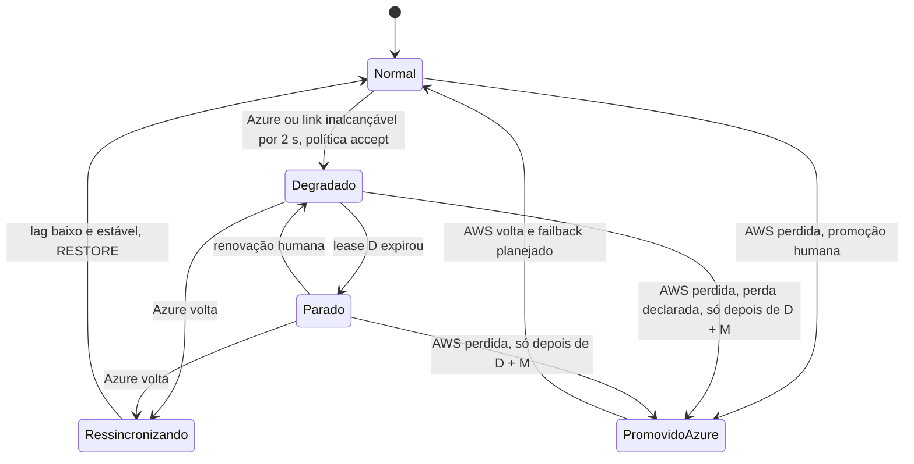

# DataReplication v1: documento principal

[Início](00_COMECE_AQUI.md) · [Arquitetura](01_arquitetura/README.md) · [Cenários](02_cenarios/INDEX.md) · [ADRs](03_adr/INDEX.md) · [Diagramas](04_diagramas/INDEX.md) · [Implementação](05_implementacao/README.md) · [Pendências](06_pendencias_e_riscos/README.md) · [Glossário](01_arquitetura/00_glossario.md)

**Estado:** 13/10/2026, com as decisões da revisão crítica (ADR-044 a ADR-054) · **Dono:** Bruno · **Papel deste documento:** reunir tudo o que importa sobre o `DataReplication` v1 e apontar, a cada assunto, o arquivo com o detalhe. Cada seção termina com os links para o aprofundamento.

## Sumário

1. [O problema](#1-o-problema)
2. [A solução em uma página](#2-a-solução-em-uma-página)
3. [Requisitos, restrições e premissas](#3-requisitos-restrições-e-premissas)
4. [Decisões (ADRs)](#4-decisões-adrs)
5. [Arquitetura em resumo](#5-arquitetura-em-resumo)
6. [Fluxos principais](#6-fluxos-principais)
7. [Falhas e recuperação](#7-falhas-e-recuperação)
8. [Cenários: situação de cada um](#8-cenários-situação-de-cada-um)
9. [Implementação](#9-implementação)
10. [Pendências, riscos e perguntas em aberto](#10-pendências-riscos-e-perguntas-em-aberto)
11. [Definição de pronto da v1](#11-definição-de-pronto-da-v1)
12. [Mapa dos arquivos](#12-mapa-dos-arquivos)

---

## 1. O problema

As aplicações do cliente persistem dados no **DynamoDB** (AWS) por meio do AWS SDK. Esses dados são valores de negócio, inclusive monetários, e precisam sobreviver à **perda de uma nuvem inteira**. Hoje não existe garantia de que um dado confirmado na AWS esteja em outra nuvem no instante da confirmação.

O que se quer:

- **RPO = 0 em operação normal:** nenhuma escrita confirmada ao cliente pode desaparecer num desastre coberto pelo modelo.
- **RTO = Delta-T**, ainda sem número: será uma **distribuição medida em exercícios de falha**, não uma soma de percentis ([R18](02_cenarios/a_rever/R18-rto-nao-quantificado.md)). Se a AWS morrer em modo degradado, o RTO é no mínimo D + M ([ADR-044](03_adr/ADR-044-lease-do-modo-degradado-e-promocao-da-azure.md)).
- **Sem mudar a lógica das aplicações:** elas continuam falando "DynamoDB" com o AWS SDK. Mudam o endpoint e o certificado de cliente do mTLS por aplicação ([ADR-052](03_adr/ADR-052-autorizacao-por-aplicacao-com-mtls.md)); "só trocar o endpoint" não é mais verdade.
- **Baixa latência de cauda:** meta de overhead P99 ≤ 50 ms a ~3.000 TPS.
- **Autocura** para falhas de uma célula, sem humano; falhas que exigem humano ficam explícitas.

A organização usa arquitetura **celular** (células isoladas, como *bulkheads*). Um **shard** reúne células; dentro dele, uma líder coordena as escritas. A AWS é a nuvem primária e a **Azure** é a de failover; ambas somente em **São Paulo**.

> **Não é objetivo da v1:** plataforma multi-cliente com muitos shards, `UpdateItem` com expressão, escritas condicionais e transações do DynamoDB, multirregião, terceiro provedor de nuvem.

Contexto e requisitos originais: [01_arquitetura/01_forma_do_app_e_escopo.md](01_arquitetura/01_forma_do_app_e_escopo.md).

## 2. A solução em uma página

Uma **camada intermediária**, o `DataReplication`, fica entre a aplicação e o banco. Ela fala o protocolo do DynamoDB e **só confirma a escrita depois que o dado está durável na AWS e na Azure**.

**Como funciona, em cinco ideias:**

1. **Célula = um cluster Kubernetes (EKS ou AKS) numa AZ.** No namespace do cliente rodam as apps e **um único** `DataReplication` (sem sidecar). Há 3 células na AWS e 3 na Azure.
2. **Consenso Raft só na AWS.** As 3 células AWS são votantes (`etcd-io/raft`). As 3 células Azure são **learners**: recebem o log e informam o índice **durável**, mas não votam.
3. **O gate decide o ACK:** `gate = min(commit do Raft, 2º maior índice durável dos learners Azure)`. Ele **nunca recua**. O ACK sai depois do gate e do apply no banco da célula da líder.
4. **Dois logs:** o do Raft (curto, fsync antes do ACK) e o de replicação (nosso, longo, em lote depois do commit). Um banco por célula; a escrita lógica é aplicada nos **seis** bancos.
5. **Se a Azure ou o link cair**, a política da instalação decide ([ADR-045](03_adr/ADR-045-politica-de-degradacao-por-instalacao.md)). Com `DEGRADED_POLICY=accept`, após 2 s a líder propõe `DEGRADE` com **validade D**: a AWS segue sozinha (**RPO > 0**) sinalizando `x-dr-mode: degraded` e **para sozinha ao fim de D**. Com `reject`, as escritas falham e o RPO é 0 sempre. A Azure **nunca se promove sozinha**: a promoção é humana e só é aceita depois de D + M ([ADR-044](03_adr/ADR-044-lease-do-modo-degradado-e-promocao-da-azure.md)).

Detalhe: [D01](04_diagramas/D01-visao-do-sistema.md), [C01](02_cenarios/atualizados/C01-visao-geral.md), [C02](02_cenarios/atualizados/C02-dentro-da-celula.md).

## 3. Requisitos, restrições e premissas

### 3.1 Restrições duras

| Restrição | Valor |
|---|---|
| Nuvens e regiões | **Somente AWS e Azure, ambas só em São Paulo** (`sa-east-1` e Brazil South) |
| Papéis | AWS primária (DynamoDB); Azure failover (Cosmos DB via Cloud-Adapter) |
| RPO / RTO | RPO = 0 em operação normal; RTO = Delta-T (a definir) |
| Carga | ~3.000 TPS, escritas majoritariamente `PutItem` e `BatchWriteItem` |
| Manutenção | Derruba **uma célula por vez** |
| Rede | 3 clusters AWS na **mesma VPC**; **link dedicado físico** AWS↔Azure, com tráfego transitivo entre contas e VPCs |
| Capacidade | DynamoDB sob demanda; Cosmos em RU; 3 AZs por nuvem |
| Política de degradação | `DEGRADED_POLICY` obrigatória por instalação: `accept` (com lease D) ou `reject` ([ADR-045](03_adr/ADR-045-politica-de-degradacao-por-instalacao.md)) |
| Implantação | **Uma instalação por cliente**, com conta AWS própria; o cabo dedicado é compartilhado ([ADR-043](03_adr/ADR-043-uma-instalacao-por-cliente-identidade-por-configuracao.md), [C31](02_cenarios/atualizados/C31-implantacao-por-cliente-e-identidade.md)) |
| Linguagem e plataforma | Go 1.27, cloud-native em AKS e EKS, 12 Factors |

### 3.2 Metas

| Meta | Valor |
|---|---|
| Latência | Overhead P99 ≤ 50 ms (alvo interno 30 a 35 ms); a escrita no banco fica fora da soma e é publicada como `overhead + banco` ([ADR-036](03_adr/ADR-036-slo-de-50ms-exclui-a-escrita-no-banco.md), [C24](02_cenarios/atualizados/C24-orcamento-de-50ms-e-escrita-no-dynamodb.md)) |
| Memória e partida | `DataReplication` ≤ 256 MiB RSS e partida em segundos |
| Autocura | Reiniciar qualquer processo sem perder dado ACKado |

### 3.3 Clientes e API

- **SDKs aceitos:** AWS SDK **Java 2.x, Go v2 e .NET v4**, identificados pelo `User-Agent` (período de alerta e depois rejeição). Os clientes fixam *timeout* de 30 s por tentativa e no máximo 3 tentativas.
- **API da v1:** `PutItem`, `DeleteItem`, `BatchWriteItem`, `GetItem`, `BatchGetItem`, `Query` e `Scan`. **Fora:** `UpdateItem` com expressão, escrita condicional e transações; o uso real de condicionais por cliente deve ser levantado antes de ele entrar ([ADR-051](03_adr/ADR-051-compatibilidade-dynamodb-inventario-conformidade-e-idempotencia.md)).
- **Uso informado:** alguns clientes usam **TTL**, poucos usam **Scan**, algumas **Query** usam **GSI**. Valores monetários trafegam como **String**.
- Entrada máxima de **4 MiB**; item do DynamoDB de até 400 KB ([R17](02_cenarios/a_rever/R17-atributo-de-versao-e-limite-400kb.md)).

### 3.4 Fora do escopo do time (dependências externas)

O **Compass-Router** (gateway) e o **Agent** do control plane decidem para onde vai o tráfego; o router sobrevive à perda total da AWS e o Agent roda nas duas nuvens.

Detalhe: [01_forma_do_app_e_escopo](01_arquitetura/01_forma_do_app_e_escopo.md) (seção 2), [09_12factors_cloud_native_e_sdks](01_arquitetura/09_12factors_cloud_native_e_sdks.md).

## 4. Decisões (ADRs)

Um arquivo por decisão, com contexto, decisão e consequências. Índice completo: [03_adr/INDEX.md](03_adr/INDEX.md).

### Estrutura e escopo

| ADR | Decisão | Status |
|---|---|---|
| [ADR-001](03_adr/ADR-001-camada-intermediaria-agnostica.md) | Camada intermediária agnóstica a cloud e a banco | Confirmado (requisito) |
| [ADR-002](03_adr/ADR-002-shards-logicos-celulas-ativo-passivo.md) | Shards lógicos, células e ativo/passivo | Confirmado (requisito) |
| [ADR-003](03_adr/ADR-003-aws-primaria-azure-failover.md) | AWS primária e Azure como failover, ambas só em São Paulo | Confirmado (restrição dura) |
| [ADR-004](03_adr/ADR-004-dynamodb-primeiro-adaptador.md) | DynamoDB como primeiro adaptador; Cosmos pelo Cloud-Adapter | Confirmado (requisito) |
| [ADR-016](03_adr/ADR-016-app-unico-por-celula-monolito-modular.md) | Um único app DataReplication por célula, monolito modular | Decidido (Bruno) |
| [ADR-031](03_adr/ADR-031-hexagonal-e-bibliotecas.md) | Arquitetura hexagonal e bibliotecas | Decidido (Bruno) |
| [ADR-032](03_adr/ADR-032-parse-json-completo-e-rust.md) | Parse completo do JSON na v1; Rust como alternativa registrada | Decidido (Bruno); problema conhecido |
| [ADR-043](03_adr/ADR-043-uma-instalacao-por-cliente-identidade-por-configuracao.md) | Uma instalação por cliente; o cliente é conhecido na configuração | Decidido (Bruno) |
| [ADR-052](03_adr/ADR-052-autorizacao-por-aplicacao-com-mtls.md) | Autorização por aplicação com mTLS | Decidido (Bruno) |
| [ADR-054](03_adr/ADR-054-banco-por-celula-mantido.md) | Um banco por célula mantido, com o trade-off registrado | Decidido (Bruno) |

### Consenso, durabilidade e gate

| ADR | Decisão | Status |
|---|---|---|
| [ADR-005](03_adr/ADR-005-ack-exige-gate.md) | ACK só depois do gate (Raft AWS e maioria durável Azure) | Aceito (reformulado na v1) |
| [ADR-006](03_adr/ADR-006-consenso-por-shard-eleicao-na-aws.md) | Consenso por shard; eleição só na AWS | Aceito |
| [ADR-017](03_adr/ADR-017-azure-learners-e-gate.md) | Azure como learners, com gate | Decidido (Bruno) |
| [ADR-018](03_adr/ADR-018-dois-logs-raft-e-replicacao.md) | Dois logs separados: o do Raft e o de replicação | Decidido (Bruno) |
| [ADR-019](03_adr/ADR-019-wal-proprio-volume-dedicado.md) | WAL próprio em volume de bloco dedicado; sem ACK em memória | Decidido (Bruno) |
| [ADR-020](03_adr/ADR-020-raft-etcd-io-camada-multigrupo.md) | Raft: etcd-io/raft com camada multi-grupo própria | Decidido (Bruno) |
| [ADR-021](03_adr/ADR-021-grpc-entre-celulas.md) | gRPC entre as células | Decidido (Bruno) |
| [ADR-029](03_adr/ADR-029-gate-monotonico-na-troca-de-lider.md) | O gate nunca recua; líder nova reconstrói antes de ACKar | Decidido (Bruno) |
| [ADR-030](03_adr/ADR-030-verificacao-formal-tla.md) | Modelo TLA+ do gate antes do código do gate (escopo ampliado em 13/10) | Decidido (Bruno) |
| [ADR-046](03_adr/ADR-046-gate-so-conta-progresso-validado-pelo-raft.md) | O gate só conta progresso validado pelo Raft no termo atual | Decidido (Bruno) |
| [ADR-049](03_adr/ADR-049-barreira-da-leitura-forte-e-o-gate.md) | A leitura forte espera `min(ReadIndex, gate)` | Decidido (Bruno) |
| [ADR-034](03_adr/ADR-034-fsync-fatal-e-identidade-nova.md) | Falha de fsync é fatal; disco perdido volta com identidade nova | Decidido (Bruno) |
| [ADR-007](03_adr/ADR-007-sidecar-e-coordenacao-compartilhada.md) | Sidecar com coordenação compartilhada | Substituído pelo ADR-016 |
| [ADR-008](03_adr/ADR-008-terceiro-dominio.md) | Terceiro domínio com WAL integral | Descartado |
| [ADR-011](03_adr/ADR-011-witness-manifesto-snapshots.md) | Witness = manifesto assinado, snapshots e WAL | Mantido |

### Dados, modos e API

| ADR | Decisão | Status |
|---|---|---|
| [ADR-009](03_adr/ADR-009-eventual-e1.md) | Modo Eventual = E1 (mesma escrita, leitura local) | Decidido (Bruno); apply paralelo retirado |
| [ADR-012](03_adr/ADR-012-sem-downgrade-strong-eventual.md) | Sem downgrade automático de Strong para Eventual | Confirmado (requisito) |
| [ADR-015](03_adr/ADR-015-wal-post-image-e-versao.md) | O log guarda a post-image e a versão do item | Aceito |
| [ADR-022](03_adr/ADR-022-banco-por-celula-nome-logico.md) | Um banco por célula; nome lógico com {cell} | Decidido (Bruno) |
| [ADR-023](03_adr/ADR-023-modos-de-escrita-e-leitura.md) | Modos de escrita (Strong serial, Eventual paralelo) e de leitura (padrão forte) | Escrita substituída pelo ADR-053; leitura vigente |
| [ADR-053](03_adr/ADR-053-eventual-sem-apply-paralelo-na-v1.md) | O modo Eventual é só de leitura; o apply paralelo sai da v1 | Decidido (Bruno) |
| [ADR-024](03_adr/ADR-024-delete-real-ttl-local-gsi.md) | DELETE real com ordem por chave; TTL local; GSI | Decidido (Bruno) |
| [ADR-025](03_adr/ADR-025-escopo-da-api-v1-e-sdks.md) | Escopo da API v1 e SDKs suportados | Decidido (Bruno) |
| [ADR-026](03_adr/ADR-026-dedupe-de-retry-id-estavel.md) | Dedupe de retry na líder por identificador estável | Decidido (Bruno) |
| [ADR-035](03_adr/ADR-035-lote-batchwriteitem-uma-entrada-e-apply-condicional.md) | BatchWriteItem vira uma entrada; o apply é por item e condicional | Decidido (Bruno) |
| [ADR-036](03_adr/ADR-036-slo-de-50ms-exclui-a-escrita-no-banco.md) | O SLO de 50 ms exclui a escrita no banco; publicado como overhead + banco | Decidido (Bruno) |
| [ADR-047](03_adr/ADR-047-delete-real-invariante-e-reconstrucao-em-tabela-sombra.md) | DELETE real com invariante formal; reconstrução em tabela sombra | Decidido (Bruno) |
| [ADR-048](03_adr/ADR-048-skip-por-item.md) | O SKIP identifica o item: (índice, ordem) | Decidido (Bruno) |
| [ADR-050](03_adr/ADR-050-gsi-nao-tem-leitura-forte.md) | `ConsistentRead=true` em GSI é recusada, como no DynamoDB | Decidido (Bruno) |
| [ADR-051](03_adr/ADR-051-compatibilidade-dynamodb-inventario-conformidade-e-idempotencia.md) | Compatibilidade com o DynamoDB: inventário, conformidade e limite da idempotência | Decidido (Bruno) |

### Operação e falhas

| ADR | Decisão | Status |
|---|---|---|
| [ADR-010](03_adr/ADR-010-follower-encaminha-para-lider.md) | Follower encaminha para a líder | Aceito (Bruno, 11/10/2026) |
| [ADR-013](03_adr/ADR-013-transferencia-planejada-de-lideranca.md) | Transferência planejada de liderança | Aceito (pausa como janela de exceção) |
| [ADR-014](03_adr/ADR-014-modo-degradado-opcao-b.md) | Modo degradado: a AWS segue quando a Azure fica inalcançável (opção B) | Decidido (Bruno, 11/10/2026) |
| [ADR-027](03_adr/ADR-027-sinalizacao-do-modo-degradado.md) | Modo degradado sinalizado por header e métrica | Decidido (Bruno) |
| [ADR-028](03_adr/ADR-028-timeouts-em-cascata.md) | Prazos em cascata dentro do timeout do SDK | Decidido (Bruno); valores a validar |
| [ADR-033](03_adr/ADR-033-promocao-da-azure-humana.md) | Promoção da Azure sempre humana, só depois de D + M | Decidido o desenho; PEND-01 fecha com D e o TLA+ |
| [ADR-044](03_adr/ADR-044-lease-do-modo-degradado-e-promocao-da-azure.md) | Modo degradado com lease: a AWS para sozinha e a Azure só promove depois de D mais margem | Decidido (Bruno); D depende da PEND-02 |
| [ADR-045](03_adr/ADR-045-politica-de-degradacao-por-instalacao.md) | `DEGRADED_POLICY` obrigatória por instalação (`accept` ou `reject`) | Decidido (Bruno) |
| [ADR-037](03_adr/ADR-037-faixa-cinzenta-do-link-so-alerta.md) | Link lento na faixa cinzenta: só alertar, RPO continua 0 | Decidido (Bruno) |
| [ADR-038](03_adr/ADR-038-skip-de-entrada-venenosa-sempre-humano.md) | O SKIP de uma entrada venenosa é sempre aprovado por uma pessoa | Decidido (Bruno) |
| [ADR-039](03_adr/ADR-039-sem-lider-conhecida-espera-ate-1s-e-503.md) | Sem líder conhecida: esperar até 1 s no servidor e então 503 | Decidido (Bruno) |
| [ADR-040](03_adr/ADR-040-leitura-eventual-na-azure-acima-do-limite.md) | Leitura eventual na Azure acima do limite: redirecionar à AWS ou recusar | Decidido (Bruno) |
| [ADR-041](03_adr/ADR-041-disco-do-log-teto-de-70-por-cento-sem-s3-na-v1.md) | Disco do log: teto de 70% e reconstrução completa; sem S3 na v1 | Decidido (Bruno) |
| [ADR-042](03_adr/ADR-042-aws-que-volta-boot-cercado-e-recriacao-da-celula.md) | AWS que volta depois da promoção: boot cercado, credenciais revogadas, célula recriada | Decidido (Bruno) |

## 5. Arquitetura em resumo

### 5.1 Forma do app e da célula

Um **monolito modular** por célula (módulos `api`, `core`, log, Raft, transporte, applier), um pod, uma porta de API, `QoS Guaranteed` e `PodDisruptionBudget` de 1. Organização hexagonal (*screaming architecture*): `domain`, `port`, `usecase`, `adapter/in|out`, `platform`, `bootstrap`; só `bootstrap` e `cmd` importam o Fx, e `depguard` barra o Raft fora do adaptador. A decisão de pod único traz o risco de reinício derrubar o endpoint da célula, mitigado por partida rápida, PDB e transferência de liderança.

→ [01_forma_do_app_e_escopo](01_arquitetura/01_forma_do_app_e_escopo.md), [D02](04_diagramas/D02-implantacao-da-celula.md), [D03](04_diagramas/D03-camadas-hexagonais.md), [ADR-016](03_adr/ADR-016-app-unico-por-celula-monolito-modular.md), [ADR-031](03_adr/ADR-031-hexagonal-e-bibliotecas.md).

### 5.2 Consenso, quórum e gate

`etcd-io/raft` com camada multi-grupo própria (Dragonboat é o plano B). *Joint consensus* foi descartado porque a eleição passaria a exigir maioria Azure, contradizendo o modo degradado. O gate é uma função pequena, modelada em **TLA+ antes do código** (P1 a P8, o gate monotônico é a primeira; o modelo foi ampliado com lease, promoção entre nuvens, troca de membros, dedupe, DELETE e a barreira de leitura). O progresso da Azure **só chega pelas respostas do Raft e só conta no termo atual**; quando uma líder nova assume, ela **reconstrói** o índice da maioria Azure com progresso confirmado no termo novo antes de ACKar ([ADR-046](03_adr/ADR-046-gate-so-conta-progresso-validado-pelo-raft.md)).

→ [03_consenso_raft_quorum_e_gate](01_arquitetura/03_consenso_raft_quorum_e_gate.md), [D05](04_diagramas/D05-gate-e-quorum.md), [X01](02_cenarios/complexos/X01-gate-e-troca-de-lider.md), [ADR-017](03_adr/ADR-017-azure-learners-e-gate.md), [ADR-029](03_adr/ADR-029-gate-monotonico-na-troca-de-lider.md), [ADR-030](03_adr/ADR-030-verificacao-formal-tla.md), [ADR-046](03_adr/ADR-046-gate-so-conta-progresso-validado-pelo-raft.md).

### 5.3 Os dois logs, o fsync e o disco

| | Log do Raft | Log de replicação |
|---|---|---|
| Dono | A biblioteca (pelo adaptador) | O `DataReplication` |
| Gravação | Antes do ACK, com fsync | Depois do commit, em lote |
| Retenção | Curta; truncado só até o `DurableIndex` do outro | Longa; teto de 70% do volume |
| Quem lê | Só o Raft | Applier, Azure atrasada, `drctl`, reconstrução |

O **fsync é o gargalo**: WAL próprio, segmentado, pré-alocado, `fdatasync`, CRC32C, *group commit* sem *linger*, em **volume de bloco dedicado** (NVMe local descartado). **Falha de fsync é fatal**; disco perdido volta com **identidade nova** como learner e a reconstrução é manual assistida (`drctl rebuild`). Não existe ACK com quórum só em memória.

→ [03_consenso_raft_quorum_e_gate](01_arquitetura/03_consenso_raft_quorum_e_gate.md) (5.5.1), [04_wal_e_fsync](01_arquitetura/04_wal_e_fsync.md), [D04](04_diagramas/D04-dois-logs-e-commitpump.md), [X04](02_cenarios/complexos/X04-partida-recuperacao-e-dois-logs.md), [ADR-018](03_adr/ADR-018-dois-logs-raft-e-replicacao.md), [ADR-019](03_adr/ADR-019-wal-proprio-volume-dedicado.md), [ADR-034](03_adr/ADR-034-fsync-fatal-e-identidade-nova.md).

### 5.4 Dados: versão, DELETE, TTL, GSI e banco por célula

- O log guarda a **post-image** e a **versão = índice do Raft**. O applier grava só se `versão guardada < versão da entrada` (atributo reservado `_dr_v`): o *replay* é idempotente.
- **DELETE real** com ordem por chave no applier (o tombstone conflitaria com o TTL do cliente), protegido por uma **invariante formal** (com leituras abertas, o estado é a dobra do log) e por um protocolo de reconstrução em **tabela sombra** ([ADR-047](03_adr/ADR-047-delete-real-invariante-e-reconstrucao-em-tabela-sombra.md)). **TTL expira localmente** em cada célula e não é replicado. **GSI** só tem leitura eventual: `ConsistentRead=true` em GSI é recusada ([ADR-050](03_adr/ADR-050-gsi-nao-tem-leitura-forte.md)). **Scan** sem snapshot. `_dr_v` nunca aparece nas respostas.
- **Um banco por célula, mantido** ([ADR-054](03_adr/ADR-054-banco-por-celula-mantido.md)). O DynamoDB é regional: o ganho das seis cópias é isolamento lógico, não domínio físico de falha. O nome lógico troca o `CELL_ID` pelo marcador `{cell}` e tem geração para o cutover da reconstrução; todas as células têm as mesmas tabelas lógicas. Um único escritor por tabela (o applier da célula).

→ [05_dados_versao_delete_ttl_gsi_e_banco_por_celula](01_arquitetura/05_dados_versao_delete_ttl_gsi_e_banco_por_celula.md), [X06](02_cenarios/complexos/X06-delete-ttl-gsi.md), [D08](04_diagramas/D08-uma-escrita-seis-bancos.md), [ADR-015](03_adr/ADR-015-wal-post-image-e-versao.md), [ADR-022](03_adr/ADR-022-banco-por-celula-nome-logico.md), [ADR-024](03_adr/ADR-024-delete-real-ttl-local-gsi.md), [C33](02_cenarios/atualizados/C33-reconstrucao-em-tabela-sombra.md).

### 5.5 Modos de escrita e de leitura

| Modo | Escrita | Leitura |
|---|---|---|
| **Strong** | Apply no banco **em série, depois do gate** (único comportamento de escrita da v1) | Espera `min(ReadIndex, gate)` e o apply local |
| **Eventual** (E1) | A mesma escrita; **só a leitura muda** | Leitura local, informa a defasagem |

`READ_MODE_DEFAULT` (padrão **forte**) é variável **obrigatória**; `ConsistentRead=true` é sempre forte na tabela base e **recusada em GSI**. O apply paralelo e a variável `WRITE_MODE` saíram da v1 ([ADR-053](03_adr/ADR-053-eventual-sem-apply-paralelo-na-v1.md)). A barreira da leitura forte é `min(ReadIndex, gate)`, que desacopla a leitura da saúde da Azure ([ADR-049](03_adr/ADR-049-barreira-da-leitura-forte-e-o-gate.md)). Não há *downgrade* automático de Strong para Eventual.

→ [06_modos_de_escrita_e_leitura_e_latencia](01_arquitetura/06_modos_de_escrita_e_leitura_e_latencia.md), [C03](02_cenarios/atualizados/C03-escrita-strong.md), [C04](02_cenarios/atualizados/C04-escrita-eventual.md), [C05](02_cenarios/atualizados/C05-leitura-strong-e-eventual.md), [ADR-009](03_adr/ADR-009-eventual-e1.md), [ADR-012](03_adr/ADR-012-sem-downgrade-strong-eventual.md), [ADR-023](03_adr/ADR-023-modos-de-escrita-e-leitura.md), [ADR-049](03_adr/ADR-049-barreira-da-leitura-forte-e-o-gate.md), [ADR-053](03_adr/ADR-053-eventual-sem-apply-paralelo-na-v1.md).

### 5.6 Prazos em cascata e idempotência

Tudo precisa responder dentro do *timeout* do SDK. O prazo nasce uma vez, na borda, e desce como `context`:

| Camada | Prazo |
|---|---|
| SDK do cliente | 30 s por tentativa, até 3 tentativas |
| `REQUEST_DEADLINE` (API) | **7,5 s** |
| Forward para a líder (gRPC) | restante do prazo, até 3 s |
| `DEGRADE_AFTER` | **2 s** |
| Validade do modo degradado (D) | a definir pelo negócio (PEND-02); a AWS para sozinha ao fim |
| Cliente do banco no applier | 1 s por tentativa, até 2 |
| Margem de resposta | ≥ 500 ms; `IdleTimeout` do servidor 120 s |

Prazo estourado **depois do commit** vira `503 PENDING`: a escrita não se perde e o retry do SDK é absorvido pelo **dedupe na líder** (id estável do SDK, janela de **5 min**) e pela versão condicional. Fora da janela vale a semântica do DynamoDB, e a escrita condicional está fora da v1 ([ADR-051](03_adr/ADR-051-compatibilidade-dynamodb-inventario-conformidade-e-idempotencia.md)). A partida **recusa subir** com prazos fora de ordem.

→ [08_resiliencia_autocura_e_timeouts](01_arquitetura/08_resiliencia_autocura_e_timeouts.md) (9.4), [X05](02_cenarios/complexos/X05-timeouts-e-idempotencia.md), [C07](02_cenarios/atualizados/C07-timeout-depois-do-commit.md), [D07](04_diagramas/D07-prazos-em-cascata.md), [ADR-026](03_adr/ADR-026-dedupe-de-retry-id-estavel.md), [ADR-028](03_adr/ADR-028-timeouts-em-cascata.md).

### 5.7 Resiliência, autocura e plataforma

- **Probes:** `startupProbe` cobre a recuperação do log; `readinessProbe` não depende de quórum; `livenessProbe` nunca olha o estado do cluster. Desligamento limpo transfere a liderança.
- **Backpressure** com os erros do DynamoDB que o SDK já entende; entradas que já estouraram o prazo são descartadas sem trabalho.
- **Autorização:** mTLS por aplicação, com lista identidade → tabelas e operações permitidas ([ADR-052](03_adr/ADR-052-autorizacao-por-aplicacao-com-mtls.md), [C34](02_cenarios/atualizados/C34-autorizacao-por-aplicacao.md)).
- **Comunicação:** gRPC entre células (mTLS), `vtprotobuf`, sem compressão. **Config:** YAML com `viper` e variáveis de ambiente obrigatórias. **Logs:** `zerolog`, sem log no caminho quente. **Métricas** por etapa em OpenTelemetry/Prometheus, em porta de administração separada.
- **12 Factors** com desvios inevitáveis (estado no disco do log). Imagem *distroless*, multi-arquitetura, assinada.

→ [02_comunicacao_grpc](01_arquitetura/02_comunicacao_grpc.md), [07_go_memoria_cpu_e_disco](01_arquitetura/07_go_memoria_cpu_e_disco.md), [08_resiliencia_autocura_e_timeouts](01_arquitetura/08_resiliencia_autocura_e_timeouts.md), [09_12factors_cloud_native_e_sdks](01_arquitetura/09_12factors_cloud_native_e_sdks.md), [10_pontos_adicionais_e_metricas](01_arquitetura/10_pontos_adicionais_e_metricas.md), [ADR-021](03_adr/ADR-021-grpc-entre-celulas.md).

## 6. Fluxos principais

### 6.1 Escrita (modo Strong)

Detalhe: [C03](02_cenarios/atualizados/C03-escrita-strong.md) (Strong), [C04](02_cenarios/atualizados/C04-escrita-eventual.md) (Eventual, só leitura), [C06](02_cenarios/atualizados/C06-follower-encaminha.md) (follower), [C32](02_cenarios/atualizados/C32-particao-e-lease-do-modo-degradado.md) (partição e lease).

### 6.2 Estados do shard

Detalhe: [C17](02_cenarios/atualizados/C17-maquina-de-estados.md), [D06](04_diagramas/D06-estados-do-shard-e-do-no.md).

## 7. Falhas e recuperação

| O que falha | O que acontece | RPO | Cenário |
|---|---|---|---|
| Uma célula AWS (a líder ou uma AZ) | Eleição entre as outras duas; a líder nova reconstrói o gate antes de ACKar | 0 | [C08](02_cenarios/atualizados/C08-queda-de-celula-lider-ou-az-aws.md) |
| Uma AZ da Azure | O gate usa 2 de 3 learners; sem impacto | 0 | [C09](02_cenarios/atualizados/C09-queda-de-az-azure.md) |
| Apps das células AWS fora, replicação viva | O tráfego vai para a Azure, que encaminha as escritas à líder na AWS (o link vira caminho quente) | 0 | [C10](02_cenarios/atualizados/C10-celulas-de-app-aws-fora.md) |
| Manutenção planejada | Transferência de liderança com barreira e pausa curta | 0 | [C11](02_cenarios/atualizados/C11-transferencia-planejada.md) |
| Link ou Azure caem, política `accept` | Após 2 s, `DEGRADE` com validade D; a AWS segue sozinha e **para ao fim de D** (`503 LEASE_EXPIRED`) | **> 0** | [C12](02_cenarios/atualizados/C12-modo-degradado.md), [C32](02_cenarios/atualizados/C32-particao-e-lease-do-modo-degradado.md), [X02](02_cenarios/complexos/X02-modo-degradado.md) |
| Link ou Azure caem, política `reject` | Sem ACK sem a Azure: `503 PENDING`; sem degradar | 0 | [C32](02_cenarios/atualizados/C32-particao-e-lease-do-modo-degradado.md) |
| Azure volta | Catch-up do log, depois `RESTORE` com barreira | 0 depois | [C13](02_cenarios/atualizados/C13-ressincronizacao-da-azure.md) |
| AWS inteira cai (modo normal) | Promoção **humana** da Azure (com `accept`, só depois de D + M); nada confirmado se perde | 0 | [C14](02_cenarios/atualizados/C14-aws-cai-sem-degradacao.md), [X03](02_cenarios/complexos/X03-desastre-e-promocao-da-azure.md) |
| AWS cai em degradado | Promoção humana só depois de D + M (RTO ≥ D + M), com **perda declarada** (órfãs) | > 0 | [C15](02_cenarios/atualizados/C15-aws-cai-em-degradacao.md) |
| AWS volta depois da promoção | Boot cercado, credenciais revogadas, learner com identidade nova e célula recriada; failback planejado | — | [C16](02_cenarios/atualizados/C16-aws-volta-apos-promocao.md), [C30](02_cenarios/atualizados/C30-aws-que-volta-boot-cercado.md) |
| O processo `DataReplication` reinicia | Recuperação dos dois logs; leitura reabre no ponto anterior | 0 | [C18](02_cenarios/atualizados/C18-partida-e-recuperacao-do-no.md), [C19](02_cenarios/atualizados/C19-falha-do-datareplication.md) |
| Disco: fsync falha, corrupção, perda | Falha fatal, identidade nova, reconstrução | 0 | [C21](02_cenarios/atualizados/C21-disco-fsync-e-reconstrucao.md) |
| App escreve direto no banco | Bloqueado por IAM; detectado por auditoria | quebra o RPO | [C20](02_cenarios/atualizados/C20-bypass-de-escrita-direta.md) |
| Pod do namespace tenta escrever em tabela que não é dele | `403` pela lista de autorização do mTLS | — | [C34](02_cenarios/atualizados/C34-autorizacao-por-aplicacao.md) |
| Célula com banco suspeito ou perdido | Reconstrução em tabela sombra (cópia difusa + replay + cutover + checksum) | 0 | [C33](02_cenarios/atualizados/C33-reconstrucao-em-tabela-sombra.md) |
| Cliente com SDK não suportado | Alerta e depois rejeição por `User-Agent` | — | [C22](02_cenarios/atualizados/C22-cliente-com-sdk-nao-suportado.md) |
| Link lento, mas abaixo de 2 s | Só alerta; RPO continua 0 e a latência sobe | 0 | [C25](02_cenarios/atualizados/C25-link-lento-faixa-cinzenta.md) |
| Entrada que o banco recusa para sempre | O shard para; `SKIP` por item, sempre decidido por uma pessoa | 0 | [C26](02_cenarios/atualizados/C26-entrada-venenosa.md) |
| Eleição em curso, sem líder conhecida | Espera até 1 s no servidor e então `503` | 0 | [C27](02_cenarios/atualizados/C27-encaminhamento-sem-lider-conhecida.md) |
| Leitura eventual na Azure com defasagem alta | Redireciona à AWS se possível, senão recusa | — | [C28](02_cenarios/atualizados/C28-leitura-eventual-na-azure-defasada.md) |
| Disco do log enche em degradação longa | Teto de 70%; Azure fora da janela e reconstrução completa | > 0 | [C29](02_cenarios/atualizados/C29-disco-do-log-em-degradacao-longa.md) |
| Duas AZs da AWS caem | O shard **para**; promoção humana (regra a decidir com o TLA+) | 0 em normal | [R06](02_cenarios/a_rever/R06-duas-azs-aws-caem.md) |

As falhas que **ainda não têm decisão completa** (órfãs, backlog do Cosmos, ressincronização, RTO, entre outras) estão em [`a_rever/`](02_cenarios/INDEX.md). Link lento, entrada venenosa, disco do log, fencing do banco, lote, líder ausente e leitura eventual defasada foram decididos em 13/10 (C23 a C31); a partição com lease, a reconstrução em tabela sombra e a autorização por aplicação vêm da revisão crítica (C32 a C34).

**Quem age em cada falha** (automático, assistido ou manual): matriz em [08_resiliencia_autocura_e_timeouts](01_arquitetura/08_resiliencia_autocura_e_timeouts.md).

## 8. Cenários: situação de cada um

Todos os cenários têm diagrama Mermaid. Totais: **34 atualizados**, **6 complexos** e **14 a rever**. Tabela completa: [02_cenarios/INDEX.md](02_cenarios/INDEX.md).

| Grupo | Quais | Observação |
|---|---|---|
| ✅ Atualizados | [C01 a C34](02_cenarios/INDEX.md#atualizados-modelo-v1) | Redesenhados no modelo v1 (learners, gate, dois logs, prazos). **C23 a C31** vêm das decisões de 13/10 e **C32 a C34** da revisão crítica |
| 🧩 Complexos | [X01 a X06](02_cenarios/INDEX.md#complexos-detalhamento) | Gate e troca de líder, modo degradado, desastre e promoção, partida e dois logs, timeouts e idempotência, delete/TTL/GSI |
| ⚠️ A rever, com proposta | [R07](02_cenarios/a_rever/R07-link-oscilando.md) | Falta decisão do Bruno |
| 🟡 A rever, parcialmente tratados | [R03](02_cenarios/a_rever/R03-backlog-de-apply-no-cosmos.md), [R06](02_cenarios/a_rever/R06-duas-azs-aws-caem.md), [R09](02_cenarios/a_rever/R09-resincronizacao-lenta-ou-bloqueada.md), [R11](02_cenarios/a_rever/R11-api-de-promocao-depende-da-aws.md), [R12](02_cenarios/a_rever/R12-promocao-com-aws-viva.md), [R13](02_cenarios/a_rever/R13-escritas-orfas-reconciliacao.md), [R16](02_cenarios/a_rever/R16-leitura-forte-em-celulas-follower.md), [R17](02_cenarios/a_rever/R17-atributo-de-versao-e-limite-400kb.md), [R20](02_cenarios/a_rever/R20-custo-6x.md), [R22](02_cenarios/a_rever/R22-memoria-da-janela-de-dedupe.md) | Parte já coberta pelo desenho. O R06 e o R12 têm o desenho decidido (lease, ADR-044) e faltam D e a prova no TLA+ |
| ❓ A rever, sem resolução | [R10](02_cenarios/a_rever/R10-operador-lento-no-desastre.md), [R18](02_cenarios/a_rever/R18-rto-nao-quantificado.md), [R23](02_cenarios/a_rever/R23-hipoteses-gerais.md) | Dependem do negócio ou de medição. O R18 tem o método decidido (distribuição medida em exercícios) |

## 9. Implementação

- **Código:** Go 1.27, hexagonal, injeção por Fx (só no `bootstrap`), `fasthttp`, `grpc-go` + `vtprotobuf`, `zerolog`, `viper`, `etcd-io/raft/v3`. Guia: [05_implementacao/README.md](05_implementacao/README.md).
- **Estrutura de pastas e regras de lint:** [01_principios_bibliotecas_e_pastas](05_implementacao/01_principios_bibliotecas_e_pastas.md).
- **Desenho e diagramas de processo e de fluxo:** [02_desenho_e_diagramas](05_implementacao/02_desenho_e_diagramas.md).
- **Exemplos de código** (compilados) e **tabela de structs:** [03](05_implementacao/03_exemplos_de_codigo.md), [04](05_implementacao/04_tabela_de_structs.md), [codigo_exemplo/](05_implementacao/codigo_exemplo/README.md).
- **Testes, armadilhas e ordem de implementação:** [05](05_implementacao/05_testes_armadilhas_e_ordem.md). **Spikes S1 a S7:** [06](05_implementacao/06_testes_e_spikes.md).

**Ordem de trabalho em cinco fases** (decidida na revisão crítica): (1) decisões e contratos de segurança; (2) modelo TLA+ ampliado, que nasce junto com a fase 1 porque o lease só vale se for modelado; (3) **núcleo mínimo verificável** (gate, lease, dois logs, um caminho de banco) antes de qualquer outro; (4) os seis caminhos de banco, o rebuild em tabela sombra e a anti-entropia; (5) conformidade, game days, medição do RTO e prontidão. Detalhe: [05_implementacao](05_implementacao/README.md).

## 10. Pendências, riscos e perguntas em aberto

- **Perguntas para o Bruno** (formato `1a 2b`, com recomendação): [03_perguntas_para_o_bruno](06_pendencias_e_riscos/03_perguntas_para_o_bruno.md).
- **Bloqueante:** PEND-02, o aceite formal do RPO > 0 no modo degradado, agora **com o valor de D** (a validade do lease). **PEND-01** (promoção da Azure, split-brain) tem desenho decidido ([ADR-044](03_adr/ADR-044-lease-do-modo-degradado-e-promocao-da-azure.md)) e fecha quando D e M forem aprovados e o modelo TLA+ provar a regra.
- **Pendências numeradas:** [01_pendencias](06_pendencias_e_riscos/01_pendencias.md). **Riscos priorizados:** [02_riscos](06_pendencias_e_riscos/02_riscos.md). **Revisões críticas:** [12/10](06_pendencias_e_riscos/revisao_critica_12_10.md) e [13/10](06_pendencias_e_riscos/revisao_critica_13_10.md).

Os riscos de maior atenção, incluindo os **bloqueantes de segurança** da revisão de 13/10: (1) duas pontas aceitando escrita na partição (mitigado pelo lease, a provar no TLA+); (2) prefixo do gate e reconstrução na troca de líder; (3) DELETE e replay sem prova; (4) RPO > 0 sem teto e sem aceite; (5) entrada venenosa trava o shard; (6) disco do log esgota em degradação longa; (7) Cosmos lento enchendo o disco do learner e degradando a AWS; (8) compatibilidade com o DynamoDB sem inventário nem suíte.

## 11. Definição de pronto da v1

A definição de pronto vale **por instalação** (uma por cliente) e é uma lista de coisas a **provar**, não de coisas já feitas.

1. Um único app `DataReplication` por célula (módulos `api` e `core`, em portas e adaptadores), imagem *distroless*, rodando em AKS e EKS com os mesmos manifests.
2. `PutItem`, `DeleteItem`, `BatchWriteItem`, `GetItem`, `BatchGetItem` e `Query` funcionando contra os SDKs do contrato, com **inventário de chamadas do cliente** e **suíte de conformidade verde** (DynamoDB real, camada e Cosmos pelo Cloud-Adapter) para o uso real dele ([ADR-051](03_adr/ADR-051-compatibilidade-dynamodb-inventario-conformidade-e-idempotencia.md)).
3. Commit com gate (maioria AWS e maioria Azure), modo degradado **com lease** e retorno por entradas replicadas; `DEGRADED_POLICY` definida e testada nos dois valores.
4. Log com *group commit*, recuperação de queda e detecção de corrupção.
5. **Modelo TLA+ ampliado** verificado: gate, lease e promoção, troca de membros, dedupe, resultado desconhecido, DELETE e replay, barreira da leitura forte.
6. **SLO ponta a ponta** (latência, erro e recuperação), medido sobre a operação completa nos discos e no link reais: overhead P99 ≤ 50 ms a 3.000 TPS, publicado como `overhead + banco`. O **RTO é uma distribuição medida em exercícios de falha** (mediana, P95, pior caso), não uma soma de percentis.
7. Matar qualquer pod, particionar o link e encher o disco **não perdem dado ACKado**. A recuperação segue a **matriz automático, assistido e manual** ([08_resiliencia](01_arquitetura/08_resiliencia_autocura_e_timeouts.md)): promoção da Azure, `SKIP`, `drctl rebuild`, extração de órfãs e prorrogação de lease **são humanos** e entram na definição por exercício (game day), não por "sem humano".
8. Métricas por etapa e painel que provam as metas, incluindo as métricas de garantia por shard (`last_committed`, `last_azure_durable`, `last_acked`, `last_applied`, `last_reconciled`).
9. **Prazos:** em cada cenário de falha, nenhuma requisição ultrapassa `REQUEST_DEADLINE` + margem, e o resultado é sucesso ou erro definido; o processo recusa subir com prazos fora de ordem.
10. Autorização por aplicação (mTLS) e NetworkPolicy ativas; o IAM das aplicações sem escrita nas tabelas.
11. Código organizado como no guia de implementação (hexagonal, `depguard` no CI, Raft e Fx isolados), com testes de concorrência para o gate, o lease e o SKIP por item.

## 12. Mapa dos arquivos

| Pasta | Conteúdo |
|---|---|
| [`01_arquitetura/`](01_arquitetura/README.md) | Detalhe de arquitetura em 10 arquivos, mais o [glossário](01_arquitetura/00_glossario.md) |
| [`02_cenarios/`](02_cenarios/INDEX.md) | `atualizados/` (C01–C34), `complexos/` (X01–X06), `a_rever/` (14 cenários ainda sem decisão completa), cada um com diagrama |
| [`03_adr/`](03_adr/INDEX.md) | 54 decisões, um arquivo cada |
| [`04_diagramas/`](04_diagramas/INDEX.md) | Diagramas de arquitetura e o catálogo de todos os 86 diagramas do pacote |
| [`05_implementacao/`](05_implementacao/README.md) | Guia de código, exemplos compilados, structs, testes e spikes |
| [`06_pendencias_e_riscos/`](06_pendencias_e_riscos/README.md) | Perguntas, pendências, riscos e revisão crítica |
