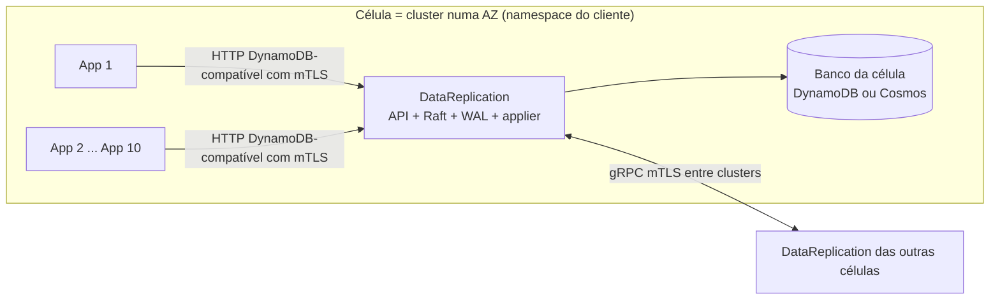

# Forma do app, escopo, premissas e metas

> Detalhe de arquitetura do **DataReplication v1**. A numeração das seções (ex.: 5.3, 6.8) vem do documento de origem e é usada nas referências cruzadas; o mapa está em [00_COMECE_AQUI](../00_COMECE_AQUI.md). Visão geral e decisões: [documento principal](../DataReplication_Versao_1.md).

## 2. Escopo, premissas e metas mensuráveis

### 2.1 Requisitos concretos (do Bruno)
- Go 1.27.
- Cloud-native: roda em **AKS e EKS**.
- **12 Factors** (com desvios inevitáveis para o módulo `core`, ver seção 10).

### 2.2 Critérios, traduzidos em metas que dá para testar

| Critério do Bruno | Meta proposta (a calibrar) | Observação |
|---|---|---|
| Extrema performance | Overhead P99 ≤ 50ms por transação completa, a ~3.000 TPS. Alvo interno de 30–35ms para ter margem. O contrato ao cliente é um **SLO ponta a ponta medido sobre a operação completa** (overhead + escrita no banco, ADR-036), não uma soma de metas por etapa (06, seção 7). | "Performance" aqui é **latência de cauda**, não vazão. 3.000 TPS × 2 KB ≈ 6 MB/s: o disco e a CPU não são o gargalo. O gargalo são o fsync, o RTT AWS↔Azure e o P99 do DynamoDB. |
| Resistente a falha e autocurável | Reiniciar qualquer processo sem perda de dado ACKado; reconvergência automática sem humano para falhas de 1 célula. O RTO de desastre é a **distribuição medida em exercícios** (mediana, P95, pior caso), com piso D + M se a AWS morrer em modo degradado (ADR-044). | Falhas que exigem humano ficam explícitas na **matriz automático, assistido e manual** (08, 9.5): promoção, `SKIP`, `drctl rebuild`, órfãs, prorrogação de lease e recriação da célula (PEND-01, ADR-044). |
| Leve e baixo consumo de memória | `DataReplication` ≤ 256 MiB RSS, partida em segundos. | Sem sidecar por pod (R1), o critério vale para o único app da célula. |

### 2.2.1 Notas: possível alternativa em Rust (registrado a pedido do Bruno, 12/10)

**Estado:** a v1 segue em **Go 1.27** (requisito concreto). Rust fica registrado como alternativa a reavaliar depois do spike S2, se a medição mostrar que a pausa de GC afeta o heartbeat ou a cauda de latência. Não consegui verificar o estado atual das bibliotecas Rust citadas.

| | Prós de Rust | Contras de Rust |
|---|---|---|
| **Latência** | Sem coletor de lixo: cauda de latência e heartbeat mais previsíveis | Em ~3.000 TPS o gargalo está fora da linguagem (fsync, RTT AWS↔Azure, P99 do DynamoDB); o ganho tende a ser pequeno |
| **Memória** | Consumo menor e previsível; parse sem cópia (ajuda o H-DR6) | Com um único app por célula (3.1), a pressão de memória que justificava Rust caiu |
| **Segurança** | Segurança de memória e de concorrência garantida pelo compilador | Código `unsafe` e FFI continuam possíveis no WAL (I/O direto, mmap) |
| **Consenso** | `raft-rs` (usado pelo TiKV) e `openraft` existem | Menos usados que `etcd-io/raft` fora de poucos casos; o gate, o WAL e a camada multi-grupo teriam de ser escritos de qualquer forma |
| **Cloud** | SDK AWS para Rust (DynamoDB) existe; gRPC com `tonic` | SDK Azure para Cosmos em Rust é mais novo (verificar maturidade); o Cloud-Adapter é outro componente |
| **Equipe e prazo** | — | Requisito do Bruno é Go 1.27; curva de aprendizado, contratação e tempo de compilação maiores; mais código assíncrono para acertar |
| **Evolução** | O monolito modular (3.2) e o gRPC entre células permitem reescrever só o módulo crítico depois | Duas linguagens no repositório se for migração parcial |

**Gatilhos para reavaliar:** (a) o S2 mostrar P99 de heartbeat ou de commit afetado por GC mesmo com `GOMEMLIMIT` e pools; (b) o parse completo (H-DR6) não caber no orçamento; (c) a memória por célula ficar acima da meta.

### 2.3 Premissas (afetam o desenho)

| # | Premissa | Se for falsa |
|---|---|---|
| ~~A1~~ | **Retirada pelo Bruno (12/10)**, a reavaliar depois dos testes de carga. Era: "o overhead de 50ms é medido contra a escrita direta ao DynamoDB". Até lá, a tabela da seção 7 é só um alvo de trabalho, sem essa premissa. | Se a escrita no DynamoDB contar nos 50ms, o orçamento fica quase inviável (seção 7). Medir nos testes de carga. |
| A2 | Uma célula tem **vários pods de aplicação** (ex.: 10 microsserviços) falando com 1 `DataReplication` por **uma única porta** (3.5). | Se a carga for maior que um processo suporta, voltar ao modelo com proxy separado (3.4). |
| A3 | **Poucos shards lógicos** por cliente (Bruno, 12/10). Cada cliente tem a sua instalação ([ADR-043](../03_adr/ADR-043-uma-instalacao-por-cliente-identidade-por-configuracao.md)). | Com muitos grupos, seria preciso coalescer heartbeats e o Dragonboat ganharia peso (seção 5). |
| A4 | Item médio ≈ poucos KB. Limite de entrada do log: 4 MiB. | O DynamoDB aceita item de até 400 KB e batch de até 16 MB; acima do limite, a v1 recusa. |
| A5 | **Confirmada pelo Bruno (12/10):** há um **link dedicado físico (cabo de rede)** entre AWS e Azure, com tráfego transitivo entre contas e VPCs, descrito como "extremamente rápido". O RTT ainda deve ser medido (S1). | O custo do RTT entra em todo ACK. Medir antes de fixar qualquer timeout. |
| A6 | **Confirmada pelo Bruno (12/10) e mantida em 13/10 ([ADR-054](../03_adr/ADR-054-banco-por-celula-mantido.md)):** há **um DynamoDB (tabelas) por célula**. O applier de cada célula escreve só nas tabelas da própria célula. Exemplo: a célula `cell-120321` tem `cliente_cell_120321`. O DynamoDB é regional: o ganho é **isolamento lógico**, não domínio físico de falha. | Ver 6.9: nome lógico (com geração) × físico, custo de escrita multiplicado e um único escritor por tabela. |

---

## 3. Decisão central: um único app DataReplication por célula

> **Revisão de 12/10/2026 (decisão do Bruno).** A versão anterior propunha um `proxy` sidecar por pod mais um `node`. O Bruno decidiu remover o sidecar: as aplicações do cliente falam **direto** com o `DataReplication`, que reúne API/proxy, Raft e WAL num só app. Esta seção descreve esse modelo e os riscos que ele traz.

### 3.1 Modelo de implantação
- **Célula = um cluster Kubernetes (EKS ou AKS) numa única AZ.** Há 3 células na AWS e 3 na Azure.
- Em cada célula, um **namespace** agrupa logicamente as aplicações do cliente (por exemplo, 10 microsserviços) e **um único app `DataReplication`** (1 pod).
- As aplicações apontam o endpoint do AWS SDK para o Service interno do `DataReplication` e apresentam um **certificado cliente** (mTLS por aplicação, [ADR-052](../03_adr/ADR-052-autorizacao-por-aplicacao-com-mtls.md)): "só trocar o endpoint" deixou de ser verdade. O tráfego entre pods fica restrito ao namespace (NetworkPolicy).
- Entre células (clusters diferentes), só trafega a replicação `DataReplication` ↔ `DataReplication`, por um endpoint interno exposto (balanceador interno ou private link) com mTLS.

Etapas:
1. A aplicação chama o endpoint do Service como chamaria o DynamoDB, com a sua identidade mTLS.
2. O `DataReplication` autentica a aplicação e confere a lista identidade → tabelas e operações (`403` sem entrada), valida, classifica (escrita / leitura forte; Query em GSI é recusada), canonicaliza e calcula o hash de dedupe.
3. Se esta célula não for a líder do shard, **encaminha** para a líder ([ADR-010](../03_adr/ADR-010-follower-encaminha-para-lider.md)).
4. A líder replica, espera o gate (seção 5.3) e aplica no banco (sempre depois do gate, [ADR-057](../03_adr/ADR-057-um-unico-modo-strong-consistency.md)).
5. A resposta volta traduzida para o formato do DynamoDB (incluindo os erros que o SDK entende).

### 3.2 Monolito modular (decisão do Bruno, 12/10)
O `DataReplication` é **um monolito modular**: um único binário e um único processo por célula, com módulos de fronteira clara e dependências em uma só direção. Não há rede entre módulos; a comunicação é por chamada de função através de interfaces.

| Módulo | Responsabilidade | Depende de |
|---|---|---|
| `api` | HTTP compatível com DynamoDB, mTLS e autorização por aplicação, parse, classificação, dedupe, remoção do `_dr_v` das respostas, tradução de erros | `core` (interfaces) |
| `core` | Orquestra escrita, leitura forte (`min(ReadIndex, gate)`), gate (5.3), modo degradado com lease e applier | `ConsensusEngine`, `ApplyProgress`, `StateStore` (interfaces) |
| `consensus/etcdraft` | Adaptador do Raft (5.5). **Único** pacote que importa a biblioteca Raft; guarda o log do Raft no `wal` do etcd e o compacta até `RaftCompactLimit` (6.9) | disco (volume do Raft) |
| `transport` | gRPC entre células, descoberta/DNS, mTLS | `consensus` |
| `applier` | Aplica no DynamoDB/Cosmos com versão condicional | `StateStore` (interface do banco) |
| `platform` | Config (env), logs, métricas, probes, ciclo de vida | todos, só por interface |

Regras para o monolito continuar modular:
1. **Dependência em uma direção**: `api` → `core` → interfaces; as implementações ficam nos módulos de baixo e são ligadas só no `main`. Nenhum módulo de baixo importa um de cima.
2. **Pacotes `internal/`** e uma regra de lint (ex.: `depguard`) que bloqueia importação fora do desenho, em especial da biblioteca Raft e dos SDKs de nuvem.
3. **Contratos como interfaces pequenas**, com testes de conformidade que valem para qualquer implementação (isso sustenta a troca do Raft, 5.5).
4. **Pools e orçamentos separados por módulo** (CPU, filas, memória), para a `api` não competir com o Raft (ver 3.3).
5. **Um módulo só vira serviço separado** se uma medição mostrar necessidade (por exemplo, o `api` como proxy, 3.4). Como a fronteira já é uma interface, a extração não reescreve o `core`.
6. **Um único ciclo de release**: versão única do binário, mas o formato do WAL e o protocolo gRPC têm versão própria (X9).

### 3.3 Riscos deste modelo e mitigações
| Risco | Por que importa | Mitigação |
|---|---|---|
| **Pod único por célula** | Reiniciar o pod deixa todas as apps da célula sem endpoint; não há segundo pod (um segundo pod seria outra réplica Raft). | Partida rápida (recuperação do WAL em segundos), `priorityClass` alta, PDB, saída limpa com transferência de liderança, e o Compass-Router desviando o tráfego durante a manutenção (externo). |
| **CPU compartilhada** | O parse de JSON das 10 apps disputa CPU com fsync e heartbeats; atraso de heartbeat vira eleição. **Problema conhecido, aceito na v1 (H-DR6):** será medido nos testes e tratado depois. | Pools separados para a API e para o Raft, QoS *Guaranteed*, limite de tamanho de requisição antes de tocar no Raft, limite de vazão por aplicação. |
| **Raio de estrago** | Requisição com bug que derrube o processo derruba uma réplica do quórum. | Validação rígida antes do `core`, limites de memória por requisição, testes de fuzz da API. |
| **Sem escala horizontal** | O número de réplicas é o quórum; HPA não se aplica. | Escala vertical e shards; medir no spike de carga a ~3.000 TPS. |
| **Autenticação e autorização** | Sem `localhost`, a API é acessível por qualquer pod do namespace, e o papel largo passa a ser o do `DataReplication` (ampliação de privilégio). | NetworkPolicy fechando o namespace **e mTLS por aplicação com lista identidade → tabelas e operações** ([ADR-052](../03_adr/ADR-052-autorizacao-por-aplicacao-com-mtls.md), PEND-19). |
| **Isolamento entre as 10 apps** | Uma app em rajada atrasa as outras. | Shard por aplicação/tabela e limite de vazão por origem (depende de D4). |

### 3.4 Alternativa que continua possível
O sidecar fino por pod volta como evolução se o parse ou o isolamento entre apps virar problema. Por isso a fronteira `api`/`core` (3.2) fica explícita na v1.

### 3.5 Uma única porta de API (decisão do Bruno, 12/10)
A v1 expõe **uma única porta de API** por `DataReplication`. A ideia de vários listeners (um grupo de apps por porta) foi avaliada e **descartada por ora**: as portas não dão mais capacidade (mesmo processo e CPU), o isolamento seria parcial sem admissão justa no núcleo, o mapa de portas deriva com o HPA e cada porta aumenta a superfície. O foco da v1 passa a ser o **fsync** (6.8). Se os testes de carga mostrarem vizinho barulhento, reavaliar com cotas por aplicação (mTLS) em vez de portas.
