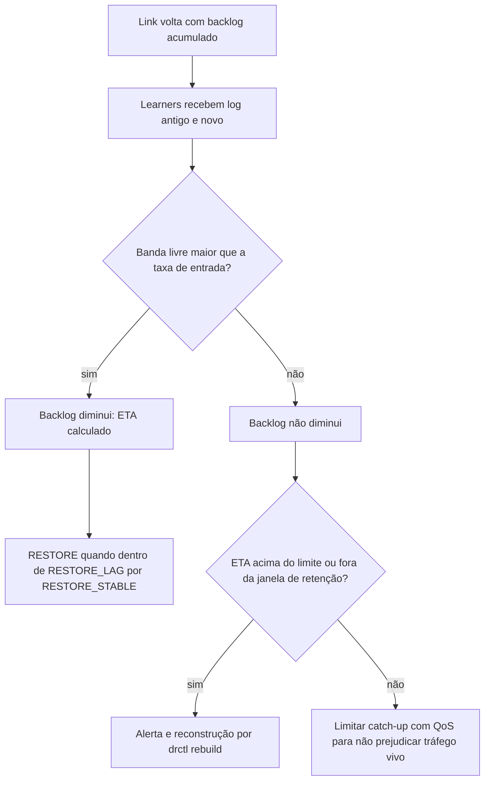

# R09 — Ressincronização da Azure lenta ou que nunca termina

**Status:** 🟡 A rever · parcialmente tratado · **ADRs:** [ADR-017](../../03_adr/ADR-017-azure-learners-e-gate.md), [ADR-041](../../03_adr/ADR-041-disco-do-log-teto-de-70-por-cento-sem-s3-na-v1.md) · **Relacionados:** [C13](../atualizados/C13-ressincronizacao-da-azure.md), [C12](../atualizados/C12-modo-degradado.md)

## Cenário

O catch-up do **log** (em bytes), feito pelo próprio Raft (`MsgApp`) enquanto o log do Raft da líder retém o que a Azure precisa, é o único que bloqueia o `RESTORE`. Se a banda disponível para o catch-up for menor ou igual à taxa de entrada nova, a Azure **nunca alcança** a AWS e o shard fica degradado até o fim do lease D, quando as escritas param (`503 LEASE_EXPIRED`) em instalações `accept` ([ADR-044](../../03_adr/ADR-044-lease-do-modo-degradado-e-promocao-da-azure.md)). O atraso de **apply** no Cosmos não bloqueia o `RESTORE`, mas afeta o RTO ([R03](R03-backlog-de-apply-no-cosmos.md)).

## Diagrama: Convergência do catch-up

## Fluxo proposto

1. Tempo de convergência ≈ `backlog / (banda_livre − taxa_de_entrada)`; infinito se a banda livre ≤ a taxa de entrada.
2. Métrica `restore_eta_seconds` e alerta quando o ETA excede um teto ou o backlog sai da janela de retenção.
3. Catch-up com **limite de vazão** e prioridade abaixo do tráfego vivo (que inclui o encaminhamento entre clouds).
4. Caminho alternativo já definido: reconstrução completa da réplica ([C21](../atualizados/C21-disco-fsync-e-reconstrucao.md)) quando a Azure está fora da janela.

## Falhas e tratativas

- **Catch-up consome o link.** Se o catch-up usar toda a banda, o encaminhamento e a replicação ao vivo pioram ([C25](../atualizados/C25-link-lento-faixa-cinzenta.md)).
- **Catch-up mais lento que o lease.** Se o ETA do `RESTORE` passa de D, as escritas param antes de a Azure alcançar a AWS; a pessoa decide entre `RENEW` e a reconstrução (`drctl rebuild`, [C33](../atualizados/C33-reconstrucao-em-tabela-sombra.md) para o banco). O ETA entra no alerta junto com o tempo restante do lease.

## Pontos em aberto

- Banda do cabo dedicado e limites de QoS (dado do time de rede). Valor de `RESTORE_LAG` (PEND-12).
