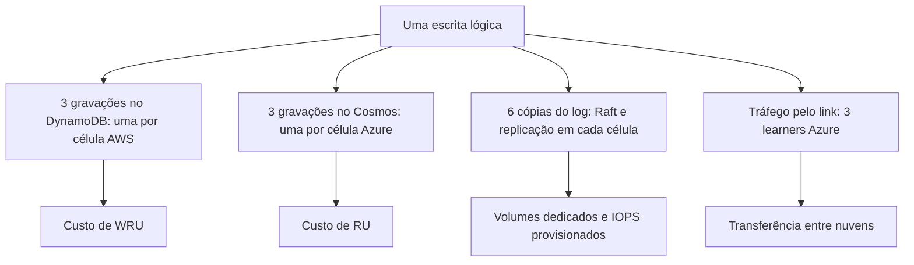

# R20 — Custo: cada escrita lógica vira seis gravações

**Status:** 🟡 A rever · decidido em 13/10 manter seis bancos ([ADR-054](../../03_adr/ADR-054-banco-por-celula-mantido.md)); falta a estimativa de custo por cliente e o teto aceito · **ADRs:** [ADR-054](../../03_adr/ADR-054-banco-por-celula-mantido.md), [ADR-022](../../03_adr/ADR-022-banco-por-celula-nome-logico.md), [ADR-017](../../03_adr/ADR-017-azure-learners-e-gate.md) · **Relacionados:** [C01](../atualizados/C01-visao-geral.md)

## Cenário

Cada escrita lógica é aplicada em **seis bancos**: 3 DynamoDB (um por célula AWS) e 3 Cosmos (um por célula Azure). A decisão de um banco por célula ([ADR-022](../../03_adr/ADR-022-banco-por-celula-nome-logico.md)) foi **mantida** na revisão de 13/10 ([ADR-054](../../03_adr/ADR-054-banco-por-celula-mantido.md)). Ela multiplica o custo de gravação por seis, além de volumes de disco, tráfego pelo link e seis clusters. O argumento que a sustenta é de **isolamento lógico**: corrupção ou throttling de uma tabela não atinge as outras, e o applier de cada célula não depende das demais. Ela não compra domínios de falha físicos: o DynamoDB é regional e já replica por três AZs, então três tabelas na mesma região não são três domínios físicos (o mesmo vale para o Cosmos com redundância de zona). A durabilidade por AZ vem dos três logs Raft.

## Diagrama: Onde o custo se multiplica

## Fluxo proposto

1. Estimativa do custo mensal com os números reais: tamanho médio do item, TPS de escrita por tabela e preços vigentes de DynamoDB sob demanda e Cosmos em RU.
2. Medir as RU por escrita no Cosmos com o Cloud-Adapter (escrita condicional incluída).
3. A alternativa de **um banco regional por nuvem** (duas materializações, com a líder como única aplicadora) foi considerada e **não adotada** ([ADR-054](../../03_adr/ADR-054-banco-por-celula-mantido.md)). Se o custo medido for inaceitável, ela pode ser reaberta, sem trocar o requisito de RPO 0; os riscos dela são um ponto lógico de corrupção na AWS e throttling compartilhado entre escrita ao vivo e replay.
4. Cada fluxo que o ADR-054 multiplica por seis entra na estimativa: reconciliação, fencing, e o rebuild em tabela sombra ([ADR-047](../../03_adr/ADR-047-delete-real-invariante-e-reconstrucao-em-tabela-sombra.md), [C33](../atualizados/C33-reconstrucao-em-tabela-sombra.md)), que gasta WCU e RU extras durante a varredura.

## Falhas e tratativas

- **Escrita condicional.** Condições de versão podem custar o mesmo que uma escrita simples, mas confirmar no teste. `TransactWriteItems` custaria o dobro ([C23](../atualizados/C23-batchwriteitem-lote-uma-entrada.md)).
- **Multiplicado por cliente (13/10).** Cada cliente é uma instalação completa e isolada ([ADR-043](../../03_adr/ADR-043-uma-instalacao-por-cliente-identidade-por-configuracao.md)): os seis bancos, os seis clusters e os volumes se repetem por time. A estimativa precisa de um custo por cliente e de um custo fixo mínimo, não só da fórmula por escrita.
- **Um volume por nó ([ADR-019](../../03_adr/ADR-019-wal-proprio-volume-dedicado.md), [ADR-041](../../03_adr/ADR-041-disco-do-log-teto-de-70-por-cento-sem-s3-na-v1.md)).** Cada um dos 6 nós da instalação (3 AWS e 3 Azure) tem um volume de bloco dedicado para o log do Raft: **6 volumes por instalação, por cliente**. Ele está no caminho do ACK, precisa de IOPS provisionadas (gp3 na AWS, Premium SSD v2 na Azure) e é dimensionado para reter D de escrita a 70% no modo degradado. Não há escrita em dobro: cada entrada é gravada uma vez, com um único fsync no caminho do ACK. Entra no custo fixo mínimo da instalação.
- **Apply de leitura.** Leituras fortes em célula follower leem o banco local, então a carga de leitura se espalha, mas cada célula tem a sua cobrança.

## Ordem de grandeza (sem preços)

Premissa a confirmar: ~3.000 escritas lógicas por segundo contínuas.

| Medida | Cálculo | Resultado |
|---|---|---|
| Escritas lógicas por mês | 3.000 × 86.400 × 30 | ≈ 7,8 bilhões |
| Gravações nos DynamoDB por mês | 7,8 bi × 3 células | ≈ 23,3 bilhões de itens |
| Gravações nos Cosmos por mês | 7,8 bi × 3 células | ≈ 23,3 bilhões de itens |
| Unidades de gravação do DynamoDB | gravações × ⌈tamanho do item em KB⌉ | por exemplo, itens de 2 KB: ≈ 46,6 bilhões de WRU por mês |
| Dados replicados pelo link | 3.000 × tamanho × 3 learners | com 2 KB, ≈ 18 MB/s |

Preços e RU por escrita ficam para a estimativa de custo; os números acima só dimensionam o volume.

## Pontos em aberto

- Quem estima e valida o custo (FinOps) e o teto aceitável por mês.
- Estimativa por cliente: custo variável por escrita e custo fixo mínimo da instalação (seis bancos, seis clusters, volumes), com os preços vigentes.
- O motivo de manter seis bancos (padrão de bulkhead da organização ou escolha do projeto) não foi registrado; se for regra da organização, citar a fonte no ADR-054.
