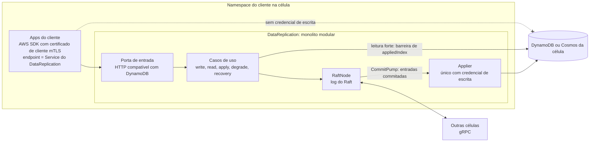

# C02 — Dentro da célula: apps do cliente e DataReplication

**Status:** ✅ Atualizado (modelo v1) · **ADRs:** [ADR-016](../../03_adr/ADR-016-app-unico-por-celula-monolito-modular.md), [ADR-031](../../03_adr/ADR-031-hexagonal-e-bibliotecas.md), [ADR-021](../../03_adr/ADR-021-grpc-entre-celulas.md), [ADR-052](../../03_adr/ADR-052-autorizacao-por-aplicacao-com-mtls.md)

## Cenário

No namespace do cliente, as apps (por exemplo 10 microsserviços) falam com **um único** `DataReplication` por uma porta. Não há sidecar nem HPA: o número de réplicas é o quórum. Uma NetworkPolicy fecha o namespace e cada app fala **mTLS** com o `DataReplication`, que autoriza por uma lista identidade → tabelas e operações ([C34](C34-autorizacao-por-aplicacao.md)). As apps **não têm credencial de escrita** nos bancos; só o applier do `DataReplication` escreve.

## Diagrama

## Etapas

1. A app chama o AWS SDK apontando o endpoint para o Service do `DataReplication` no namespace e apresentando o certificado de cliente (mTLS). Trocar só o endpoint não basta.
2. O `DataReplication` autentica a identidade, confere a lista de permissões (sem entrada, `403`) e classifica a chamada: escrita ou leitura forte (Query em GSI é recusada).
3. Escrita: segue o fluxo de C03 (apply depois do gate, paralelo por chave).
4. Leitura: segue o fluxo de C05 (sempre forte, pela barreira `min(ReadIndex, gate)`).
5. O applier é o único com credencial de escrita no banco da célula; a app não consegue contornar a camada.

## Falhas e tratativas

- **Aplicação escreve direto no banco (bypass).** Barrado por IAM: a app não tem credencial de escrita ([C20](C20-bypass-de-escrita-direta.md)).
- **Aplicação escreve em tabela que não é dela, pelo proxy.** Barrado pela lista de permissões por identidade: `403` ([C34](C34-autorizacao-por-aplicacao.md)).
- **DataReplication cai ou reinicia.** Ver [C19](C19-falha-do-datareplication.md).
- **Cache de líder desatualizado.** A líder antiga recusa ou encaminha, e toda resposta traz a líder e o termo atuais ([ADR-010](../../03_adr/ADR-010-follower-encaminha-para-lider.md)).

## Pontos em aberto

- Autenticação e autorização entre apps e `DataReplication`: NetworkPolicy do namespace como primeira barreira e mTLS por aplicação com lista de permissões ([C31](C31-implantacao-por-cliente-e-identidade.md), [C34](C34-autorizacao-por-aplicacao.md)).
