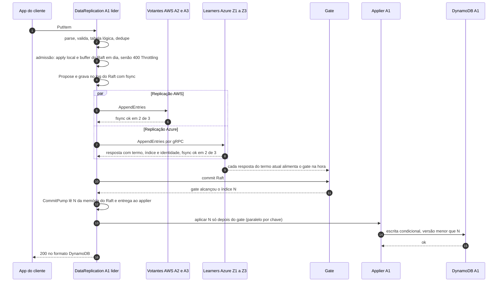

# C03 — Caminho feliz: escrita (apply depois do gate, paralelo por chave)

**Status:** ✅ Atualizado (modelo v1, revisão crítica de 13/10/2026; admissão e apply por chave em 14/10/2026) · **ADRs:** [ADR-005](../../03_adr/ADR-005-ack-exige-gate.md), [ADR-017](../../03_adr/ADR-017-azure-learners-e-gate.md), [ADR-057](../../03_adr/ADR-057-um-unico-modo-strong-consistency.md), [ADR-058](../../03_adr/ADR-058-apply-paralelo-por-chave-com-marca-dagua.md), [ADR-029](../../03_adr/ADR-029-gate-monotonico-na-troca-de-lider.md), [ADR-046](../../03_adr/ADR-046-gate-so-conta-progresso-validado-pelo-raft.md), [ADR-056](../../03_adr/ADR-056-group-commit-por-shard-e-nada-sai-antes-do-fsync.md), [ADR-060](../../03_adr/ADR-060-laco-do-raft-nunca-espera-o-apply-e-admissao-por-atraso.md) · **Relacionados:** [Orçamento de latência](../../01_arquitetura/06_leitura_forte_escrita_serial_e_latencia.md), [C05](C05-leitura-strong.md), [C06](C06-follower-encaminha.md), [X07](../complexos/X07-gate-explicado-com-exemplos.md), [Estado atual](../../ESTADO_ATUAL.md)

## Cenário

Regime normal, AWS e Azure se alcançando. A app faz um `PutItem`. O `DataReplication` valida, deduplica, confere a admissão (apply local e buffer do Raft em dia) e propõe a entrada ao Raft. A entrada é gravada com fsync no log do Raft, replicada para 2 de 3 votantes AWS e para 2 de 3 learners Azure. Quando o gate alcança o índice, o applier grava no banco da célula e o ACK sai. **O apply é sempre depois do gate**, em paralelo por chave e com o `applied` como marca d'água contígua ([ADR-058](../../03_adr/ADR-058-apply-paralelo-por-chave-com-marca-dagua.md)), em todas as instalações (modo único, [ADR-057](../../03_adr/ADR-057-um-unico-modo-strong-consistency.md)), então o `applied` nunca passa do gate. RPO = 0. O apply nas outras células é assíncrono.

## Diagrama

## Etapas

1. **Entrada:** o SDK envia o `PutItem` ao `DataReplication` da célula (se não for a líder, ele encaminha, C06).
2. **Preparo:** parse completo do JSON (H-DR6), validação, tradução do nome lógico da tabela e dedupe pelo identificador estável da **requisição** ([ADR-026](../../03_adr/ADR-026-dedupe-de-retry-id-estavel.md)).
3. **Admissão:** antes de propor, a líder recusa com `400 ThrottlingException` se o apply local está mais de `APPLY_LAG_MAX` entradas atrás do gate ([ADR-060](../../03_adr/ADR-060-laco-do-raft-nunca-espera-o-apply-e-admissao-por-atraso.md)) ou se o buffer de entradas não persistidas do Raft está cheio ([ADR-056](../../03_adr/ADR-056-group-commit-por-shard-e-nada-sai-antes-do-fsync.md)). Nada entra no log, e o SDK repete com backoff.
4. **Proposta:** a entrada leva a imagem final do item (post-image) e vira uma entrada do Raft; a versão do item é o índice Raft.
5. **Durabilidade AWS:** fsync no log do Raft da líder e em 2 de 3 votantes.
6. **Durabilidade Azure:** em paralelo, os learners gravam com fsync; 2 de 3 confirmam. O progresso da Azure só chega pelas respostas do `AppendEntries`, com termo, índice e identidade do learner ([ADR-046](../../03_adr/ADR-046-gate-so-conta-progresso-validado-pelo-raft.md)).
7. **Gate:** `gateIndex = min(commit Raft, maioria Azure durável no termo atual)` alcança N. O gate é alimentado **por evento** (cada resposta de learner), não só quando chega um lote commitado.
8. **Distribuição:** o `CommitPump` lê N por faixa da memória do Raft e a entrega ao applier ([ADR-060](../../03_adr/ADR-060-laco-do-raft-nunca-espera-o-apply-e-admissao-por-atraso.md)). Não há outra escrita em disco: o único fsync no caminho do ACK é o do Raft.
9. **Apply:** o applier grava no banco da célula **só depois do gate**, em paralelo por chave (a mesma chave na ordem do log), com escrita condicional `v < N`; o ACK espera a marca d'água alcançar N. A barreira entre gate e apply é a razão de a leitura forte poder usar `min(ReadIndex, gate)` ([C05](C05-leitura-strong.md)).
10. **ACK:** o `DataReplication` responde ao SDK. As demais células aplicam N de forma assíncrona.

## Falhas e tratativas

- **Apply no banco falha de forma transitória.** Throttling ou erro 5xx depois do commit. A escrita não se perde; a resposta é `503 PENDING` (retentável) e o applier repete com backoff. O retry do SDK é absorvido pelo dedupe e pela versão ([ADR-026](../../03_adr/ADR-026-dedupe-de-retry-id-estavel.md)).
- **Apply falha de forma permanente.** Item que o banco recusa sempre estaciona o applier; quem espera o apply dele recebe `503 PENDING` na hora: [C26](C26-entrada-venenosa.md).
- **Banco lento ou apply atrasado.** A admissão recusa escritas novas com `ThrottlingException` antes de entrarem no log, e o laço do Raft segue com tick e heartbeat ([C35](C35-banco-lento-nao-derruba-a-lideranca.md)).
- **Azure lenta ou fora.** O gate segura o ACK. Sem Azure por `DEGRADE_AFTER`, o resultado depende da `DEGRADED_POLICY`: `accept` entra em modo degradado com lease ([C12](C12-modo-degradado.md), [C32](C32-particao-e-lease-do-modo-degradado.md)); `reject` responde `503 PENDING`.
- **Prazo da requisição estoura.** Ver [C07](C07-timeout-depois-do-commit.md) e [ADR-028](../../03_adr/ADR-028-timeouts-em-cascata.md).

## Pontos em aberto

- O ACK espera o apply só no banco da célula líder (6.9, item 4), então o P99 do DynamoDB entra no caminho do ACK: [C24](C24-orcamento-de-50ms-e-escrita-no-dynamodb.md). Não há apply antes do gate: o modo único é strong ([ADR-057](../../03_adr/ADR-057-um-unico-modo-strong-consistency.md)); o paralelismo é só entre chaves, depois do gate ([ADR-058](../../03_adr/ADR-058-apply-paralelo-por-chave-com-marca-dagua.md)).
- Latência total depende do RTT AWS↔Azure e do P99 de fsync, ainda não medidos (spike S1).
