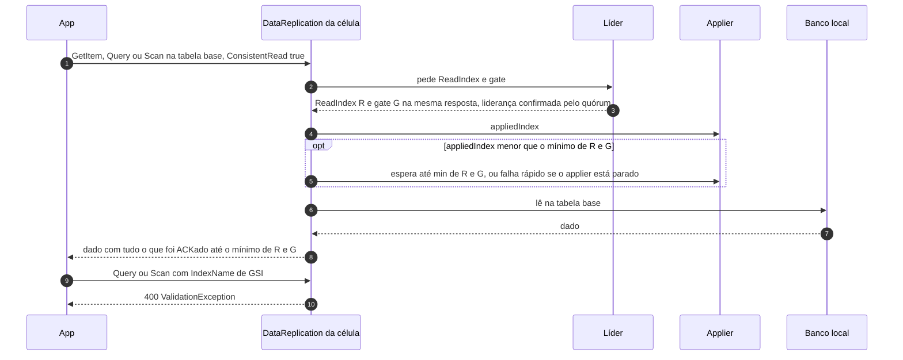

# C05 — Caminho feliz: leitura strong

**Status:** ✅ Atualizado (modo único strong, 13/10/2026) · **ADRs:** [ADR-057](../../03_adr/ADR-057-um-unico-modo-strong-consistency.md), [ADR-049](../../03_adr/ADR-049-barreira-da-leitura-forte-e-o-gate.md), [ADR-050](../../03_adr/ADR-050-query-em-gsi-recusada.md), [ADR-024](../../03_adr/ADR-024-delete-real-ttl-local-gsi.md), [ADR-046](../../03_adr/ADR-046-gate-so-conta-progresso-validado-pelo-raft.md)

## Cenário

O `DataReplication` tem um único modo, strong consistency ([ADR-057](../../03_adr/ADR-057-um-unico-modo-strong-consistency.md)). As aplicações enviam `ConsistentRead=true`; uma leitura de tabela base que chegue sem o parâmetro é servida da mesma forma, porque não há outro caminho. A leitura pede à líder o **ReadIndex e o gate** e espera o `appliedIndex` local alcançar **`min(ReadIndex, gate)`**. Um cliente só pode ter visto escritas já ACKadas, e toda escrita ACKada está abaixo do gate, então a leitura-do-que-escrevi continua garantida **sem depender da saúde da Azure**. `Query` em GSI é recusada ([ADR-050](../../03_adr/ADR-050-query-em-gsi-recusada.md)).

## Diagrama

## Etapas

1. **Alvo:** a célula pede à líder o `ReadIndex`; a líder confirma com o quórum que ainda é líder e devolve R **e o gate G na mesma resposta**. Um gate antigo guardado na follower enfraqueceria a garantia, por isso nunca é reutilizado.
2. **Barreira:** o `DataReplication` compara o `appliedIndex` local com `min(R, G)` e espera o applier, até o prazo da requisição. Como o apply é serial e depois do gate, `applied` nunca passa do gate, e uma Azure lenta **não atrasa** a leitura.
3. **Leitura:** lê o banco local e responde com todas as escritas ACKadas até `min(R, G)`.
4. **Líder recém-eleita:** só atende leitura depois de reconstruir o gate com progresso confirmado no termo novo ([ADR-029](../../03_adr/ADR-029-gate-monotonico-na-troca-de-lider.md), [ADR-046](../../03_adr/ADR-046-gate-so-conta-progresso-validado-pelo-raft.md)).
5. **GSI:** `Query` ou `Scan` com `IndexName` de GSI é recusado com `ValidationException` (400), com ou sem `ConsistentRead`.
6. **Células da Azure antes da promoção:** mesma regra de qualquer célula seguidora (ReadIndex e gate da líder AWS, espera o Cosmos alcançar a barreira). Sem líder alcançável, `503`.
7. **Sem relógio:** a leitura usa ReadIndex e gate e nunca lease (X11).
8. **Exemplos com dados mock:** cada passo acima com valores concretos (leitura na líder, célula atrasada, escrita em voo, ler o que acabei de escrever em outra célula, Azure fora) e o fluxograma da decisão da leitura estão em [X08](../complexos/X08-leitura-forte-com-exemplos.md).

## Falhas e tratativas

- **Líder isolada que ainda não sabe que perdeu.** O ReadIndex exige quórum: sem ele a líder não responde.
- **Sem líder conhecida** (eleição, partição): espera até 1 s e `503`, como a escrita ([ADR-039](../../03_adr/ADR-039-sem-lider-conhecida-espera-ate-1s-e-503.md)).
- **Applier parado** (entrada venenosa, [C26](C26-entrada-venenosa.md)). O `appliedIndex` não chega ao alvo: a leitura do shard falha rápido com `503`, em vez de esperar até o prazo.
- **Modo degradado:** as células da Azure não alcançam a líder e recusam com `503`; nunca devolvem dado defasado.
- **Scan.** A barreira vale antes de cada página, mas não há instantâneo entre páginas: dois Scans consecutivos podem divergir.
- **TTL.** Cada célula expira por conta própria e com atraso; a aplicação filtra pelo atributo de TTL ([X06](../complexos/X06-delete-ttl-gsi.md)).
- **Prazo vence esperando o applier.** Erro recuperável (o SDK retenta).
- **Líder recém-eleita com a Azure fora** (cenário oculto, T7 de [X08](../complexos/X08-leitura-forte-com-exemplos.md)). A líder nova não fica com o gate pronto enquanto 2 learners Azure não confirmarem no termo dela: toda leitura forte do shard responde `503 GATE_NOT_READY` até o link voltar. Usar o gate recebido da líder antiga poderia esconder uma escrita já ACKada. Tratamento em avaliação (pergunta 3 de X08).

## Pontos em aberto

- Leitura em células follower concentra ReadIndex na líder e soma ~1 RTT: [R16](../a_rever/R16-leitura-forte-em-celulas-follower.md).
- Leitura forte indisponível numa líder nova enquanto a Azure está fora (T7 de [X08](../complexos/X08-leitura-forte-com-exemplos.md)): aceitar e bloquear manutenção com o link fora, ou só ACKar depois de o gate chegar a 2 de 3 células AWS.
