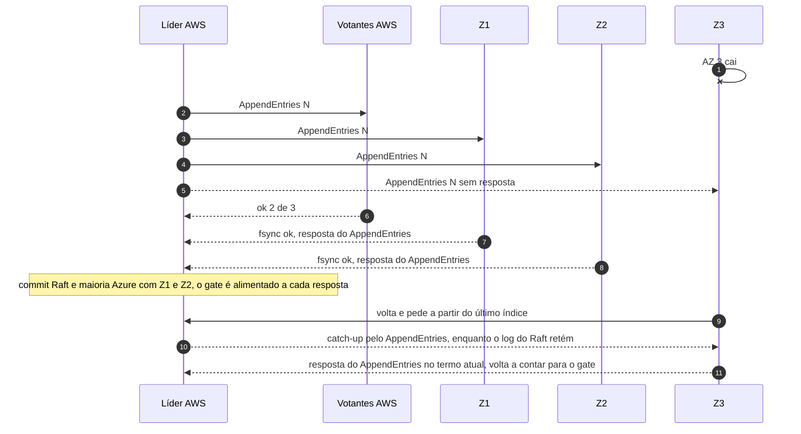

# C09 — Queda de uma AZ na Azure

**Status:** ✅ Atualizado (modelo v1) · **ADRs:** [ADR-017](../../03_adr/ADR-017-azure-learners-e-gate.md), [ADR-046](../../03_adr/ADR-046-gate-so-conta-progresso-validado-pelo-raft.md), [ADR-045](../../03_adr/ADR-045-politica-de-degradacao-por-instalacao.md)

## Cenário

Uma AZ da Azure cai (por exemplo, Z3). Z1 e Z2 seguem como maioria dos learners (2 de 3), então o gate segue satisfeito. Nada muda para o cliente. Quando Z3 volta, faz catch-up pelo log antes de contar de novo para o gate: só conta depois de responder ao `AppendEntries` no termo atual, com termo, índice e identidade. Se **duas** AZs da Azure caem, é como a Azure inalcançável: com `DEGRADED_POLICY=accept` entra o modo degradado com lease ([C12](C12-modo-degradado.md)); com `reject` a escrita responde `503 PENDING` e o RPO continua 0.

## Diagrama

## Etapas

1. A AZ 3 da Azure cai; Z3 fica fora.
2. A líder replica N para os votantes AWS e para Z1, Z2 e Z3 (sem resposta de Z3).
3. 2 de 3 votantes AWS e 2 de 3 learners (Z1 e Z2) confirmam o fsync; o gate libera.
4. Z3 volta e recebe as entradas que faltam pelo próprio Raft (`MsgApp`), enquanto o log do Raft da líder ainda retém o que Z3 precisa. Se a compactação já passou do índice de Z3, Z3 volta por reconstrução em tabela sombra ([C33](C33-reconstrucao-em-tabela-sombra.md)).

## Falhas e tratativas

- **Duas AZs da Azure caem.** Do ponto de vista da AWS é igual à Azure inalcançável: modo degradado com lease se `accept` (C12, [C32](C32-particao-e-lease-do-modo-degradado.md)) ou `503 PENDING` se `reject`; ressincronização depois (C13).
- **Z3 volta com disco novo.** Identidade nova como learner e reconstrução ([C21](C21-disco-fsync-e-reconstrucao.md)).
