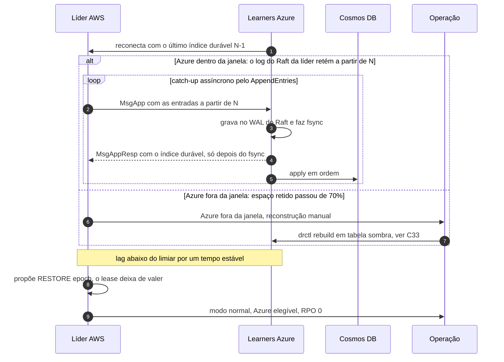

# C13 — Ressincronização da Azure

**Status:** ✅ Atualizado (modelo v1) · **ADRs:** [ADR-014](../../03_adr/ADR-014-modo-degradado-opcao-b.md), [ADR-044](../../03_adr/ADR-044-lease-do-modo-degradado-e-promocao-da-azure.md), [ADR-047](../../03_adr/ADR-047-delete-real-invariante-e-reconstrucao-em-tabela-sombra.md), [ADR-041](../../03_adr/ADR-041-disco-do-log-teto-de-70-por-cento-sem-s3-na-v1.md), [ADR-046](../../03_adr/ADR-046-gate-so-conta-progresso-validado-pelo-raft.md), [ADR-034](../../03_adr/ADR-034-fsync-fatal-e-identidade-nova.md) · **Relacionados:** [X02 Modo degradado](../complexos/X02-modo-degradado.md)

## Cenário

A Azure (ou o link) volta. Os learners pedem as entradas a partir do último índice durável que têm, e o catch-up é assíncrono. Com o lag abaixo do limiar e histerese, a líder propõe `RESTORE(epoch)`, o modo degradado e o lease terminam e o gate volta a exigir a maioria Azure. Se o lease já tinha vencido (`503 LEASE_EXPIRED`), as escritas só voltam com o `RESTORE` (ou com um `RENEW` humano). Se a retenção do log na AWS não cobrir o período, a Azure precisa de reconstrução manual assistida (`drctl rebuild`), que segue o protocolo da tabela sombra ([C33](C33-reconstrucao-em-tabela-sombra.md)).

**Catch-up pelo próprio Raft.** Enquanto a Azure está dentro da janela, o log do Raft da líder retém tudo a partir do índice durável da maioria Azure: a compactação não passa desse ponto (`domain.RaftCompactLimit`), e a retenção fica no disco do WAL e na memória do `MemoryStorage`, até o teto de 70% do volume do Raft ([ADR-041](../../03_adr/ADR-041-disco-do-log-teto-de-70-por-cento-sem-s3-na-v1.md)). O catch-up é o `AppendEntries` normal (`MsgApp`): o learner grava as entradas no seu WAL com fsync e só então responde, e o gate conta só o progresso que chega por essa resposta ([ADR-046](../../03_adr/ADR-046-gate-so-conta-progresso-validado-pelo-raft.md)). Não há canal de catch-up separado. Se a Azure saiu da janela (o espaço retido passou do teto), ela deixa de segurar a compactação e volta por reconstrução em tabela sombra.

## Diagrama

## Etapas

1. Os learners reconectam informando o último índice durável.
2. Se a Azure está dentro da janela, o log do Raft da líder ainda tem as entradas, e o próprio `AppendEntries` resolve: o learner grava no seu WAL **com fsync**, só então responde, e aplica no Cosmos em ordem.
3. Se a retenção passou do teto, a Azure é marcada fora da janela, deixa de segurar a compactação e a reconstrução em tabela sombra é manual.
4. Com o lag abaixo do limiar de forma estável (histerese), a líder propõe `RESTORE`.
5. O RPO volta a 0 e a Azure volta a ser elegível para promoção. Se a Azure já tiver sido promovida (passou D + M e a epoch mudou), não há `RESTORE`: a AWS é tratada como em [C16](C16-aws-volta-apos-promocao.md). A elegibilidade para o failover depende também do limite de lag de apply do Cosmos (PEND-18), a definir.

## Falhas e tratativas

- **Catch-up mais lento que a entrada nova.** O catch-up do log (em bytes) é rápido e é o único que bloqueia o RESTORE. O atraso de apply no Cosmos não bloqueia o RESTORE, mas afeta o RTO: [R03](../a_rever/R03-backlog-de-apply-no-cosmos.md).
- **Learner cai no meio do catch-up.** O que foi gravado com fsync no WAL fica; o resto é reenviado pelo Raft a partir do último índice durável. O learner nunca responde um índice acima do último fsync do seu WAL.
- **Memória da líder durante o catch-up longo.** Tudo o que a líder retém para a Azure está também na memória do `MemoryStorage`; com a Azure muito atrasada, a memória do nó cresce até o teto (risco 46, PEND-24).
- **Azure não alcança a AWS.** Parcialmente tratado: [R09](../a_rever/R09-resincronizacao-lenta-ou-bloqueada.md).
- **Lease vencido e a Azure volta.** O `RESTORE` encerra o degradado; ele não pode competir com uma promoção. Se a Azure estiver bloqueada para promoção (`promotion_blocked`, H-DR13), a ordem entre `RENEW`, `RESTORE` e o desbloqueio é definida no modelo TLA+ ([C32](C32-particao-e-lease-do-modo-degradado.md)).

## Pontos em aberto

- Reconstrução automática de réplica (H-DR1): [R23](../a_rever/R23-hipoteses-gerais.md).
