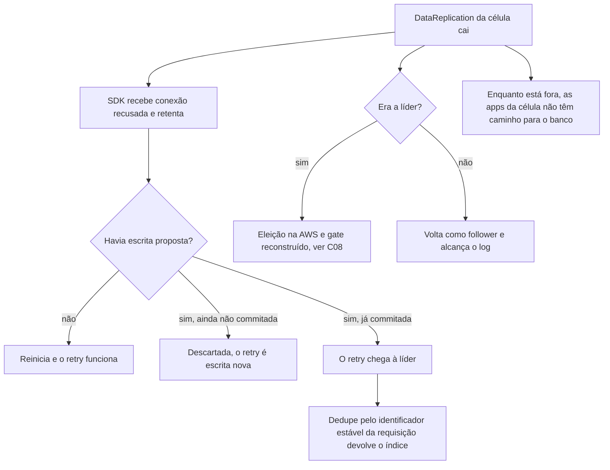

# C19 — O DataReplication da célula cai ou reinicia

**Status:** ✅ Atualizado (modelo v1) · **ADRs:** [ADR-016](../../03_adr/ADR-016-app-unico-por-celula-monolito-modular.md), [ADR-026](../../03_adr/ADR-026-dedupe-de-retry-id-estavel.md), [ADR-028](../../03_adr/ADR-028-timeouts-em-cascata.md) · **Relacionados:** [C07](C07-timeout-depois-do-commit.md)

## Cenário

O `DataReplication` é o único caminho entre as apps e o banco da célula, e há um só por célula. Se cai (crash, OOM, deploy), o SDK recebe conexão recusada e retenta. O pior caso é cair **depois** de propor a escrita: o retry chega a um processo novo, mas o dedupe da líder pelo identificador estável reconhece a repetição.

## Diagrama

## Etapas

1. O processo cai e o SDK da app recebe conexão recusada.
2. Se não havia escrita em voo, o retry automático do SDK funciona quando o pod volta.
3. Se havia escrita já commitada, o retry chega à líder (a mesma ou a nova) e o dedupe devolve o índice sem entrada nova.
4. Se era a líder, há eleição (C08); se não, volta como follower e alcança o log.
5. O PDB limita a indisponibilidade a uma célula por vez.

## Falhas e tratativas

- **Célula inteira sem DataReplication.** O Compass-Router (externo) pode desviar o tráfego; as apps toleram a indisponibilidade com retry do SDK.
- **Reinício no meio do apply de um lote.** O progresso por item é lido do volume do Raft; os itens já aplicados são reaplicados de forma idempotente ([C23](C23-batchwriteitem-lote-uma-entrada.md)).
- **Sem identificador estável no SDK.** Hash do conteúdo como último recurso, com falso positivo possível.

## Pontos em aberto

- Janela de dedupe e memória: [R22](../a_rever/R22-memoria-da-janela-de-dedupe.md).
