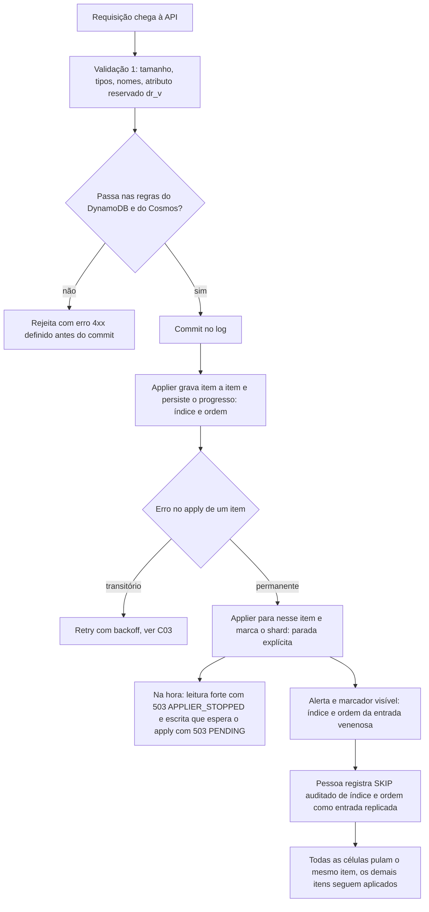

# C26 — Entrada venenosa: um item que o banco recusa para sempre (antes R02)

**Status:** ✅ Atualizado (decidido pelo Bruno em 13/10/2026; SKIP por item na revisão crítica; falha rápida em 14/10/2026) · **ADRs:** [ADR-038](../../03_adr/ADR-038-skip-de-entrada-venenosa-sempre-humano.md), [ADR-048](../../03_adr/ADR-048-skip-por-item.md), [ADR-049](../../03_adr/ADR-049-barreira-da-leitura-forte-e-o-gate.md), [ADR-057](../../03_adr/ADR-057-um-unico-modo-strong-consistency.md), [ADR-024](../../03_adr/ADR-024-delete-real-ttl-local-gsi.md), [ADR-015](../../03_adr/ADR-015-wal-post-image-e-versao.md) · **Relacionados:** [C03](C03-escrita-strong.md), [C23](C23-batchwriteitem-lote-uma-entrada.md), [X01](../complexos/X01-gate-e-troca-de-lider.md), [ADR-005](../../03_adr/ADR-005-ack-exige-gate.md), [R17](../a_rever/R17-atributo-de-versao-e-limite-400kb.md)

## Cenário

Com o `applied` como **marca d'água contígua por shard** (apply sempre depois do gate, em paralelo por chave, [ADR-058](../../03_adr/ADR-058-apply-paralelo-por-chave-com-marca-dagua.md)), o applier não pode pular um item sem decisão. Os itens anteriores ao venenoso terminam, o despacho para e a marca d'água fica logo antes dele. Se um item de uma entrada **já commitada** é recusado de forma **permanente** pelo banco (item acima do limite, tipo sem tradução no Cloud-Adapter, nome de atributo inválido no Cosmos), o `appliedIndex` para: as escritas seguintes ficam `PENDING` e as leituras fortes do shard não chegam ao alvo. **Um item trava o shard.** Como o apply é determinístico, todas as células aplicam os mesmos itens anteriores e param no mesmo item ruim: não há divergência entre réplicas, mas a semântica de pular a entrada inteira era ruim.

Variante silenciosa: a recusa acontece só no Cosmos. A AWS segue normal e o atraso da Azure cresce até o failover.

O ACK só sai depois do apply na célula da líder (6.9). Logo, uma recusa permanente na líder aparece **antes do ACK**: o cliente recebe erro. O problema real é que a entrada **já está no log** e todas as células tropeçam nela.

## Decisão

O `SKIP` de um item venenoso é **sempre decidido por uma pessoa**, identifica o item por **`(índice, ordem)`** e pula **só esse item**. O applier persiste o progresso por item ([ADR-048](../../03_adr/ADR-048-skip-por-item.md)). Não há SKIP automático.

## Diagrama: defesa em camadas

## Etapas

1. **Validar antes do commit.** A líder valida contra as regras dos **dois** bancos (`ValidateCapabilities` do Cloud-Adapter inclui as regras do Cosmos). O que nenhum banco aceita nunca vira entrada do log.
2. **Classificar o erro do apply.** Throttling, 5xx e timeout são transitórios. `ValidationException`, item grande demais e restrição são permanentes.
3. **Parada explícita.** Erro permanente para o applier no item, expõe `poison_entry_index` (com a ordem do item) e gera alerta. O shard fica visivelmente parado, em vez de lento sem explicação. Com o applier parado, quem espera um índice no item venenoso ou depois dele recebe a resposta **na hora**, em vez de esperar o prazo: a leitura forte responde `503 APPLIER_STOPPED` e a escrita, `503 PENDING` ([ADR-049](../../03_adr/ADR-049-barreira-da-leitura-forte-e-o-gate.md), item 4; implementado na POC em 14/10).
4. **`SKIP` auditado, por uma pessoa.** O operador propõe uma entrada replicada `SKIP(index, ordem, motivo, autor)`. Como passa pelo Raft, **todas as células pulam o mesmo item**; a divergência entre bancos é registrada, não escondida. A entrada original nunca é apagada. Pular a entrada inteira exige listar todas as ordens e continua sendo decisão humana.
5. **Replay.** Um replay reaplica os itens anteriores de forma idempotente (condição `v < índice`) e pula só o item marcado.

## Falhas e tratativas

- **Recusa só no Cosmos.** Se a validação não conhece uma regra do Cosmos, a AWS aplica e a Azure para. O desvio é silencioso até o failover. Mitigação: métrica `applied_lag` por cloud, teste de contrato do Cloud-Adapter com itens reais dos clientes e a suíte de conformidade contra o Cloud-Adapter ([ADR-051](../../03_adr/ADR-051-compatibilidade-dynamodb-inventario-conformidade-e-idempotencia.md)). O limite de lag de apply do Cosmos para a elegibilidade ao failover (PEND-18) também cobre esse caso.
- **Raio de impacto.** A parada vale para o shard inteiro e dura até uma pessoa decidir. As escritas do shard continuam entrando no log e respondem `503 PENDING` na hora, porque o apply delas não vai acontecer. Um circuito de proteção que recuse **antes de propor** enquanto o shard está parado evitaria encher o log com escritas que só serão aplicadas depois do SKIP; continua em aberto.
- **Tempo de resposta humana.** Sem SKIP automático, o tempo parado é o tempo do plantão. Isso entra no desenho do plantão e nos game days ([R10](../a_rever/R10-operador-lento-no-desastre.md)).
- **Divergência por SKIP.** Pular em todas as células mantém os bancos iguais entre si, mas o cliente que recebeu `PENDING` pode ter essa escrita como "desconhecida" para sempre. O SKIP precisa devolver o resultado **por item** na consulta por identificador: `REJECTED` para o item pulado, `APPLIED` para os demais, `PENDING` para os que ainda não foram aplicados.
- **Lote com item venenoso.** O lote é uma entrada ([C23](C23-batchwriteitem-lote-uma-entrada.md)), mas o `SKIP` age no item: os itens bons são mantidos, como no sucesso parcial do `BatchWriteItem` do DynamoDB. A validação pré-commit continua sendo a defesa principal.

## Pontos em aberto

- Lista final de regras de validação do Cosmos e do DynamoDB no caminho de commit (junto com [R17](../a_rever/R17-atributo-de-versao-e-limite-400kb.md)).
- Formato da consulta por item (campos e códigos de erro) e o checkpoint por item no volume do log: a detalhar na implementação.
- H-DR2 (SKIP automático) fica fora da v1 e só volta se o plantão se mostrar um gargalo.
