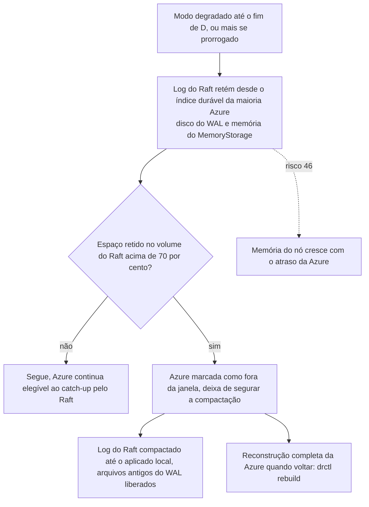

# C29 — Disco do log esgota durante uma degradação longa (antes R08)

**Status:** ✅ Atualizado (decidido pelo Bruno em 13/10/2026) · **ADRs:** [ADR-041](../../03_adr/ADR-041-disco-do-log-teto-de-70-por-cento-sem-s3-na-v1.md), [ADR-019](../../03_adr/ADR-019-wal-proprio-volume-dedicado.md), [ADR-063](../../03_adr/ADR-063-snapshot-e-compactacao-do-log-do-raft.md), [ADR-014](../../03_adr/ADR-014-modo-degradado-opcao-b.md), [ADR-044](../../03_adr/ADR-044-lease-do-modo-degradado-e-promocao-da-azure.md), [ADR-045](../../03_adr/ADR-045-politica-de-degradacao-por-instalacao.md), [ADR-047](../../03_adr/ADR-047-delete-real-invariante-e-reconstrucao-em-tabela-sombra.md) · **Relacionados:** [C32](C32-particao-e-lease-do-modo-degradado.md), [C33](C33-reconstrucao-em-tabela-sombra.md), [C12](C12-modo-degradado.md), [C21](C21-disco-fsync-e-reconstrucao.md), [X02](../complexos/X02-modo-degradado.md)

## Cenário

No modo degradado, a AWS retém todas as entradas desde `fromIndex` para a Azure fazer catch-up. A 3.000 TPS e ~2 KB por entrada são **~0,5 TB por dia por shard**. Se os votantes ficarem sem disco, o fsync falha e **não há mais commit**: o modo criado para manter o sistema de pé o derrubaria.

## Decisão

A retenção para a Azure tem **teto de 70% do volume**. Passado o teto, a Azure vira "fora da janela" e volta por **reconstrução completa**. **Sem descarga para S3 na v1.**

**Onde fica a retenção.** O disco em questão é o **volume do log do Raft**, um volume de bloco dedicado por nó ([ADR-019](../../03_adr/ADR-019-wal-proprio-volume-dedicado.md)). A retenção para a Azure fica no próprio log do Raft: no disco do WAL e na memória do `MemoryStorage`. Enquanto a Azure está dentro da janela, a compactação do log do Raft não passa do índice durável da maioria Azure (`domain.RaftCompactLimit`). O teto de 70% vale para esse volume e mede o **espaço retido**. Passado o teto, a Azure deixa de segurar a compactação, o log do Raft é compactado até o aplicado local e os arquivos antigos do WAL são liberados ([ADR-063](../../03_adr/ADR-063-snapshot-e-compactacao-do-log-do-raft.md), pendente; na POC a compactação está desligada).

**Memória.** O `MemoryStorage` do etcd-raft guarda em RAM tudo o que não foi compactado. Num modo degradado longo, a memória do nó cresce com o atraso da Azure até o teto, e não só o disco (risco 46). Mitigações em aberto: teto da janela também por bytes retidos em memória, ou um `raft.Storage` que lê as entradas antigas do WAL em disco; medir no spike S1 (PEND-24).

Com o lease do modo degradado ([ADR-044](../../03_adr/ADR-044-lease-do-modo-degradado-e-promocao-da-azure.md)), a degradação sem prorrogação dura no máximo D, e **D passa a ser o parâmetro de dimensionamento**: o volume deve reter D de escrita à taxa de pico abaixo dos 70%. O dimensionamento só vale para instalações `DEGRADED_POLICY=accept`; com `reject` o log não cresce por degradação ([ADR-045](../../03_adr/ADR-045-politica-de-degradacao-por-instalacao.md)).

## Diagrama: teto de retenção

## Etapas

1. **Alertas** de ocupação por votante com **projeção de tempo até encher**, e dimensionamento do volume para D, a maior degradação aceita (PEND-02), mais as prorrogações previstas. Uma verificação na partida ou um alerta compara D com o tempo de retenção estimado a 70% (proposta, a definir): se a retenção for menor que D, a Azure perde a elegibilidade **antes** de o lease acabar.
2. Com 70% de um volume de, por exemplo, 2 TB, a retenção para a Azure cobre pouco menos de 3 dias a 3.000 TPS. O número real depende do tamanho médio da entrada, medido em teste.
3. O que cresce é o próprio log do Raft: a compactação fica presa no índice durável da maioria Azure enquanto ela estiver na janela. Fora da degradação, a compactação vai até o aplicado local, com uma folga até o menor `match` dos votantes AWS limitada por `RAFT_RETAIN_MAX`, e o log fica curto.
4. Passado o teto, o log do Raft é compactado, os arquivos antigos do WAL são liberados, o disco e a memória voltam, e a Azure só volta por `drctl rebuild`.

## Falhas e tratativas

- **Janela perdida e a AWS cai.** Depois do teto, a Azure não alcança a AWS pelo log. Se a AWS cair nesse período, a promoção da Azure perde tudo o que foi escrito desde `fromIndex` ([R13](../a_rever/R13-escritas-orfas-reconciliacao.md)). A perda tem um teto de tempo, D, enquanto não houver prorrogação; cada `RENEW` humano estende esse teto e também a necessidade de disco.
- **Custo e duração da reconstrução completa.** A reconstrução da Azure segue o protocolo da tabela sombra ([C33](C33-reconstrucao-em-tabela-sombra.md)): copiar todo o conteúdo para o Cosmos consome RU e leva um tempo ainda não medido, durante o qual o log precisa estar retido desde F ([R09](../a_rever/R09-resincronizacao-lenta-ou-bloqueada.md), [R18](../a_rever/R18-rto-nao-quantificado.md)).
- **Volume do Raft cheio.** O fsync do WAL falha e o processo encerra ([ADR-034](../../03_adr/ADR-034-fsync-fatal-e-identidade-nova.md)): sem disco nos votantes não há commit. O teto de 70% existe para isso não acontecer.
- **Memória do nó antes do disco.** Com o `MemoryStorage` guardando tudo o que não foi compactado, a memória pode chegar ao limite do pod antes de o disco chegar a 70% (risco 46). Até a mitigação ser escolhida (PEND-24), o teto precisa ser dimensionado também pela memória do pod.
- **Disco do learner.** O mesmo risco vale do lado Azure quando o apply atrasa ([R03](../a_rever/R03-backlog-de-apply-no-cosmos.md)).
- **S3 descartado na v1.** O catch-up lendo do S3 atravessaria o link, exigiria credencial AWS na Azure ([R23](../a_rever/R23-hipoteses-gerais.md), H10) e pioraria o desastre em que a AWS some.

## Pontos em aberto

- Tempo máximo de degradação aceito pelo negócio (D), que dimensiona o volume (PEND-02).
- Alerta intermediário (por exemplo em 50%) para dar tempo de agir antes do teto.
- Tamanho do volume do Raft e mitigação da memória do `MemoryStorage` (PEND-24), medidos no spike S1 com uma degradação simulada.
