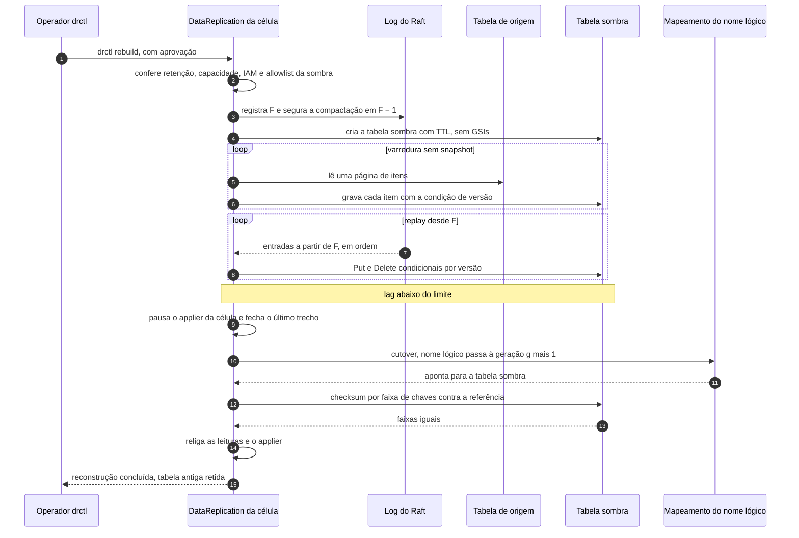
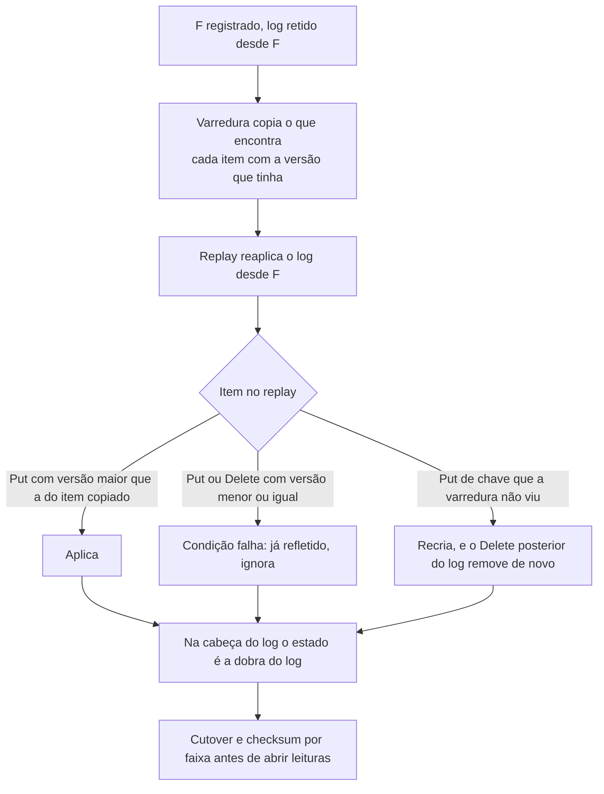

# C33 — Reconstrução do banco de uma célula em tabela sombra

**Status:** ✅ Atualizado (decidido pelo Bruno em 13/10/2026, revisão crítica); o protocolo é desenho, ainda sem teste de propriedade nem modelo TLA+ · **ADRs:** [ADR-047](../../03_adr/ADR-047-delete-real-invariante-e-reconstrucao-em-tabela-sombra.md), [ADR-022](../../03_adr/ADR-022-banco-por-celula-nome-logico.md), [ADR-024](../../03_adr/ADR-024-delete-real-ttl-local-gsi.md), [ADR-041](../../03_adr/ADR-041-disco-do-log-teto-de-70-por-cento-sem-s3-na-v1.md), [ADR-054](../../03_adr/ADR-054-banco-por-celula-mantido.md), [ADR-030](../../03_adr/ADR-030-verificacao-formal-tla.md) · **Relacionados:** [C13](C13-ressincronizacao-da-azure.md), [C21](C21-disco-fsync-e-reconstrucao.md), [C29](C29-disco-do-log-em-degradacao-longa.md), [C30](C30-aws-que-volta-boot-cercado.md), [X06](../complexos/X06-delete-ttl-gsi.md), [R09](../a_rever/R09-resincronizacao-lenta-ou-bloqueada.md), [R20](../a_rever/R20-custo-6x.md)

## Cenário

O DELETE real, sem tombstone ([ADR-024](../../03_adr/ADR-024-delete-real-ttl-local-gsi.md)), é correto quando o applier reaplica o log em ordem por chave a partir do progresso salvo: `Put(10)` recria a chave e `Delete(11)` a remove de novo. O estado errado existe só durante o replay, escondido pela regra "leituras só abrem depois do high-water mark". Os caminhos que **não passam pelo replay do log** não têm essa proteção: reconstrução do banco da célula, restauração PITR, cópia de outra célula, recriação depois do boot cercado ([C30](C30-aws-que-volta-boot-cercado.md)), Azure fora da janela do log ([C13](C13-ressincronizacao-da-azure.md), [C29](C29-disco-do-log-em-degradacao-longa.md)).

O protocolo é **cópia difusa mais replay**: copia-se a tabela sem snapshot e reaplica-se o log a partir de um índice **F**. Converge porque o apply é condicional por versão e o DELETE é reaplicado em ordem. A invariante `I-DEL` vale o tempo todo: com as leituras abertas, o estado materializado é a dobra do log até `applied`.

## Diagrama: protocolo da reconstrução

## Diagrama: por que a cópia difusa converge

## Etapas

1. **Pedido:** `drctl rebuild` é manual assistido, com aprovação humana. A tabela de origem é a de uma célula saudável do mesmo shard ou, para refazer só a estrutura, a própria tabela da célula (a escolha da origem entra no detalhamento do protocolo).
2. **Pré-condições:** o log do Raft cobre a duração estimada da varredura (ver retenção abaixo), há WCU ou RU para a cópia e o replay, e o papel do applier e a allowlist ([ADR-022](../../03_adr/ADR-022-banco-por-celula-nome-logico.md)) admitem o nome da tabela sombra.
3. **Registro de F:** o índice F é o índice aplicado da origem **antes** de começar. Um F menor que o real só custa mais replay; um F maior perderia escritas. O log do Raft é retido desde F (a compactação não passa de `F − 1` enquanto a reconstrução estiver em curso, `domain.RaftCompactLimit`) e F é persistido, para a reconstrução poder ser retomada depois de um reinício.
4. **Tabela sombra:** criada com o mesmo atributo de TTL e a mesma chave, sem GSIs (Query em GSI é recusada, [ADR-050](../../03_adr/ADR-050-query-em-gsi-recusada.md)). No Cosmos, o Cloud-Adapter cria o container equivalente.
5. **Cópia difusa:** varredura por páginas, sem snapshot; cada item é gravado com a condição de versão, para nunca sobrescrever uma versão mais nova.
6. **Replay:** o log desde F é reaplicado em ordem até a cabeça, com `Put` e `Delete` condicionais por versão ([ADR-035](../../03_adr/ADR-035-lote-batchwriteitem-uma-entrada-e-apply-condicional.md)). O estado da sombra é provisório e **ninguém lê dele**.
7. **Cutover:** com o lag abaixo de um limite (a definir), o applier da célula pausa, o último trecho é fechado e o nome lógico passa à **geração g + 1**, apontando para a tabela sombra. O cliente não percebe a troca do nome físico.
8. **Verificação:** checksum por faixa de chaves (anti-entropia) contra a referência, no mesmo índice aplicado. Só com as faixas iguais as leituras da célula e o applier são religados.
9. **Encerramento:** a tabela antiga fica retida por um prazo (a definir), para desfazer o cutover; apagá-la exige aprovação.

## Falhas e tratativas

- **O log não cobre a varredura.** Se a varredura demorar mais que a retenção do teto de 70% do volume ([ADR-041](../../03_adr/ADR-041-disco-do-log-teto-de-70-por-cento-sem-s3-na-v1.md)), o log desde F é liberado e o rebuild **falha e recomeça** com um F novo. Estimar a duração (itens, tamanho, WCU ou RU disponíveis) antes de começar e alertar quando a folga de retenção encolher; as durações reais ainda não foram medidas ([R09](../a_rever/R09-resincronizacao-lenta-ou-bloqueada.md)). Enquanto retido, o log desde F também ocupa a memória do `MemoryStorage` do nó (risco 46).
- **Custo e throttling (WCU e RU).** A varredura e o replay competem com a escrita ao vivo da célula, no DynamoDB e no Cosmos, e podem gerar throttling. Se a célula reconstruída for a líder, o throttling do applier vira latência de ACK e `503 PENDING` ([C24](C24-orcamento-de-50ms-e-escrita-no-dynamodb.md)). Recomendação: transferir a liderança antes ([C11](C11-transferencia-planejada.md)) e limitar o ritmo da cópia. O custo da tabela dupla entra em [R20](../a_rever/R20-custo-6x.md).
- **Sem GSI na tabela sombra.** Query em GSI é recusada pela camada ([ADR-050](../../03_adr/ADR-050-query-em-gsi-recusada.md)), então a sombra nasce sem GSIs: não há backfill de índice nem conferência de índice, e o checksum compara só a tabela base.
- **Cosmos pelo Cloud-Adapter.** O mesmo protocolo vale para a Azure e precisa estar no contrato do Cloud-Adapter: criar container, varrer, gravar com condição de versão, trocar o mapeamento. Os custos em RU, o limite de tamanho de item e o índice consistente do Cosmos entram na suíte de conformidade ([ADR-051](../../03_adr/ADR-051-compatibilidade-dynamodb-inventario-conformidade-e-idempotencia.md)).
- **IAM e allowlist da sombra.** O papel do applier não deve ganhar permissão de criar ou apagar tabelas por causa disso. Proposta: um papel de reconstrução separado e temporário, concedido com a aprovação do `drctl rebuild`, restrito ao padrão de nome da sombra (a definir com segurança). As aplicações continuam sem nenhuma permissão de escrita ([C20](C20-bypass-de-escrita-direta.md)).
- **TTL.** O replay pode recriar um item já expirado, e ele permanece legível até o TTL local apagá-lo de novo. É o comportamento do DynamoDB, onde o item expirado pode ser lido até a remoção, e deve estar documentado para os clientes. O checksum ignora itens expirados e a sombra precisa do mesmo atributo de TTL.
- **Reinício, troca de líder ou queda no meio.** F e o progresso da cópia são persistidos; a reconstrução retoma. Cutover interrompido: o mapeamento só muda por uma operação atômica, e sem ela a tabela antiga segue valendo.
- **Checksum diferente.** As leituras ficam fechadas e as faixas divergentes são recopiadas e reaplicadas. O checksum **detecta** divergência, não a previne.
- **Restauração PITR e cópia de outra célula.** Seguem o mesmo protocolo, com a tabela restaurada ou a copiada como origem e F igual ou menor que o índice refletido nela.
- **Cache do mapeamento.** O `DescribeTable` da partida e o cache do nome lógico precisam respeitar a geração; um `DataReplication` com geração antiga deve falhar rápido, não escrever na tabela velha.

## Pontos em aberto

- Escrever `I-DEL` como teste de propriedade (sequências aleatórias de `Put` e `Delete`, com queda em qualquer ponto) e no modelo TLA+ ([ADR-030](../../03_adr/ADR-030-verificacao-formal-tla.md)).
- Limite de lag do cutover, prazo de retenção da tabela antiga, ritmo máximo da cópia e a origem da cópia: a definir.
- Duração real da varredura por tamanho de tabela, a medir.
- Papel de reconstrução e a allowlist da sombra: a definir com segurança.
