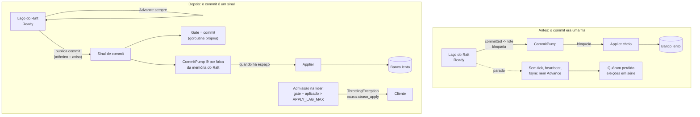
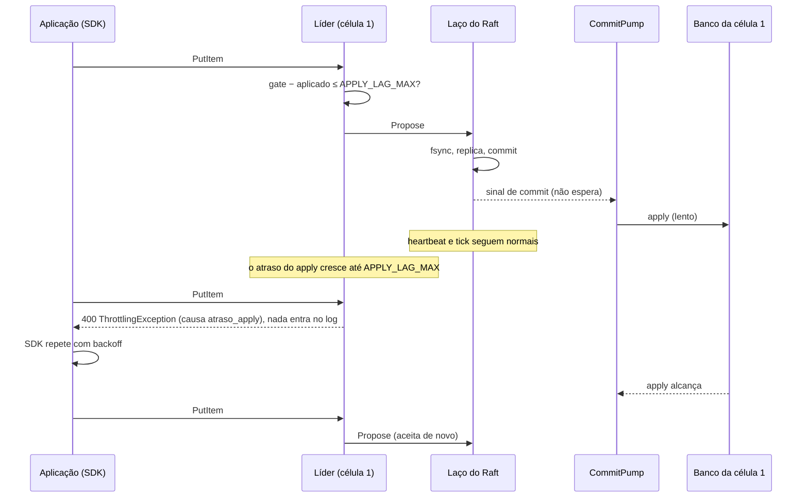

# C35 — Banco lento numa célula não derruba a liderança

**Status:** ✅ Atualizado (decidido pelo Bruno em 14/10/2026, depois do teste de carga da POC) · **ADRs:** [ADR-060](../../03_adr/ADR-060-laco-do-raft-nunca-espera-o-apply-e-admissao-por-atraso.md), [ADR-058](../../03_adr/ADR-058-apply-paralelo-por-chave-com-marca-dagua.md), [ADR-056](../../03_adr/ADR-056-group-commit-por-shard-e-nada-sai-antes-do-fsync.md) · **Relacionados:** [C26](C26-entrada-venenosa.md), [C21](C21-disco-fsync-e-reconstrucao.md), [C18](C18-partida-e-recuperacao-do-no.md), [C08](C08-queda-de-celula-lider-ou-az-aws.md), [R18](../a_rever/R18-rto-nao-quantificado.md) · **Análise:** [teste de carga de 14/10](../../06_pendencias_e_riscos/analise_teste_de_carga_14_10.md)

## Cenário

O banco de uma célula fica lento: throttling do DynamoDB sob demanda (o tráfego passou do dobro do pico anterior, comum numa tabela nova ou na tabela sombra), uma partição quente ou, na POC, o LocalStack a cerca de 1 s por PutItem. O applier daquela célula não acompanha o commit.

**Antes do ADR-060**, o laço do Raft entregava os commits por um canal bloqueante. Com o applier cheio o canal enchia, o laço parava e com ele o tick, o heartbeat, o fsync e o `Advance`. A célula ficava muda, o grupo perdia o quórum e vinham eleições em série. Foi o que o teste de carga de 14/10 mostrou (termo de 7 para 18, ACK OK = 0). **Uma lentidão do banco de uma célula derrubava a liderança do grupo inteiro.**

**Depois do ADR-060**, o laço do Raft só publica o commit. Quem espera é o `CommitPump`, que lê as entradas por faixa da memória do Raft quando o applier tem espaço. O efeito visível passa a ser o atraso do apply crescendo e, na líder, a admissão recusando escrita.

## Diagrama: antes e depois

## Diagrama: sequência com o banco lento na líder

## Etapas

1. **O banco fica lento numa célula.** O applier daquela célula atrasa: `dr_apply_lag` (gate menos aplicado) e `dr_commit_undelivered` (commit menos o que o `CommitPump` entregou) sobem.
2. **O Raft não percebe.** O laço do `Ready` publica o commit e chama `Advance` sem esperar ninguém. Tick, heartbeat e fsync seguem; `dr_raft_tick_gap_seconds` fica perto de 100 ms e não há eleição.
3. **O gate não depende do banco.** Na POC, gate = commit o tempo todo. Com a Azure, o gate continua dependendo só do Raft e dos learners.
4. **Se a célula lenta é uma follower:** nada muda para o cliente. A líder continua dando ACK, porque o ACK espera a marca d'água do apply da **líder** ([ADR-058](../../03_adr/ADR-058-apply-paralelo-por-chave-com-marca-dagua.md)). A follower acumula atraso e alcança depois. O alerta é `dr_apply_lag` da follower.
5. **Se a célula lenta é a líder:** quando `gate − aplicado` passa de `APPLY_LAG_MAX` (padrão `APPLY_WORKERS × 256`), a líder recusa a escrita com ThrottlingException antes do `Propose`. Nada entra no log e o RPO continua 0. A métrica é `dr_throttled_total{causa="atraso_apply"}`.
6. **O SDK repete com backoff.** Quando o apply alcança, a admissão volta a aceitar.
7. **Partida depois de queda:** o nó retoma no índice do progresso do applier, com o replay a partir do WAL do Raft, e não reaplica o log inteiro ([C18](C18-partida-e-recuperacao-do-no.md)).

## Falhas e tratativas

| Situação | O que acontece | Tratativa |
|---|---|---|
| Banco lento só na líder | Admissão recusa (`atraso_apply`); escrita indisponível enquanto durar | Transferência planejada para uma célula saudável ([ADR-013](../../03_adr/ADR-013-transferencia-planejada-de-lideranca.md)) quando o atraso persiste; alerta em `dr_throttled_total{causa="atraso_apply"}` |
| Banco lento só numa follower | Sem impacto no cliente; atraso cresce na follower | Alerta em `dr_apply_lag` da follower: ela não deve virar líder com atraso grande |
| Follower atrasada vira líder (queda da líder) | Recusa escritas até o atraso cair abaixo de `APPLY_LAG_MAX` | Esse tempo entra no RTO ([R18](../a_rever/R18-rto-nao-quantificado.md)); risco registrado |
| Applier estacionado por entrada venenosa | Atraso cresce sem limite naquela célula; Raft segue | [C26](C26-entrada-venenosa.md): SKIP humano por item |
| Memória do Raft cresce com o apply parado | As entradas ficam no `MemoryStorage` até o `CommitPump` consumi-las | Produção: a compactação não passa do aplicado local, então a memória só para de crescer quando o apply volta; na líder a admissão por atraso limita; riscos 44 e 46 |
| Fsync lento (picos de 1 a 2 s) | Ainda pode atrasar o heartbeat, porque o fsync roda no laço | `ELECTION_TICKS` acima do P99.9 do fsync (S1) e spike S1b (`AsyncStorageWrites`) |

## Como observar

- Dashboard v2, seção **08** (entrada HTTP por célula, códigos, latência, contrapressão por causa) e seção **09** (atraso do apply contra o teto, commit não entregue, fila do applier, duração do `Ready`, intervalo entre ticks).
- `task diag` na POC imprime tudo por célula numa tabela.
- `task test-banco-lento CELL=N` reproduz este cenário na POC: pausa o LocalStack só da célula N (cada célula tem o seu) enquanto escreve pela líder, e falha se o termo de alguma célula mudar.
- `/status`: `apply.atraso`, `apply.atrasoMax`, `apply.fila`, `commitNaoEntregue`, `electionTicks`.
