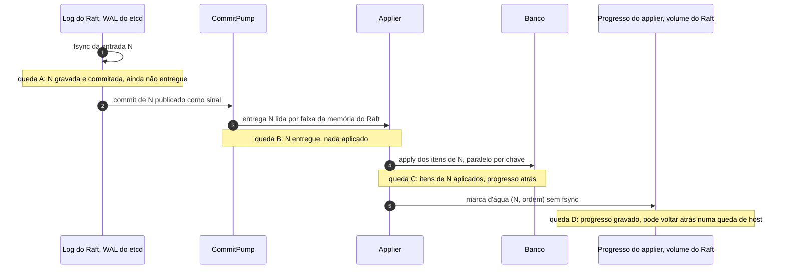

# X04 — Partida e recuperação do nó

**Status:** Decidido (progresso por item em 13/10, [ADR-048](../../03_adr/ADR-048-skip-por-item.md); retomada pelo progresso do applier em 14/10, [ADR-060](../../03_adr/ADR-060-laco-do-raft-nunca-espera-o-apply-e-admissao-por-atraso.md)); casos de queda a cobrir nos testes · **ADRs:** [ADR-019](../../03_adr/ADR-019-wal-proprio-volume-dedicado.md), [ADR-056](../../03_adr/ADR-056-group-commit-por-shard-e-nada-sai-antes-do-fsync.md), [ADR-060](../../03_adr/ADR-060-laco-do-raft-nunca-espera-o-apply-e-admissao-por-atraso.md), [ADR-058](../../03_adr/ADR-058-apply-paralelo-por-chave-com-marca-dagua.md), [ADR-034](../../03_adr/ADR-034-fsync-fatal-e-identidade-nova.md), [ADR-047](../../03_adr/ADR-047-delete-real-invariante-e-reconstrucao-em-tabela-sombra.md), [ADR-048](../../03_adr/ADR-048-skip-por-item.md), [ADR-063](../../03_adr/ADR-063-snapshot-e-compactacao-do-log-do-raft.md)

## Cenário

Cada réplica tem um único log, o do Raft (`wal` do etcd, um por shard, fsync antes de responder, group commit por shard do [ADR-056](../../03_adr/ADR-056-group-commit-por-shard-e-nada-sai-antes-do-fsync.md)), num volume de bloco dedicado. Ele é a única fonte das entradas commitadas. Ao lado do diretório do WAL, no mesmo volume, fica o **progresso do applier** (arquivo `progress`; na POC `/var/lib/dr/raft/progress`): um registro pequeno com CRC, gravado **sem fsync**, com a marca d'água `(índice, ordem)`. Uma queda pode acontecer entre o fsync do Raft, o apply no banco e a gravação do progresso. Este documento lista cada janela de queda e o que a partida faz.

Há dois tipos de queda com efeitos diferentes no progresso do applier:
- **Queda do processo** (pânico, OOM, reinício do contêiner): o que já foi entregue ao kernel continua no cache de páginas e chega ao disco. Nada se perde.
- **Queda do host** (energia, kernel, VM encerrada): o progresso gravado depois do último sync do sistema de arquivos pode voltar atrás ou ficar com CRC errado. O log do Raft não perde nada que tenha respondido, porque cada `Save` termina com fsync.

## Diagrama: janelas de queda

## Etapas

1. **Abertura do log do Raft:** o nó abre o WAL de cada shard, verifica o CRC e recupera o `HardState` (termo, voto, commit) e as entradas. O replay das entradas vem desse WAL.
2. **Ponto de retomada ([ADR-060](../../03_adr/ADR-060-laco-do-raft-nunca-espera-o-apply-e-admissao-por-atraso.md), item 5):** a retomada é o índice do progresso do applier; sem progresso (ou com CRC errado, que vale como ausente), começa em 1. O Raft reinicia com `Applied = retomada − 1`, limitado entre o snapshot e o commit gravado, e o `CommitPump` começa na retomada. A entrada do progresso é reentregue inteira, e o applier pula os itens já gravados pela ordem salva.
3. **Quedas A e B (N commitada, nada aplicado):** o progresso está antes de N, então a partida reentrega N a partir do WAL. Nada se perde, porque N só é commitada depois do fsync do Raft.
4. **Queda C (N aplicada em parte, progresso atrás):** com o apply paralelo por chave ([ADR-058](../../03_adr/ADR-058-apply-paralelo-por-chave-com-marca-dagua.md)), itens depois da marca d'água podem já estar no banco. Na partida o applier reaplica em ordem a partir da marca; a escrita é idempotente pela versão, então os itens já aplicados são reaplicados sem efeito e um item marcado por `SKIP` é pulado sozinho ([ADR-048](../../03_adr/ADR-048-skip-por-item.md), [C26](../atualizados/C26-entrada-venenosa.md)). DELETE é refeito na ordem; o item pode reaparecer por instantes durante o replay. Código: `usecase.Applier`.
5. **Queda D (progresso gravado sem fsync):** numa queda de host o progresso pode voltar atrás ou sumir. Perdê-lo só alonga o replay, que é idempotente pela versão. A compactação do log do Raft nunca passa do aplicado local (`domain.RaftCompactLimit`), e o aplicado local está no banco da célula, então o replay sempre encontra as entradas que faltam no banco.
6. **High-water mark e I-DEL:** as leituras só abrem depois que o applier alcança o ponto mais alto que já tinha aplicado. Essa regra é a que sustenta a invariante **I-DEL** (com as leituras abertas, o estado de cada chave é a dobra das operações dela até algum índice entre `applied` e o gate; com o apply paralelo por chave, a dobra é por chave, [ADR-058](../../03_adr/ADR-058-apply-paralelo-por-chave-com-marca-dagua.md)): é imposta por código e coberta por teste de propriedade e pelo modelo TLA+ ([ADR-047](../../03_adr/ADR-047-delete-real-invariante-e-reconstrucao-em-tabela-sombra.md), [X06](X06-delete-ttl-gsi.md)). Como o progresso pode voltar atrás numa queda de host, **a proposta é abrir as leituras só quando o applier alcançar o índice de commit recuperado do `HardState` do Raft**, que é sempre maior ou igual ao que já tinha sido aplicado (o apply nunca passa do gate, e o gate nunca passa do commit). Os caminhos que **não passam pelo replay do log** (reconstrução, restauração PITR, cópia de outra célula) não têm essa proteção e usam o protocolo da tabela sombra ([C33](../atualizados/C33-reconstrucao-em-tabela-sombra.md)).
7. **Leitura forte depois da partida:** além do high-water mark, a líder recém-eleita só atende leitura forte depois de reconstruir o gate ([ADR-049](../../03_adr/ADR-049-barreira-da-leitura-forte-e-o-gate.md), [X01](X01-gate-e-troca-de-lider.md)). Com o applier parado por entrada venenosa, a leitura forte falha rápido com `503`.
8. **Cauda rasgada e corrupção:** o WAL do etcd trata o registro parcial no fim do último segmento. **Corrupção no meio** do WAL: o nó recusa subir.
9. **Tabela de dedupe:** é projeção do log e é reconstruída na partida a partir do log do Raft retido ([X05](X05-timeouts-e-idempotencia.md), [R22](../a_rever/R22-memoria-da-janela-de-dedupe.md)). Na POC a compactação está desligada e o log inteiro está disponível; em produção, o que já tiver sido compactado vem do snapshot ([ADR-063](../../03_adr/ADR-063-snapshot-e-compactacao-do-log-do-raft.md), pendente).
10. **Partida antes do snapshot (produção):** se a retomada ficar antes do último snapshot do Raft, as entradas que faltam já não estão em lugar nenhum, e a célula volta por reconstrução em tabela sombra ([ADR-063](../../03_adr/ADR-063-snapshot-e-compactacao-do-log-do-raft.md), [C33](../atualizados/C33-reconstrucao-em-tabela-sombra.md)). A regra de compactação até o aplicado local torna esse caso raro: ele só aparece quando o banco da célula foi trocado ou restaurado.

## Falhas e tratativas

- **Erro de escrita ou de fsync no log do Raft.** Fatal para o processo ([ADR-034](../../03_adr/ADR-034-fsync-fatal-e-identidade-nova.md)).
- **Perda do volume do Raft.** É disco perdido: o nó volta com **identidade nova** ([ADR-034](../../03_adr/ADR-034-fsync-fatal-e-identidade-nova.md)).
- **Progresso do applier perdido ou corrompido.** Vale como ausente: o replay começa no início do que o log do Raft retém e é idempotente pela versão. O high-water mark é coberto pela proposta do passo 6 (abrir leituras no commit do `HardState`); falta fixar no desenho e testar.
- **Applier parado por muito tempo.** As entradas commitadas e não aplicadas ficam no WAL e na memória do `MemoryStorage`; a memória cresce com o atraso (riscos 44 e 46).

## Pontos em aberto

- Conformidade (`ConsensusEngine`) inclui todos os casos de queda da tabela acima, com **queda de host simulada** (descartar o progresso gravado depois do último sync), e não só queda de processo.
- Valor de `RAFT_RETAIN_MAX` e tamanho do volume do Raft (PEND-24).
- Tempo total de partida (RTO do nó, medido em exercícios de falha como distribuição): [R18](../a_rever/R18-rto-nao-quantificado.md). O replay do WAL desde o snapshot entra na medição; na POC, sem compactação, a partida relê o WAL inteiro.
