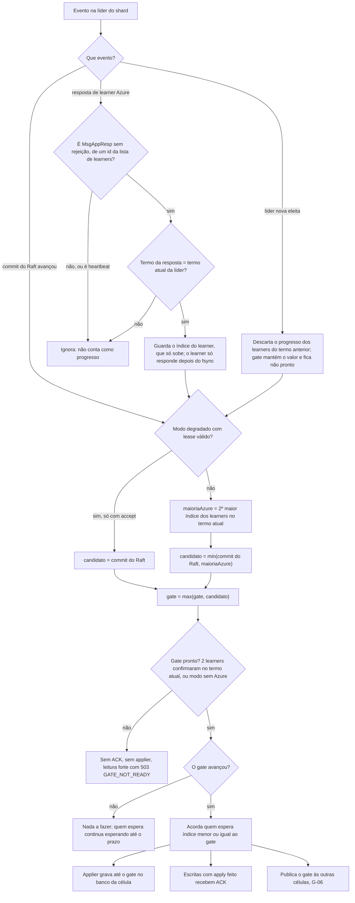
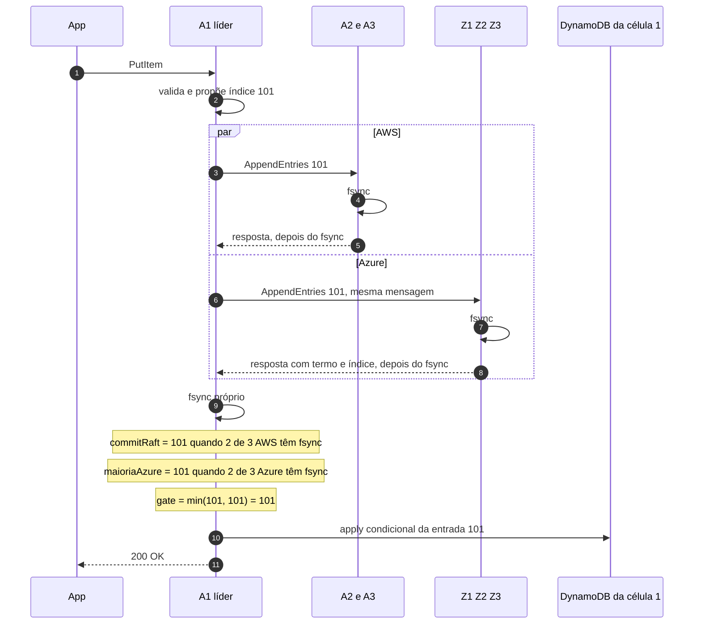

# X07 — O gate explicado com exemplos

**Status:** Explicação didática (14/10/2026). Não decide nada novo: resume as regras já decididas e mostra cada uma com índices concretos · **ADRs:** [ADR-005](../../03_adr/ADR-005-ack-exige-gate.md), [ADR-017](../../03_adr/ADR-017-azure-learners-e-gate.md), [ADR-029](../../03_adr/ADR-029-gate-monotonico-na-troca-de-lider.md), [ADR-044](../../03_adr/ADR-044-lease-do-modo-degradado-e-promocao-da-azure.md), [ADR-046](../../03_adr/ADR-046-gate-so-conta-progresso-validado-pelo-raft.md), [ADR-049](../../03_adr/ADR-049-barreira-da-leitura-forte-e-o-gate.md), [ADR-056](../../03_adr/ADR-056-group-commit-por-shard-e-nada-sai-antes-do-fsync.md), [ADR-057](../../03_adr/ADR-057-um-unico-modo-strong-consistency.md) · **Relacionados:** [X01](X01-gate-e-troca-de-lider.md), [D05](../../04_diagramas/D05-gate-e-quorum.md), [C12](../atualizados/C12-modo-degradado.md), [C32](../atualizados/C32-particao-e-lease-do-modo-degradado.md), [SPEC_POC_LOCAL](../../../spec/SPEC_POC_LOCAL.md) (regras G-01 a G-10)

## Cenário

### O que é, em uma frase

O gate é **o maior índice do log que já está durável nas duas nuvens**. Nada acima dele pode ser confirmado ao cliente, aplicado em banco nenhum ou lido por leitura forte.

O Raft sozinho só garante "durável em 2 de 3 AWS". O gate acrescenta "e durável em 2 de 3 Azure". É por causa dele que o RPO é 0 entre nuvens.

### A condição (a regra)

Existe **um gate por shard** (cada shard tem o seu grupo Raft). Na célula líder do shard:

```
maioriaAzure = 2º maior índice durável entre Z1, Z2, Z3
               (só respostas de AppendEntries do termo atual, enviadas depois do fsync)
candidato    = min(commitRaft, maioriaAzure)
gate         = max(gate, candidato)            -- nunca recua
```

Nas células que não são líderes do shard (G-06):

```
gate = min(commitRaft local, maior gate recebido da líder)
```

O "2º maior" é só um jeito de dizer "o maior índice que pelo menos 2 de 3 têm". Exemplo: Z1=105, Z2=101, Z3=98 → ordenando 105, 101, 98 → o 2º é 101. Z1 e Z2 têm 101; só Z1 tem 105.

As cinco condições que fazem um valor contar:

| # | Condição | Por quê | Regra |
|---|---|---|---|
| 1 | Só conta depois do fsync, em toda réplica (líder inclusive) | "Confirmado" tem de significar "no disco", não "na memória" | ADR-056, G-05, SG-03 |
| 2 | Progresso da Azure só vem da resposta do `AppendEntries` (`MsgAppResp` sem rejeição) | Essa resposta passou pelo casamento de logs: índice N significa "o mesmo prefixo até N" | ADR-046, G-04 |
| 3 | Só conta resposta do **termo atual** da líder | Um número de outro termo pode ser o sufixo de uma líder antiga (cenário 5) | ADR-046, G-03 |
| 4 | É o mínimo dos dois lados | A Azure pode ter entrada ainda não commitada; a AWS pode ter commit que a Azure ainda não tem | ADR-017, G-01 |
| 5 | Nunca recua | Escrita ACKada e aplicada não pode "desconfirmar" | ADR-029, G-02 |

### Quando ele atua

| Momento | O que espera | Se o gate não chega |
|---|---|---|
| **ACK da escrita** (célula líder) | `gate >= índice da escrita` e apply na célula da líder (SG-01) | Aos 7,5 s responde `503 PENDING` (resultado desconhecido; o retry cai no dedupe) |
| **Applier** (toda célula) | Aplica no DynamoDB só até o gate (`aplicado <= gate`, SG-02) | O banco fica parado no último gate; nada acima é escrito |
| **Leitura forte** | Barreira `min(ReadIndex, gate)` e `aplicado >= barreira` | Não depende da Azure para o que já foi ACKado (cenário 4) |
| **Troca de líder** | Gate fica "não pronto" até 2 learners confirmarem no termo novo (G-07) | Sem ACK, sem applier e leitura forte com `503 GATE_NOT_READY` |
| **Modo degradado** (só `accept`, com lease válido) | A Azure sai da conta: `gate = commitRaft` | Fim do lease D: `503 LEASE_EXPIRED` |
| **Publicação às outras células** | A líder envia o gate a cada avanço, ou a cada 100 ms sem avanço | A follower aplica até o último gate recebido |

O gate é recalculado **por evento**: cada commit do Raft e cada resposta de learner acorda quem espera. Não há polling.

## Diagrama: comportamento do gate a cada evento



## Diagrama: uma escrita passando pelo gate



## Etapas

Cenários com índices concretos, do mais simples ao mais delicado.

Notação: `A1..A3` votantes AWS (A1 é a líder), `Z1..Z3` learners Azure. Os números são o maior índice **durável** de cada réplica. Os tempos são ilustrativos.

### Cenário 1 — Caminho feliz

Estado inicial: tudo em 100, gate = 100, termo 5. Chega a escrita que vira o índice 101.

| t | Evento | commitRaft | Z1/Z2/Z3 | maioriaAzure | gate | Efeito |
|---|---|---|---|---|---|---|
| 0 ms | A1 propõe 101 | 100 | 100/100/100 | 100 | 100 | escrita espera |
| 3 ms | A2 faz fsync e responde | 101 (A2 + A1 depois do fsync dela) | 100/100/100 | 100 | 100 | Raft commitou, mas **não ACKa** |
| 8 ms | Z1 responde 101 | 101 | 101/100/100 | 100 | 100 | 1 de 3 na Azure não basta |
| 9 ms | Z2 responde 101 | 101 | 101/101/100 | 101 | **101** | gate anda; applier grava 101 no DynamoDB da célula 1 |
| 15 ms | apply termina | | | | 101 | **ACK 200** ao cliente |

O ponto: o commit do Raft (3 ms) não é o momento do ACK. O ACK espera a Azure e o apply.

### Cenário 2 — Azure atrasada (e Azure à frente do commit)

Várias escritas em voo, índices 101 a 105.

| Momento | commitRaft | Z1/Z2/Z3 | maioriaAzure | gate | Quem é ACKado |
|---|---|---|---|---|---|
| a | 105 | 104/101/99 | 101 | 101 | até 101 |
| b | 105 | 104/103/99 | 103 | 103 | 102 e 103 |
| c | 105 | 105/105/99 | 105 | 105 | 104 e 105 |
| d (Azure à frente) | 106 | 108/107/99 | 107 | **106** | 106; 107 e 108 esperam o commit do Raft |

Leitura: o gate anda no ritmo da **segunda** Azure mais rápida e nunca passa do commit do Raft. No momento d a Azure tem entradas que a AWS ainda não commitou; elas não contam, porque podem nunca ser commitadas (se A1 cair agora).

### Cenário 3 — Uma Azure fora

Z3 cai. Z1 e Z2 seguem respondendo.

| Momento | commitRaft | Z1/Z2/Z3 | maioriaAzure | gate |
|---|---|---|---|---|
| a | 200 | 200/200/150 | 200 | 200 |
| b | 210 | 210/204/150 | 204 | 204 |

Nada para, mas a margem acabou: o gate agora depende **das duas** que sobraram, e anda no ritmo da mais lenta delas (Z2). Se Z2 também cair, cai no cenário 4. Por isso a queda de uma AZ da Azure é alerta, não incidente ([C09](../atualizados/C09-queda-de-az-azure.md)).

### Cenário 4 — Link AWS↔Azure caído

Estado no instante da queda: tudo em 200, gate = 200. A AWS continua commitando.

| t | commitRaft | Z1/Z2/Z3 | maioriaAzure | gate | O que acontece |
|---|---|---|---|---|---|
| 0 s | 200 | 200/200/200 | 200 | 200 | link cai |
| 1 s | 230 | 200/200/200 | 200 | 200 | escritas 201 a 230 commitadas, **sem ACK e sem apply** |
| 2 s (`DEGRADE_AFTER`) | 240 | parado | 200 | 200 | decide pela `DEGRADED_POLICY` |

Daqui em diante:

- **`reject`** (recomendado para dinheiro): o gate fica em 200. Aos 7,5 s cada escrita recebe `503 PENDING`. As entradas 201 a 240 **estão commitadas na AWS mas não no DynamoDB**. Quando o link volta, a Azure recebe 201 a 240, a maioria Azure chega a 240, o gate anda, o applier grava e o retry do SDK encontra o resultado pelo dedupe. RPO 0, disponibilidade de escrita zero durante a queda.
- **`accept`**: a líder propõe `DEGRADE` (índice 241). Commitado o `DEGRADE` e com lease válido, `gate = commitRaft`: as escritas pendentes são ACKadas com `x-dr-mode: degraded`. RPO > 0 enquanto durar. O lease conta desde o último contato com a maioria Azure (`t_c` = 0 s), não desde o `DEGRADE`. Em `t_c + D` a AWS para sozinha: `503 LEASE_EXPIRED`. A Azure só pode ser promovida depois de `D + M`.

E a **leitura forte** durante a queda (com `reject`): `ReadIndex = 240`, gate = 200, barreira = `min(240, 200) = 200`, aplicado = 200. A leitura é servida na hora com o estado de 200. Isso está correto: nenhum cliente recebeu ACK de 201 a 240, então ninguém pode esperar vê-las. É exatamente o que o ADR-049 resolveu: leitura não trava por causa da Azure.

### Cenário 5 — Troca de líder (onde o termo importa)

Estado no termo 5, líder A1:

| | commitRaft | A1/A2/A3 | Z1/Z2/Z3 | maioriaAzure | gate |
|---|---|---|---|---|---|
| antes | 305 | 306/305/303 | 306/304/300 | 304 | 304 |

A1 tinha a entrada **306 (termo 5)**, já enviada a Z1, mas não commitada (só A1 a tinha entre os votantes). A1 morre.

| Passo | O que acontece | gate |
|---|---|---|
| 1 | A2 é eleita no termo 6 (log de A2 vai até 305) | 304, **não pronto** |
| 2 | Progresso dos learners do termo 5 é descartado (G-03). O gate **não zera** (monotônico), mas fica parado: sem ACK, sem applier, leitura forte com `503 GATE_NOT_READY` | 304 |
| 3 | A2 grava a entrada vazia do termo novo, **306 (termo 6)**, e a envia a todos. Z1 tinha 306 do termo 5: o casamento de logs detecta conflito e Z1 troca pela 306 do termo 6 antes de responder | 304 |
| 4 | A3 faz fsync: commitRaft = 306 (termo 6) | 304 |
| 5 | Z1 e Z2 respondem 306 **no termo 6** | **306, pronto** |
| 6 | A2 volta a ACKar, aplicar e servir leitura forte | 306 |

Por que não confiar no "Z1 diz que tem 306" que chega por fora, no passo 2? Porque aquela 306 era a do termo 5, de A1, que **nunca foi commitada e foi apagada** no passo 3. Se A2 contasse esse número, acharia que a 306 dela já estava na Azure quando não estava. Esse é o caso que o ADR-046 fecha.

Os clientes que escreveram 306 (termo 5) em A1 recebem timeout ou `503 PENDING`; o retry vai para A2 e o dedupe resolve. Escritas de A1 já ACKadas (até 304) estão abaixo do gate antigo e nunca se perdem, porque o Raft garante que A2 tem tudo o que foi commitado.

### Cenário 6 — POC só AWS (G-08)

Com `LEARNERS` vazia: não existe maioriaAzure, então **gate = commitRaft** e o gate está sempre pronto. O `/status` mostra `azure: "off"`.

| t | Evento | commitRaft (cell_1 líder) | gate cell_1 | commit local cell_2 / cell_3 | gate cell_2 / cell_3 |
|---|---|---|---|---|---|
| 0 ms | propõe 101 | 100 | 100 | 100 / 100 | 100 / 100 |
| 3 ms | cell_2 faz fsync | 101 | **101** | 101 / 100 | 100 / 100 |
| 4 ms | cell_1 aplica 101 e **ACKa** | 101 | 101 | 101 / 100 | 100 / 100 |
| 5 ms | publica gate 101 | | | 101 / 100 | **101 / 100** (cell_3 limitada pelo commit local) |
| 9 ms | cell_3 recebe o commit | | | 101 / 101 | 101 / **101** |

O que a POC prova: o caminho Raft → gate → apply → ACK, a propagação do gate (G-06) e `aplicado <= gate` nas três células. O que **não** prova: nenhuma espera pela Azure, nada dos cenários 2 a 5. Essas regras (G-01 a G-05, G-07) ficam nos testes de unidade com learners simulados (O-02).

## Pontos em aberto

### Cenários ocultos

1. **A POC não exercita o gate segurando nada.** Com gate = commit, o gate nunca é o gargalo, então a latência e o comportamento medidos na POC não dizem nada sobre a espera pela Azure, a reconstrução na troca de líder (cenário 5) nem a faixa cinzenta ([C25](../atualizados/C25-link-lento-faixa-cinzenta.md)). Os testes de unidade provam a regra, não a integração com o `etcd-io/raft` (por exemplo, se o `MsgAppResp` do learner realmente vira evento no termo certo). Ver a pergunta 1 abaixo.
2. **O canal de eventos que bloqueia (G-04) pode travar o shard.** "O canal bloqueia em vez de perder" é correto para não perder progresso, mas, se quem consome o canal for lento, ele bloqueia o laço `Ready` do Raft daquele shard: commit, heartbeat e eleição ficam parados. O risco é um gate lento derrubar a liderança. Ver a pergunta 2.
3. **Na troca de líder, a janela sem ACK é pelo menos um RTT AWS↔Azure mais o fsync na Azure.** Se o link estiver na faixa cinzenta exatamente nessa hora, a líder nova fica sem gate pronto até `DEGRADE_AFTER`; com `reject` isso vira `503` para todas as escritas do shard. É o comportamento decidido, mas entra na conta do RTO.
4. **Apply é parte do ACK.** O ACK espera o gate **e** o apply na célula da líder (SG-01). Um DynamoDB lento ou com throttling na célula da líder atrasa o ACK mesmo com o gate em dia; uma entrada venenosa para o shard inteiro ([C26](../atualizados/C26-entrada-venenosa.md)).

### Perguntas para o Bruno

**1. A POC deve ter um learner simulado de ponta a ponta?**
- **a)** Manter como está: gate = commit na POC, regras da Azure só em teste de unidade.
- **b) (recomendado)** Adicionar à POC um quarto processo DR como learner (sem DynamoDB, sem voto), com atraso injetável no `docker compose`. Com `LEARNERS=1` id, a maioria Azure seria "1 de 1" só para teste. Prova o `MsgAppResp` virando evento, o termo e o cenário 5 de verdade, sem trazer a Azure para a POC.

**2. Como tratar o canal de progresso do gate quando o consumidor atrasa?**
- **a)** Manter o canal que bloqueia (G-04) e medir no spike se o laço `Ready` chega a travar.
- **b) (recomendado)** Trocar o canal por um "último valor por learner" (variável atômica por (learner, termo) que só sobe, com um sinal de acordar). Não perde progresso, porque o progresso é monotônico e só o maior valor importa, e nunca bloqueia o Raft. Exigiria ajustar a G-04 na spec.
